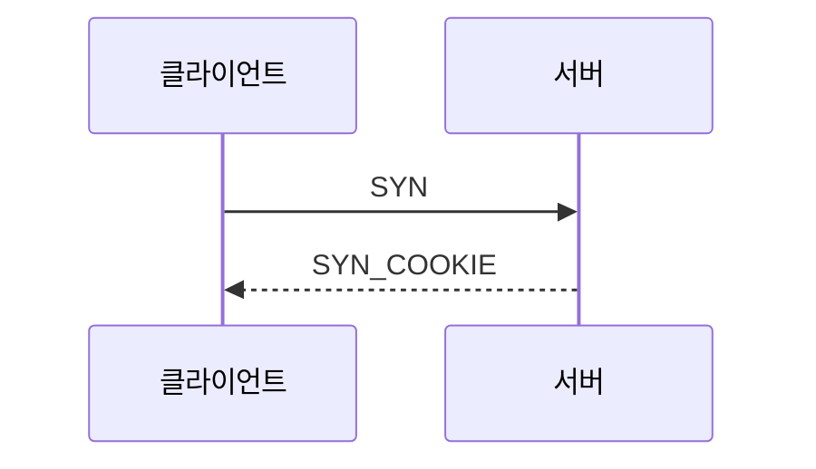

# 집필 규약 (P6-2)

이 책을 고치거나 장을 더할 때 지키는 규칙입니다.

## 파일과 이름

- 경로: `docs/book/ch01-why-udp.md` … `docs/book/appendix-e-glossary.md`
- 새 장을 추가하면 `docs/_sidebar.md` 에 반드시 링크를 넣습니다.

## 장 구성 템플릿

모든 장은 아래 다섯 부분을 순서대로 갖습니다.

1. **학습 목표** — 3줄. "이 장을 읽고 나면 …할 수 있습니다" 형태.
2. **본문** — 개념 → 문제 → 해법 → 코드 순서. 다이어그램은 mermaid로 작성합니다.
3. **전체 코드** — 복붙해서 실행되는 형태. 발췌라면 원본 경로를 코드 블록 위 주석에 씁니다.
4. **요약** — 불릿 5개 이내.
5. **연습문제** — 2~3개. 다음 장으로 자연스럽게 이어지도록 만듭니다.

## 코드 규칙

**모든 코드는 실행 가능해야 합니다.** 책의 코드 조각은 `samples/` 의 실제 코드에서 발췌하고,
발췌 원본 경로를 코드 블록 바로 위 주석에 적습니다.

```csharp
// samples/01-Echo/Server/Program.cs
server.ReliableReceived += (session, data) => session.Send(data.Span);
```

이렇게 묶어 두면 **라이브러리 API가 바뀌는 순간 샘플이 깨지고, 샘플이 깨지면 책도 고쳐야 합니다.**
문서가 코드보다 먼저 썩는 것을 막으려고 일부러 만든 구조입니다.

지어낸 코드를 넣지 않습니다. 설명을 위해 단순화한 의사 코드라면 반드시 그렇다고 밝힙니다.

## 문체

- **한국어 경어체**로 통일합니다("…합니다", "…입니다").
- 용어는 [부록 E 용어집](appendix-e-glossary.md)을 단일 기준으로 씁니다.
  영문 용어를 처음 쓸 때만 괄호로 병기합니다 — 예: 지연 보상(lag compensation).
- 숫자는 실측만 씁니다. 추정이면 "대략", "감각치"라고 밝힙니다.
- 잘 안 됐던 시도, 잘못된 가정도 지우지 않고 남깁니다. 실패 기록이 가장 잘 읽히는 부분입니다.

## 다이어그램

mermaid 로 작성합니다(이미지 파일을 만들지 않습니다 — 코드로 관리해야 고치기 쉽습니다).

````markdown

````

## 장별 완료 조건(DoD)

- [ ] 코드를 실제로 실행해 확인했다
- [ ] 해당한다면 다이어그램이 1개 이상 있다
- [ ] 요약과 연습문제가 있다
- [ ] `_sidebar.md` 에 링크가 있다
- [ ] 인용한 코드의 원본 경로를 적었다
