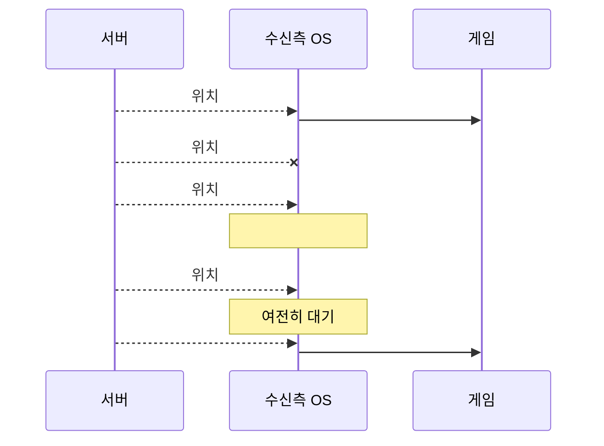
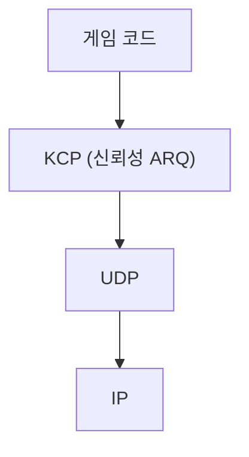

# 1장. 온라인 게임과 네트워크

> **학습 목표**
> 1. 지연·손실·지터·대역폭 네 가지가 게임 경험에 어떻게 나타나는지 구분할 수 있습니다.
> 2. TCP로 실시간 게임을 만들면 왜 끊기는지(HOL 블로킹) 그림으로 설명할 수 있습니다.
> 3. "신뢰성 스펙트럼" 위에 자기 게임의 데이터를 배치할 수 있습니다.

## 네트워크가 게임에 하는 네 가지 일

네트워크 문제를 "렉"이라는 한 단어로 뭉뚱그리면 고칠 수 없습니다. 네 가지로 나눠 봅시다.

| 요소 | 정의 | 게임에서 보이는 모습 |
|---|---|---|
| **지연(latency)** | 보내고 도착하기까지 걸리는 시간 | 조작이 굼뜨다. 이미 지나간 위치를 쏘게 된다 |
| **손실(loss)** | 패킷이 사라지는 비율 | 캐릭터가 멈췄다 순간이동한다 |
| **지터(jitter)** | 지연이 들쭉날쭉한 정도 | 부드럽다가 갑자기 튄다 |
| **대역폭(bandwidth)** | 초당 보낼 수 있는 양 | 인원이 많아지면 갑자기 나빠진다 |

### 지연은 물리 법칙이기도 합니다

서울에서 미국 서부까지 빛이 광섬유를 통해 가는 데만 왕복 약 **80ms**가 걸립니다.
라우터를 거치면서 실제로는 130~180ms가 됩니다.

**이 지연은 없앨 수 없습니다.** 게임 네트워킹의 기술은 대부분
"없앨 수 없는 지연을 어디로 옮길까"에 관한 것입니다(13장에서 세 가지 방법을 봅니다).

### 장르별 허용 지연

| 장르 | 허용 왕복 지연 | 근거 |
|---|---|---|
| 격투 게임 | **< 50ms** | 프레임 단위 입력(1프레임 = 16ms) |
| FPS·액션 | **< 100ms** | 조준과 반응 속도 |
| MMORPG | **< 200ms** | 스킬 시전에 여유가 있음 |
| 턴제·카드 | **< 1s** | 사람의 판단 시간이 더 김 |

이 표는 **서버 위치를 정할 때** 씁니다. 격투 게임을 만드는데 서버가 지구 반대편에 있으면
기술로 해결할 수 없습니다.

## TCP로 만들면 생기는 일

"TCP는 신뢰성이 있으니 좋은 것 아닌가?"라는 질문에서 시작합시다.

TCP는 **모든 바이트가 보낸 순서대로 도착함**을 보장합니다. 파일 전송에는 완벽합니다.
그런데 게임에서는 이 보장이 문제가 됩니다.

### head-of-line 블로킹



**#102와 #103은 t=50, 100에 이미 도착해 있었습니다.** 그런데 게임은 t=250까지 못 봅니다.
운영체제가 "순서대로"를 지키느라 붙잡고 있기 때문입니다.

플레이어 눈에는 이렇게 보입니다.

> 캐릭터가 0.25초 동안 멈춰 있다가 갑자기 순간이동한다.

가장 최신 위치(#103)가 손에 있는데도 못 쓰는 것이 핵심입니다.
**"놓친 옛날 위치"를 기다리느라 "지금 위치"를 못 보여 주는 것**은 명백한 손해입니다.

### TCP의 다른 문제들

| 문제 | 내용 |
|---|---|
| Nagle 알고리즘 | 작은 패킷을 모아 보내 지연을 늘립니다(`TCP_NODELAY` 로 끄지만 완전하지 않습니다) |
| 지연 ACK | 상대 OS가 ACK를 40ms까지 미룹니다 |
| 재전송 타임아웃 | 최소 RTO가 보통 200ms 이상입니다 |
| 혼잡 제어 | 손실을 "혼잡"으로 해석해 전송 속도를 절반으로 줄입니다 — 무선 손실에는 잘못된 반응입니다 |

각각을 조금씩 완화할 수는 있지만, **순서 보장은 끌 수 없습니다.** TCP의 본질이니까요.

## UDP는 무엇을 주나

UDP는 거의 아무것도 안 해 줍니다. 그것이 장점입니다.

| 성질 | 뜻 |
|---|---|
| 비연결 | 연결 개념이 없습니다. 그냥 보냅니다 |
| 비신뢰 | 도착 보장이 없습니다. 재전송도 없습니다 |
| 순서 없음 | 보낸 순서와 도착 순서가 다를 수 있습니다 |
| **메시지 경계 보존** | 1400바이트를 보내면 1400바이트로 받습니다(TCP는 스트림이라 잘립니다) |

마지막 항목이 게임에 특히 좋습니다. "패킷 하나 = 메시지 하나"가 자연스럽습니다.

**필요한 신뢰성만 골라서 직접 얹는 것** — 이것이 KCP를 비롯한 게임용 프로토콜의 발상입니다.

## 신뢰성 스펙트럼

신뢰성은 있거나 없거나가 아니라 **정도**입니다.


이 라이브러리는 양 끝 두 개를 제공합니다.

| 채널 | 보장 | 쓰는 곳 |
|---|---|---|
| **신뢰 채널**(KCP) | 도착 + 순서 | 채팅, 아이템, 판정 결과 |
| **비신뢰 채널**(RAW) | 없음 | 위치 스냅숏, 입력 |

여러분의 게임 데이터를 이 축 위에 배치해 보세요. 대부분은 양 끝에 몰립니다.

| 데이터 | 위치 |
|---|---|
| "3번 아이템을 샀다" | 완전 신뢰 — 돈이 걸린 일 |
| "적을 맞혔다" | 완전 신뢰 — 결과가 뒤집히면 안 됨 |
| "지금 (120, 340)에 있다" | 완전 비신뢰 — 50ms 뒤 새 것이 옴 |
| "W 키를 누르고 있다" | 거의 비신뢰 — 중복 전송으로 보강(7장) |

## KCP의 위치와 역사

KCP는 **"TCP만큼 신뢰하되, TCP보다 30~40% 빠르게 복구하는"** ARQ 프로토콜입니다.
전송 계층이 아니라 **애플리케이션 계층**에 있습니다 — UDP 위에 얹는 라이브러리입니다.



| 구현 | 언어 | 비고 |
|---|---|---|
| [skywind3000/kcp](https://github.com/skywind3000/kcp) | C | 원본. `ikcp.c` 한 파일 |
| [xtaci/kcp-go](https://github.com/xtaci/kcp-go) | Go | 가장 널리 쓰이는 서버 구현. FEC·암호화 포함 |
| **kcp-csharp**(이 책) | C# | kcp-go 포팅 기반. 코어는 원본과 바이트 호환 |

**와이어 호환**이 중요합니다. 24바이트 헤더가 원본과 같으므로,
C# 클라이언트가 Go 서버에 붙을 수 있습니다(부록 C).

### KCP가 TCP보다 빠른 이유

| 항목 | TCP | KCP |
|---|---|---|
| RTO 백오프 | 2배 | **1.5배**(nodelay) |
| 최소 RTO | 보통 200ms+ | **30ms**(nodelay) |
| ACK 지연 | 최대 40ms | **0**(옵션) |
| 재전송 방식 | 선택적(SACK) | 선택적 + 빠른 재전송 + 조기 재전송 |
| 혼잡 제어 | 필수 | **끌 수 있음**(`nc=1`) |

요약하면 **"손실을 더 빨리 포기하고 다시 보낸다"** 입니다.
대역폭을 조금 더 쓰고 지연을 얻는 거래입니다.

> 공짜는 아닙니다. 혼잡 제어를 끄면 회선이 막혔을 때 상황을 악화시킬 수 있습니다(8장).

## 실습: TCP와 UDP를 손실 환경에서 비교하기

**목표**: HOL 블로킹을 눈으로 확인합니다.

### 준비

손실을 흉내 낼 도구가 필요합니다.

```bash
# Linux
sudo tc qdisc add dev lo root netem loss 10% delay 50ms
sudo tc qdisc del dev lo root                              # 끝나면 지우기
```

Windows에서는 [clumsy](https://jagt.github.io/clumsy/)를 씁니다(Lag 50ms + Drop 10%).

### 실험

이 저장소의 MoveSync 샘플로 바로 확인할 수 있습니다(12장에서 자세히).
서버 코드 **한 줄만** 바꿔 보세요.

```csharp
// samples/04-MoveSync/Server/WorldServer.cs
foreach (var player in joined)
    player.Session.SendUnreliable(packet);   // ← 이것을 Send(packet) 으로 바꾸면
```

| 설정 | 손실 10% 환경에서의 모습 |
|---|---|
| `SendUnreliable` | 부드럽게 움직입니다. 가끔 아주 살짝 튑니다 |
| `Send`(신뢰) | **주기적으로 멈췄다가 순간이동합니다** |

한 줄 차이로 게임의 느낌이 완전히 달라집니다. 이 차이가 이 책 전체의 주제입니다.

### 숫자로도 확인하기

부하 도구로 같은 비교를 수치로 할 수 있습니다.

```bash
dotnet run -c Release --project samples/tools/LoadTest -- server
dotnet run -c Release --project samples/tools/LoadTest -- client --sessions 100 --duration 30
dotnet run -c Release --project samples/tools/LoadTest -- client --sessions 100 --duration 30 --unreliable
```

손실을 건 상태에서 **RTT p99** 를 비교해 보세요. 신뢰 채널 쪽이 훨씬 큽니다.

## 요약

- 네트워크 문제는 **지연·손실·지터·대역폭** 네 가지로 나눠 봐야 고칠 수 있습니다.
- 지연은 물리 법칙이라 없앨 수 없습니다. 기술은 **지연을 어디로 옮길지** 정하는 것입니다.
- TCP의 순서 보장은 **HOL 블로킹**을 낳습니다 — 최신 데이터가 손에 있어도 못 씁니다.
- UDP는 아무것도 안 해 주는 대신 **필요한 신뢰성만 골라 얹을** 수 있게 합니다.
- KCP는 "TCP만큼 신뢰하되 더 빨리 복구"하는 애플리케이션 계층 ARQ입니다.

## 연습문제

1. **내 게임의 허용 지연** — 만들고 싶은 게임의 장르를 정하고, 허용 왕복 지연을 근거와 함께
   적어 보세요. 그 값이 서버 위치 선택에 어떤 제약을 주나요?
2. **HOL 재현** — MoveSync 서버의 `SendUnreliable` 을 `Send` 로 바꾸고 손실 10%를 걸어
   화면을 녹화해 보세요. 되돌린 뒤와 비교하면 무엇이 다른가요?
3. **스펙트럼 배치** — 여러분의 게임 데이터 10가지를 신뢰성 스펙트럼 위에 배치하고,
   각각의 이유를 한 줄로 적어 보세요. 7장에서 이 표를 다시 검토하게 됩니다.

---

다음 장에서는 "신뢰성"을 직접 만들어 봅니다. 순서 번호와 ACK만으로 시작해
KCP가 실제로 쓰는 구조까지 단계적으로 올라갑니다.
