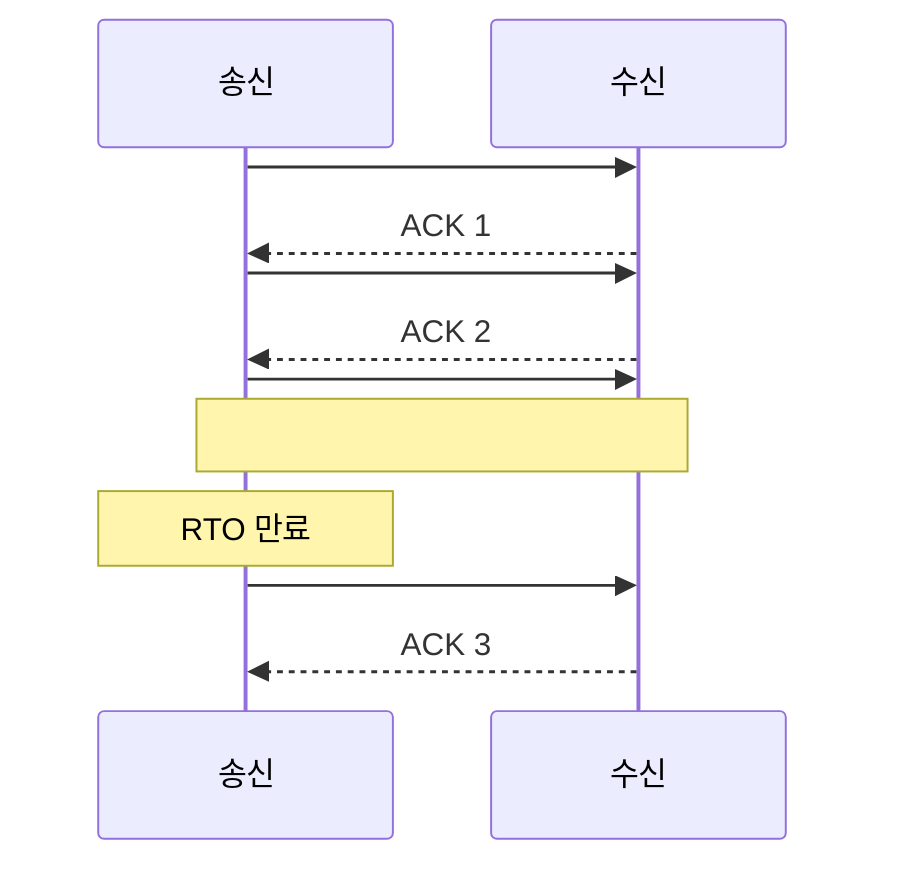
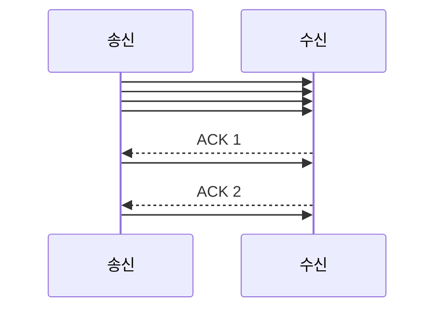
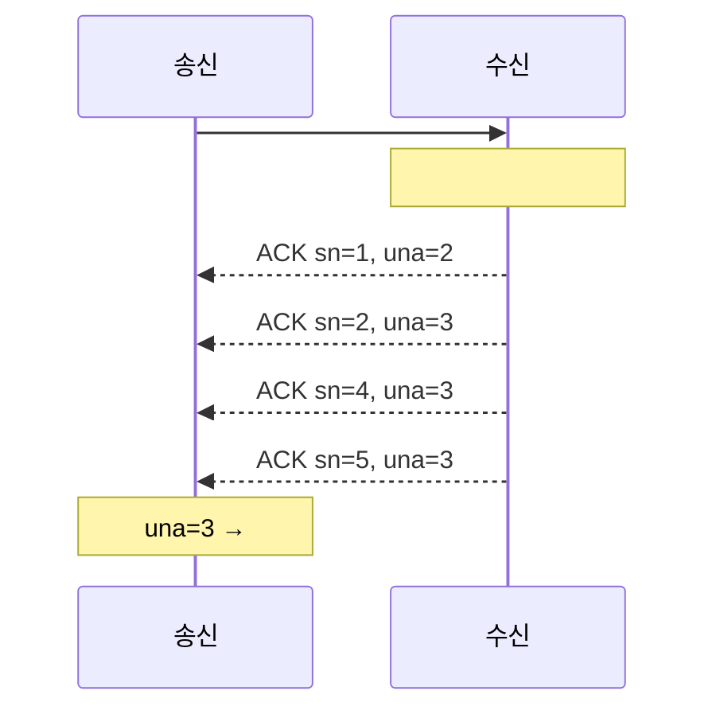

# 2장. 신뢰성을 직접 만들기 — ARQ의 원리

> **학습 목표**
> 1. 순서 번호와 ACK만으로 신뢰성을 만드는 최소 구조를 설명할 수 있습니다.
> 2. stop-and-wait → go-back-N → selective repeat 의 처리량 차이를 계산할 수 있습니다.
> 3. RTO를 RTT 측정값으로부터 계산하는 방법(RFC 6298)을 이해합니다.

## ARQ 란

**ARQ(Automatic Repeat reQuest)** — "안 왔으면 다시 보내기"입니다.
신뢰성 있는 전송의 거의 모든 구현이 이 발상 위에 서 있습니다.

필요한 재료는 두 가지뿐입니다.

1. **순서 번호(sequence number)** — 보낸 것마다 번호를 붙인다
2. **확인 응답(acknowledgement)** — 받은 쪽이 "몇 번 받았다"고 알려 준다

그리고 규칙 하나: **일정 시간 안에 확인이 안 오면 다시 보낸다.**

## 1단계: stop-and-wait

가장 단순한 형태입니다. 하나 보내고, 확인이 올 때까지 기다립니다.



**구현은 쉽지만 처리량이 끔찍합니다.**

RTT 100ms, 패킷 1400바이트라고 합시다.

```
처리량 = 1400 B ÷ 0.1 s = 14,000 B/s = 112 kbps
```

회선이 100Mbps여도 **112kbps밖에 못 씁니다.** 대부분의 시간을 기다리며 놀기 때문입니다.

## 2단계: 슬라이딩 윈도

확인을 기다리지 말고 **여러 개를 미리 보냅시다.**



동시에 확인 없이 보낼 수 있는 개수를 **윈도(window)** 라고 합니다.

```
처리량 = 윈도 크기 × 패킷 크기 ÷ RTT
```

윈도 32, RTT 100ms, 1400바이트면

```
32 × 1400 ÷ 0.1 = 448,000 B/s ≈ 3.6 Mbps
```

stop-and-wait의 **32배**입니다. 윈도를 키우면 더 늘어납니다.

### 윈도가 세 종류인 이유

| 윈도 | 누가 정하나 | 뜻 |
|---|---|---|
| **송신 윈도**(snd_wnd) | 나 | 내가 한 번에 보낼 의향 |
| **수신 윈도**(rcv_wnd) | 상대 | 상대가 받을 수 있는 양 |
| **혼잡 윈도**(cwnd) | 네트워크 상황 | 회선이 감당할 것 같은 양 |

실제로 보낼 수 있는 양은 **셋 중 가장 작은 값**입니다.

```csharp
// src/KcpCSharpR1/Kcp.cs
// 윈도 크기 계산
var cwnd_ = _imin_(snd_wnd, rmt_wnd);
if (0 == nocwnd)
    cwnd_ = _imin_(cwnd, cwnd_);
```

`nocwnd=1` 이면 혼잡 윈도를 무시합니다(8장에서 다룬 `nc` 인자입니다).

## 3단계: 빠진 것을 어떻게 다시 보낼까

윈도로 보내다가 중간이 하나 빠지면 어떻게 할까요? 두 가지 길이 있습니다.

### go-back-N

빠진 것부터 **전부 다시** 보냅니다.

```
보낸 것:  #1 #2 #3 #4 #5 #6
유실:        #3
재전송:      #3 #4 #5 #6      ← #4~#6 은 잘 갔는데도 다시 보냄
```

구현이 단순합니다(수신측이 버퍼를 안 가져도 됨). 대신 **낭비가 큽니다.**
손실률 p, 윈도 W일 때 대략 `1 + p×W` 배의 트래픽이 듭니다.

### selective repeat

**빠진 것만** 다시 보냅니다.

```
보낸 것:  #1 #2 #3 #4 #5 #6
유실:        #3
재전송:      #3               ← 이것만
```

수신측이 #4~#6을 버퍼에 들고 있다가 #3이 오면 순서대로 넘겨줍니다.
버퍼가 필요하지만 **낭비가 없습니다.**

**KCP는 selective repeat입니다.** 게임처럼 대역폭이 아까운 곳에서는 당연한 선택입니다.

## KCP가 쓰는 확인 방식 — una + sn

TCP는 **누적 확인(cumulative ACK)** 만 씁니다. "5번까지 다 받았다"는 뜻의 ACK 하나입니다.
간단하지만 "3번만 빠졌다"를 표현할 수 없습니다(그래서 SACK 확장이 생겼습니다).

KCP는 처음부터 **두 가지를 함께** 씁니다.

| 필드 | 뜻 |
|---|---|
| `una` | "이 번호 미만은 전부 받았다"(누적 확인) |
| `sn` (ACK 패킷의) | "이 번호 하나를 받았다"(개별 확인) |



`una` 로 **버퍼를 비우고**, `sn` 으로 **개별 도착을 표시**합니다.
덕분에 무엇을 다시 보낼지 정확히 압니다.

```csharp
// src/KcpCSharpR1/Kcp.cs
private void parse_ack(uint sn)
{
    if (_itimediff(sn, snd_una) < 0 || _itimediff(sn, snd_nxt) >= 0) return;

    var index = BinarySearchSn(sn);
    if (index >= 0)
    {
        // 확인 표시만 하고 세그먼트는 남겨 둔다. una 가 지울 때까지 기다린다.
        snd_buf.AtUnchecked(index).acked = 1;
    }
}
```

## 언제 "안 왔다"고 판단하나 — RTO

핵심 질문입니다. **너무 빨리** 판단하면 멀쩡한 패킷을 중복으로 보내고,
**너무 늦게** 판단하면 복구가 늦어집니다.

답은 "RTT를 재서 그보다 조금 더 기다린다"입니다.

### RTT 측정과 평활 (RFC 6298)

한 번 잰 RTT를 그대로 쓰면 안 됩니다. 값이 들쭉날쭉하니까요(지터).
**평활(smoothing)** 을 합니다.

```csharp
// src/KcpCSharpR1/Kcp.cs
private void update_ack(int rtt)
{
    if (0 == rx_srtt)
    {
        rx_srtt = rtt;
        rx_rttval = rtt >> 1;
    }
    else
    {
        int delta = rtt - rx_srtt;
        rx_srtt += delta >> 3;               // srtt += (rtt - srtt) / 8
        if (0 > delta) delta = -delta;

        if (rtt < rx_srtt - rx_rttval)
        {
            // 새 RTT 샘플이 예상 범위의 하단보다 낮으면 가중치를 8배 낮춘다.
            rx_rttval += (delta - rx_rttval) >> 5;
        }
        else
        {
            rx_rttval += (delta - rx_rttval) >> 2;   // rttval += (|delta| - rttval) / 4
        }
    }

    uint rto = (uint)rx_srtt + _imax_(interval, (uint)rx_rttval << 2);
    rx_rto = _ibound_(rx_minrto, rto, IKCP_RTO_MAX);
}
```

| 변수 | 뜻 |
|---|---|
| `srtt` | 평활된 RTT — "대체로 이 정도" |
| `rttval` | RTT의 변동 폭 — "이 정도는 흔들린다" |
| `rto` | `srtt + max(interval, 4 × rttval)` — 흔들림까지 감안한 대기 시간 |

**4배의 변동 폭을 더하는 것**이 요령입니다. 회선이 안정적이면(`rttval` 이 작으면)
RTO가 RTT에 가까워 빠르게 복구하고, 불안정하면 여유를 둡니다.

`>> 3`, `>> 2` 같은 시프트를 쓰는 이유는 나눗셈을 피하기 위해서입니다.
1980년대 TCP 구현부터 이어진 관행이며, KCP도 그대로 씁니다.

### 지수 백오프

재전송했는데도 안 오면 회선이 나쁜 것입니다. 기다리는 시간을 늘립니다.

```csharp
// src/KcpCSharpR1/Kcp.cs
else if (_itimediff(current, segment.resendts) >= 0) // RTO 만료
{
    needsend = true;
    if (nodelay == 0)
        segment.rto += rx_rto;          // 2배
    else
        segment.rto += rx_rto / 2;      // 1.5배 — KCP 의 선택
    segment.fastack = 0;
    segment.resendts = current + segment.rto;
    lostSegs++;
}
```

TCP는 2배씩 늘립니다. KCP는 `nodelay=1` 일 때 **1.5배**입니다.
"조금 더 공격적으로 재시도한다" — 이것이 KCP가 TCP보다 빠른 이유 중 하나입니다.

## 더 빨리 알아채기 — 빠른 재전송

RTO를 기다리는 것은 느립니다. **더 빨리 알 방법**이 있습니다.

#3이 유실되고 #4, #5, #6이 도착하면, 수신측은 그때마다 ACK를 보냅니다.
송신측에서 보면 **"#3보다 뒤엣것들의 ACK가 계속 오는데 #3의 ACK만 안 온다"** 는 신호입니다.

```csharp
// src/KcpCSharpR1/Kcp.cs
private void parse_fastack(uint sn, uint ts)
{
    if (_itimediff(sn, snd_una) < 0 || _itimediff(sn, snd_nxt) >= 0)
        return;

    // sn 미만 구간만 순회하면 되므로 상한을 이분 탐색으로 먼저 좁힌다.
    var found = BinarySearchSn(sn);
    var upper = found >= 0 ? found : ~found;

    for (var i = 0; i < upper; i++)
    {
        var seg = snd_buf.AtUnchecked(i);
        if (_itimediff(seg.ts, ts) <= 0)
            seg.fastack++;      // "나보다 뒤엣것이 도착했다" 카운터
    }
}
```

이 카운터가 임계값(보통 2)에 도달하면 RTO를 기다리지 않고 보냅니다.

```csharp
// src/KcpCSharpR1/Kcp.cs
else if (segment.fastack >= resent) // 빠른 재전송
{
    needsend = true;
    segment.fastack = 0;
    segment.rto = rx_rto;
    segment.resendts = current + segment.rto;
    change++;
    fastRetransSegs++;
}
```

RTO(수십~수백 ms) 대신 **한 RTT 안에** 복구합니다.

### 조기 재전송

KCP에는 한 가지가 더 있습니다.

```csharp
// src/KcpCSharpR1/Kcp.cs
else if (segment.fastack > 0 && newSegsCount == 0) // 조기 재전송
{
    needsend = true;
    segment.fastack = 0;
    ...
    earlyRetransSegs++;
}
```

**보낼 새 데이터가 없을 때**(`newSegsCount == 0`)는 카운터가 1만 돼도 재전송합니다.
어차피 회선이 놀고 있으니 밑져야 본전이라는 발상입니다.

## 실습: 장난감 stop-and-wait 만들기

이 저장소의 가상 링크 위에서 100줄짜리 프로토콜을 직접 만들어 보세요.
3장을 이해하는 발판이 됩니다.

```csharp
// 설명용 코드입니다. tests/KcpCSharpR1.SimTests/SimulatedLink.cs 를 그대로 쓸 수 있습니다.
var link = new SimulatedLink(seed: 1) { DelayMs = 50, LossRate = 0.2 };

uint now = 0;
uint nextSeq = 1;
uint lastAcked = 0;
uint resendAt = 0;
var payload = new byte[64];

link.Deliver = (buf, len) =>
{
    // 아주 단순한 형식: [seq u32][ack u32][데이터...]
    var seq = BitConverter.ToUInt32(buf, 0);
    ...
};

for (var step = 0; step < 2000; step++)
{
    now += 10;
    link.Advance(now);

    if (nextSeq > lastAcked && now >= resendAt)
    {
        Send(nextSeq, payload);
        resendAt = now + 200;        // 고정 RTO — 여기를 RFC 6298 로 바꿔 보세요
    }
}
```

만들어 보면 이런 것들을 몸으로 알게 됩니다.

- 고정 RTO(200ms)가 얼마나 비효율적인지
- 윈도 없이 하나씩 보내면 처리량이 얼마나 나오는지
- ACK가 유실되면 어떻게 되는지(중복 수신!)

그다음 윈도를 8로 늘리고 처리량을 재 보세요. 이론값과 맞나요?

## 요약

- ARQ의 재료는 **순서 번호 + ACK + 타임아웃** 세 가지뿐입니다.
- stop-and-wait의 처리량은 `패킷 ÷ RTT` 로 형편없습니다. **윈도**가 그것을 `윈도 × 패킷 ÷ RTT` 로 만듭니다.
- KCP는 **selective repeat**(빠진 것만 재전송)이며, `una`(누적) + `sn`(개별) 확인을 함께 씁니다.
- RTO는 `srtt + 4 × rttval` 로 계산합니다 — **변동 폭까지 감안**하는 것이 핵심입니다.
- **빠른 재전송**은 중복 ACK로 손실을 RTO보다 훨씬 빨리 알아챕니다.

## 연습문제

1. **처리량 계산** — RTT 40ms, MTU 1400, 윈도 128일 때 이론 최대 처리량은?
   그 값이 100Mbps 회선을 다 쓰나요? 부족하다면 윈도를 얼마로 해야 하나요?
2. **RTO 손으로 계산** — RTT 샘플이 50, 55, 45, 120, 50(ms) 순으로 들어올 때
   각 단계의 `srtt`, `rttval`, `rto` 를 계산해 보세요. 120이 들어온 뒤 RTO는 얼마나 커지나요?
3. **장난감 프로토콜** — 위 실습을 완성하고, 고정 RTO를 RFC 6298 방식으로 바꿔 보세요.
   손실 20% 환경에서 전송 완료 시간이 얼마나 줄어드나요?

---

다음 장에서는 KCP의 실제 패킷을 바이트 단위로 뜯어봅니다.
지금까지 배운 개념이 24바이트 안에 어떻게 담기는지 보게 됩니다.
