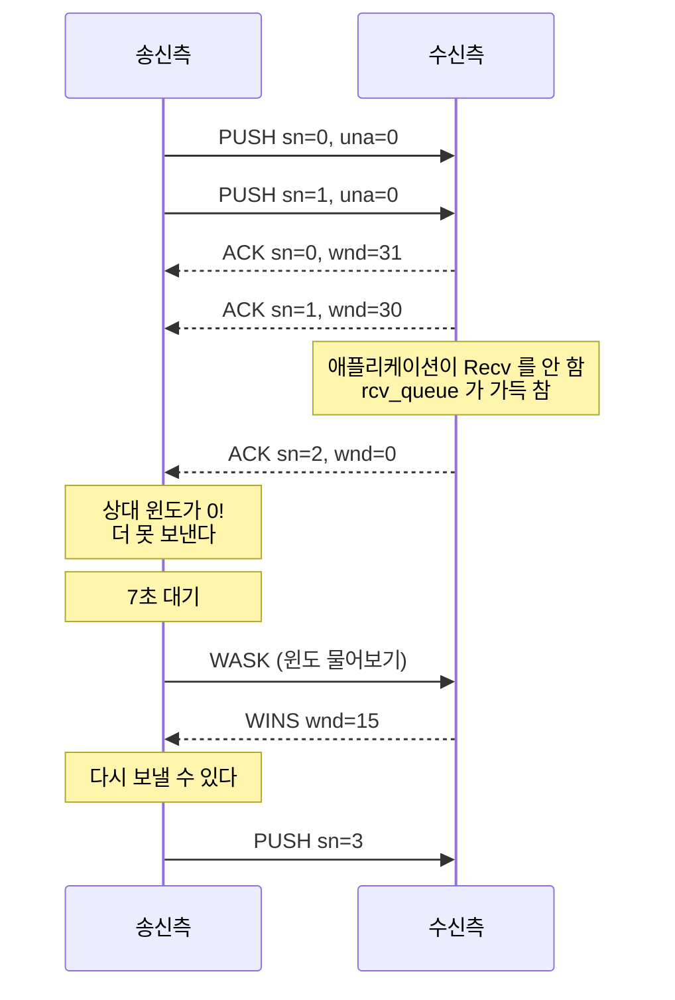

# 3장. KCP 프로토콜 해부

> **학습 목표**
> 1. 24바이트 헤더의 여덟 필드를 바이트 위치까지 설명할 수 있습니다.
> 2. cmd 4종(PUSH/ACK/WASK/WINS)이 어떻게 맞물려 도는지 이해합니다.
> 3. 재전송 3경로(RTO/빠른/조기)와 윈도 프로브, 조각화를 코드에서 짚을 수 있습니다.

이 장은 이 책의 이론 핵심입니다. 여기를 이해하면 나머지는 응용입니다.

## 24바이트 헤더

모든 KCP 세그먼트는 24바이트 헤더로 시작합니다. **모든 정수는 리틀엔디언**입니다.

```
 0        4    5    6      8            12           16           20          24
 +--------+----+----+------+------------+------------+------------+------------+
 |  conv  |cmd |frg | wnd  |     ts     |     sn     |    una     |    len     |
 +--------+----+----+------+------------+------------+------------+------------+
    u32    u8   u8   u16        u32          u32          u32          u32
```

| 오프셋 | 크기 | 필드 | 뜻 |
|---:|---:|---|---|
| 0 | 4 | `conv` | 대화 번호. **양 끝이 같아야** 이 패킷을 받아들입니다 |
| 4 | 1 | `cmd` | 명령 종류(아래 4종) |
| 5 | 1 | `frg` | **남은 조각 수**. 0이면 이 조각이 마지막 |
| 6 | 2 | `wnd` | 내 수신 윈도의 남은 자리 |
| 8 | 4 | `ts` | 보낸 시각(ms). RTT 계산용 |
| 12 | 4 | `sn` | 순서 번호 |
| 16 | 4 | `una` | "이 번호 미만은 다 받았다" |
| 20 | 4 | `len` | 뒤에 붙는 페이로드 길이 |

### 골든 벡터로 확인하기

말보다 바이트를 보는 편이 빠릅니다. `conv=0x11223344, cmd=81(PUSH), frg=2, wnd=32,
ts=1000, sn=7, una=5, len=3` 을 인코딩하면 이렇게 됩니다.

```csharp
// tests/KcpCSharpR1.Tests/CodecTests.cs
private static readonly byte[] GoldenHeader =
{
    0x44, 0x33, 0x22, 0x11,   // conv = 0x11223344
    0x51,                     // cmd  = 81 (IKCP_CMD_PUSH)
    0x02,                     // frg  = 2
    0x20, 0x00,               // wnd  = 32
    0xE8, 0x03, 0x00, 0x00,   // ts   = 1000
    0x07, 0x00, 0x00, 0x00,   // sn   = 7
    0x05, 0x00, 0x00, 0x00,   // una  = 5
    0x03, 0x00, 0x00, 0x00,   // len  = 3
};
```

**리틀엔디언**이라 `0x11223344` 가 `44 33 22 11` 로 뒤집혀 들어갑니다.
이 테스트는 원본 C kcp 의 산출과 같은지 못 박는 **상호운용의 근거**입니다.
코어를 아무리 리팩터링해도 이 바이트가 바뀌면 테스트가 먼저 깨집니다.

### conv 는 왜 필요한가

UDP는 연결이 없으므로, 같은 포트로 아무 패킷이나 들어올 수 있습니다.
`conv` 가 다르면 즉시 버립니다.

```csharp
// src/KcpCSharpR1/Kcp.cs
var conv_ = KcpCodec.ReadU32(header);

if (conv != conv_) return -1;
```

또 하나의 역할: **재접속 구분**입니다. 같은 IP·포트에서 새로 접속했을 때
이전 세션의 늦은 패킷이 섞이는 것을 막습니다.

## cmd 4종

| 값 | 이름 | 방향 | 하는 일 |
|---:|---|---|---|
| 81 | `PUSH` | 데이터 | 실제 데이터를 나른다 |
| 82 | `ACK` | 응답 | "sn 번을 받았다" |
| 83 | `WASK` | 질의 | "네 윈도가 얼마나 비었니?" |
| 84 | `WINS` | 응답 | "내 윈도는 이만큼 비었다" |

### 어떻게 맞물리나



`wnd` 는 **모든 패킷 헤더에** 들어갑니다. ACK를 보낼 때마다 자기 상태를 알려 주는 셈입니다.

## una — 누적 확인이 하는 일

`una` 를 받으면 그 미만의 세그먼트를 **송신 버퍼에서 지웁니다.**

```csharp
// src/KcpCSharpR1/Kcp.cs
private int parse_una(uint una)
{
    var count = 0;
    for (var i = 0; i < snd_buf.Count; i++)
    {
        var seg = snd_buf.AtUnchecked(i);
        if (_itimediff(una, seg.sn) > 0)
        {
            count++;
            ReturnSegment(seg);      // 풀에 반납
        }
        else
            break;
    }

    if (count > 0)
        snd_buf.RemoveFront(count);
    return count;
}
```

`sn` 개별 ACK는 **표시만** 하고 지우지 않습니다.

```csharp
// src/KcpCSharpR1/Kcp.cs
// 확인 표시만 하고 세그먼트는 남겨 둔다. una 가 지울 때까지 기다린다.
snd_buf.AtUnchecked(index).acked = 1;
```

왜 이렇게 할까요? **중간을 지우면 배열을 당겨야 하기 때문**입니다.
윈도가 1024쯤 되면 그 비용이 무시하기 어렵습니다.
`acked` 로 표시해 두었다가 `una` 가 앞에서부터 한꺼번에 밀어내면 O(1)로 끝납니다.

> 이 라이브러리는 여기서 한 걸음 더 나갔습니다. 큐를 원형 덱(`RingBuffer`)으로 바꿔
> `RemoveFront` 를 head 이동만으로 처리합니다(14장).

## 재전송 3경로

`Flush()` 안의 이 분기가 KCP의 심장입니다.

```csharp
// src/KcpCSharpR1/Kcp.cs
if (segment.acked == 1)
    continue;                                        // 이미 확인됨 — 건너뜀

if (segment.xmit == 0)                               // ① 최초 전송
{
    needsend = true;
    segment.rto = rx_rto;
    segment.resendts = current + segment.rto;
}
else if (segment.fastack >= resent)                  // ② 빠른 재전송
{
    needsend = true;
    segment.fastack = 0;
    segment.rto = rx_rto;
    segment.resendts = current + segment.rto;
    change++;
    fastRetransSegs++;
}
else if (segment.fastack > 0 && newSegsCount == 0)   // ③ 조기 재전송
{
    needsend = true;
    segment.fastack = 0;
    ...
    earlyRetransSegs++;
}
else if (_itimediff(current, segment.resendts) >= 0) // ④ RTO 만료
{
    needsend = true;
    if (nodelay == 0)
        segment.rto += rx_rto;
    else
        segment.rto += rx_rto / 2;
    segment.fastack = 0;
    segment.resendts = current + segment.rto;
    lostSegs++;
}
```

| 경로 | 조건 | 복구 시간 | 통계 |
|---|---|---|---|
| ② 빠른 재전송 | 중복 ACK n회 | **~1 RTT** | `FastRetransmitSegments` |
| ③ 조기 재전송 | 중복 ACK 1회 + 보낼 새 데이터 없음 | ~1 RTT | `EarlyRetransmitSegments` |
| ④ RTO 만료 | 시간 초과 | RTO(30~수백 ms) | `RetransmitSegments` |

**②·③이 많고 ④가 적으면 건강한 상태**입니다. ④가 많다는 것은
"뒤엣것도 안 오고 있다" = 회선이 심하게 막혔다는 뜻입니다.

이 세 가지는 통계로 따로 셀 수 있습니다.

```csharp
var s = kcp.GetStats();
var total = s.RetransmitSegments + s.FastRetransmitSegments + s.EarlyRetransmitSegments;
```

## 흐름 제어 — 윈도 프로브

수신측이 `Recv` 를 안 하면 `rcv_queue` 가 차고, 통지 윈도가 0이 됩니다.

```csharp
// src/KcpCSharpR1/Kcp.cs
private ushort wnd_unused()
{
    if (rcv_queue.Count < rcv_wnd)
        return (ushort)(rcv_wnd - rcv_queue.Count);
    return 0;
}
```

송신측은 더 못 보냅니다. 그런데 **"이제 자리가 났다"는 소식을 어떻게 들을까요?**

수신측이 알아서 알려 주면 좋겠지만, 그 통지가 유실되면 영원히 멈춥니다(교착).
그래서 **송신측이 주기적으로 물어봅니다.**

```csharp
// src/KcpCSharpR1/Kcp.cs
// 상대 윈도가 0 이면 윈도 크기를 물어본다.
if (0 == rmt_wnd)
{
    if (0 == probe_wait)
    {
        probe_wait = IKCP_PROBE_INIT;        // 7초
        ts_probe = current + probe_wait;
    }
    else
    {
        if (_itimediff(current, ts_probe) >= 0)
        {
            if (probe_wait < IKCP_PROBE_INIT)
                probe_wait = IKCP_PROBE_INIT;
            probe_wait += probe_wait / 2;    // 1.5배씩 증가
            if (probe_wait > IKCP_PROBE_LIMIT)
                probe_wait = IKCP_PROBE_LIMIT;   // 최대 120초
            ts_probe = current + probe_wait;
            probe |= IKCP_ASK_SEND;
        }
    }
}
```

첫 프로브는 7초 뒤, 그다음은 1.5배씩 늘려 최대 120초 간격입니다.
**교착을 확실히 푸는 안전장치**입니다.

시나리오 테스트가 이 동작을 지킵니다.

```csharp
// tests/KcpCSharpR1.SimTests/ScenarioTests.cs
/// <summary>#6 수신측이 Recv 를 멈추면 송신이 멈추고, 재개하면 다시 흐른다(윈도 프로브).</summary>
[Fact]
public void S06_수신윈도_0에서_송신정지_후_재개된다()
```

## 혼잡 제어

`nc=0`(기본)이면 TCP와 비슷한 혼잡 제어가 돕니다.

```csharp
// src/KcpCSharpR1/Kcp.cs
// rate halving, RFC 6937
if (change > 0)
{
    var inflght = snd_nxt - snd_una;
    ssthresh = inflght / 2;
    if (ssthresh < IKCP_THRESH_MIN) ssthresh = IKCP_THRESH_MIN;
    cwnd = ssthresh + resent;
    incr = cwnd * mss;
}

// 혼잡 제어, RFC 5681
if (lostSegs > 0)
{
    ssthresh = cwnd / 2;
    if (ssthresh < IKCP_THRESH_MIN) ssthresh = IKCP_THRESH_MIN;
    cwnd = 1;                // 처음부터 다시
    incr = mss;
}
```

| 사건 | 반응 |
|---|---|
| 빠른 재전송 발생(`change > 0`) | 윈도를 **절반**으로(rate halving) |
| RTO 만료(`lostSegs > 0`) | 윈도를 **1로**(심각한 상황으로 판단) |

`nc=1` 이면 이 전부를 무시합니다. 게임에서 흔히 쓰지만, 그 의미를 알고 써야 합니다(8장).

## 조각화 — frg

MTU보다 큰 메시지는 쪼갭니다. `frg` 에 **남은 조각 수**를 넣습니다.

```csharp
// src/KcpCSharpR1/Kcp.cs
for (var i = 0; i < count; i++)
{
    var size = Math.Min(data.Length, (int)mss);

    var seg = RentSegment(stream != 0 ? (int)mss : size);
    seg.Append(data.Slice(0, size));
    data = data.Slice(size);

    seg.frg = stream == 0 ? (uint)(count - i - 1) : 0u;
    snd_queue.PushBack(seg);
}
```

3조각이면 `frg` 가 **2, 1, 0** 순입니다. 수신측은 `frg == 0` 을 만날 때까지 모읍니다.

```csharp
// src/KcpCSharpR1/Kcp.cs
public int PeekSize()
{
    if (0 == rcv_queue.Count) return -1;

    ref var seq = ref rcv_queue.PeekFront();

    if (0 == seq.frg) return seq.Len;             // 조각이 아니면 바로

    if (rcv_queue.Count < seq.frg + 1) return -1; // 아직 다 안 모임

    var length = 0;
    for (var i = 0; i < rcv_queue.Count; i++)
    {
        var item = rcv_queue.AtUnchecked(i);
        length += item.Len;
        if (0 == item.frg) break;
    }
    return length;
}
```

**왜 역순(2,1,0)일까요?** `frg == 0` 하나만 보면 "여기가 끝"임을 알 수 있기 때문입니다.
정순(0,1,2)이면 총 개수를 따로 알아야 합니다.

### 조각 수 한계 — 실제로 있었던 버그

`frg` 는 1바이트라 최대 255입니다. 그런데 진짜 한계는 그것이 아닙니다.

```csharp
// src/KcpCSharpR1/Kcp.cs
// 원본 ikcp.c 와 동일한 검사. 조각 수가 수신 윈도 이상이면 수신측 rcv_queue 가
// 절대 채워지지 못해 영구 교착이 된다(진단 B-04).
if (count >= rcv_wnd) return -2;
```

수신 윈도가 32인데 33조각을 보내면, 수신측은 32개까지만 받고 멈춥니다.
33번째를 받아야 메시지가 완성되는데 자리가 없어 못 받고, 앞의 32개는 완성 안 됐다고 안 넘어가고
— **영구 교착**입니다.

이 저장소의 이전 버전은 `count > 255` 만 검사해 이 버그가 있었습니다.
지금은 시나리오 테스트가 지킵니다.

```csharp
// tests/KcpCSharpR1.SimTests/ScenarioTests.cs
// 조각 수가 수신 윈도 이상이면 영구 교착 대신 -2 를 반환해야 한다.
var tooBig = new byte[rcvWnd * mss];
Assert.Equal(-2, pair.A.Send(tooBig));
```

## 메시지 모드 vs 스트림 모드

`frg` 처리 하나가 두 모드를 가릅니다.

| | 메시지 모드 | 스트림 모드 |
|---|---|---|
| `frg` 값 | `count - i - 1` | **항상 0** |
| 경계 | 보존 | 사라짐 |
| 마지막 세그먼트 | 새로 만듦 | **빈 자리가 있으면 이어 붙임** |

```csharp
// src/KcpCSharpR1/Kcp.cs
if (stream != 0 && snd_queue.Count > 0)
{
    // 스트림 모드: 마지막 세그먼트에 빈 자리가 있으면 이어 붙인다.
    var last = snd_queue.AtUnchecked(snd_queue.Count - 1);
    if (last.Len < mss)
    {
        var capacity = (int)mss - last.Len;
        var writen = Math.Min(capacity, data.Length);
        last.Append(data.Slice(0, writen));
        data = data.Slice(writen);
    }
}
```

스트림 모드는 작은 메시지를 모아 보내므로 **패킷 수가 줄어듭니다.** 대신 경계를 잃습니다.

## KCP가 TCP보다 빠른 이유 총정리

| 선택 | KCP | TCP | 대가 |
|---|---|---|---|
| RTO 백오프 | 1.5배 | 2배 | 대역폭 |
| 최소 RTO | 30ms | 200ms+ | 불필요한 재전송 가능 |
| ACK 지연 | 없음(옵션) | 최대 40ms | ACK 트래픽 증가 |
| 조기 재전송 | 있음 | 없음 | 약간의 낭비 |
| 혼잡 제어 | 끌 수 있음 | 필수 | **공정성 포기** |

**전부 "대역폭을 더 쓰고 지연을 얻는" 거래**입니다.
게임 트래픽은 작으니 남는 장사인 경우가 많습니다.

## 실습: 로그로 재전송 관찰하기

KCP는 내부 로그를 켤 수 있습니다.

```csharp
kcp.SetLogger(Console.WriteLine);
kcp.SetLogMask(Kcp.IKCP_LOG_OUT_DATA | Kcp.IKCP_LOG_IN_ACK);
```

손실 20% 링크에서 돌리면 이런 로그가 나옵니다.

```
output psh: sn=5 ts=1200 resendts=1230 rto=30 fastack=0, xmit=1
 input ack: sn=6 ts=1210 rtt=25 rto=30
 input ack: sn=7 ts=1220 rtt=24 rto=30
output psh: sn=5 ts=1260 resendts=1290 rto=30 fastack=2, xmit=2   ← 빠른 재전송!
```

`fastack=2` 에 주목하세요. sn=6, 7의 ACK가 오면서 sn=5의 카운터가 2가 되었고,
임계값에 도달해 재전송했습니다. `xmit=2` 는 두 번째 전송이라는 뜻입니다.

가상 링크로 재현하려면 `tests/KcpCSharpR1.SimTests/ScenarioTests.cs` 의
`S02_손실환경에서_전량_도달하고_재전송이_발생한다` 를 참고하세요.

## 요약

- 24바이트 헤더에 **conv/cmd/frg/wnd/ts/sn/una/len** 이 리틀엔디언으로 들어갑니다.
- `una`(누적)로 버퍼를 비우고, `sn`(개별)로 도착을 표시합니다 — **중간을 지우지 않는 것**이 요령입니다.
- 재전송은 세 경로: **빠른 재전송(~1RTT) / 조기 재전송 / RTO 만료**. 앞의 둘이 많아야 건강합니다.
- 윈도가 0이 되면 **송신측이 주기적으로 물어봐(WASK)** 교착을 풉니다.
- `frg` 는 **남은 조각 수**(역순)이며, `조각 수 >= 수신 윈도` 면 보내기 전에 거부해야 합니다.

## 연습문제

1. **헤더 손으로 만들기** — `conv=1, cmd=ACK(82), frg=0, wnd=16, ts=5000, sn=42, una=40, len=0`
   을 24바이트로 적어 보세요. `CodecTests` 의 골든 벡터와 같은 방식으로 검산하세요.
2. **교착 재현** — `WndSize(32, 32)` 상태에서 `32 × Mss` 크기 메시지를 보내면 `-2` 가 나옵니다.
   이 검사를 임시로 지우면 어떤 일이 생기는지 시뮬레이션 테스트로 확인해 보세요.
   (**주의**: 영원히 안 끝나므로 타임아웃을 걸어 두세요.)
3. **재전송 경로 세기** — 손실 5%, 10%, 20% 환경에서 `FastRetransmitSegments` 와
   `RetransmitSegments`(RTO)의 비율이 어떻게 변하는지 재 보세요. 무엇을 알 수 있나요?

---

1부는 여기까지입니다. 2부에서는 이 프로토콜을 실제로 쓰는 법을 배웁니다.
