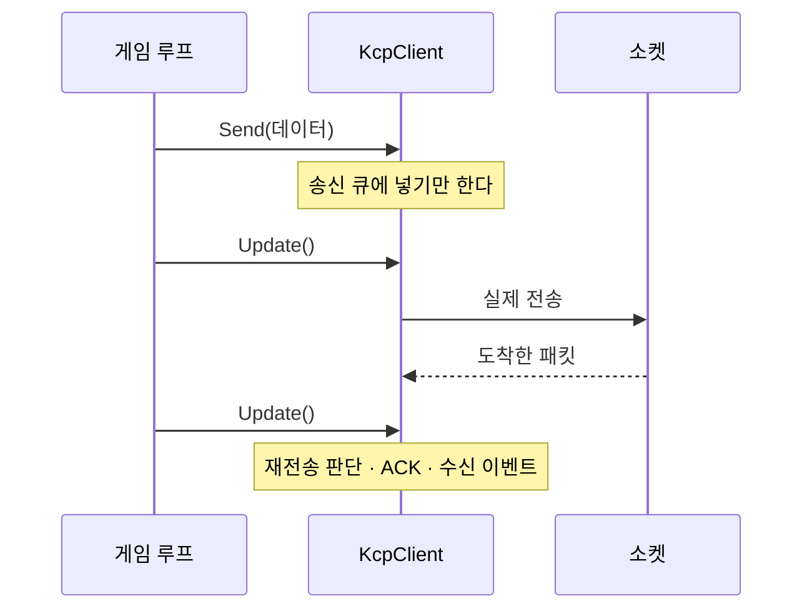

# 4장. 시작하기

> **학습 목표**
> 1. KcpCSharpR1 를 프로젝트에 넣고 에코 서버와 클라이언트를 직접 돌릴 수 있습니다.
> 2. `Update()` 루프가 왜 필요한지, 부르지 않으면 어떤 증상이 나는지 설명할 수 있습니다.
> 3. 처음 만나는 세 가지 실수(Update 누락, 방화벽, 포트 충돌)를 스스로 진단할 수 있습니다.

## 설치

### NuGet (배포 후)

```bash
dotnet add package KcpCSharpR1
dotnet add package KcpCSharpR1.Transport
```

`KcpCSharpR1` 는 프로토콜 코어(의존성 0), `KcpCSharpR1.Transport` 는 소켓·세션 계층입니다.
직접 소켓을 다루겠다면 코어만 참조해도 됩니다.

### 소스 참조 (지금 방식)

```bash
git clone https://github.com/jacking75/kcp-csharp
dotnet add reference ../kcp-csharp/src/KcpCSharpR1/KcpCSharpR1.csproj
dotnet add reference ../kcp-csharp/src/KcpCSharpR1.Transport/KcpCSharpR1.Transport.csproj
```

### 지원 플랫폼

| 타깃 | 비고 |
|---|---|
| `net8.0` | 권장. 서버·MonoGame 클라이언트 모두 이 타깃을 씁니다 |
| `netstandard2.1` | Godot C#, Unity 등 구형 런타임 호환용 |

MonoGame(3.8.2+)은 net8.0 을 그대로 쓰므로 별도 대응이 필요 없습니다(부록 D).

## 첫 프로그램: 에코

"보낸 것이 그대로 돌아온다"를 확인하는 것이 첫 목표입니다.
사소해 보이지만 **연결·송신·수신·종료** 사이클 전부를 한 번에 검증하는 좋은 출발점입니다.

### 서버

```csharp
// samples/01-Echo/Server/Program.cs
using var server = new KcpServer(27001);

// ① 누가 들어왔는지
server.SessionConnected += session =>
    Log($"접속 {session.RemoteEndPoint} (conv={session.Conv}, 현재 {server.SessionCount}명)");

// ② 받은 것을 그대로 돌려준다
server.ReliableReceived += (session, data) =>
{
    var text = Encoding.UTF8.GetString(data.Span);
    Log($"수신 [{session.Conv}] {text}");

    var result = session.Send(data.Span);
    if (result != KcpSendResult.Ok)
        Log($"에코 실패 [{session.Conv}] {result}");
};

// ③ 왜 나갔는지 (정상 종료 / 타임아웃 / 데드링크)
server.SessionDisconnected += (session, reason) =>
    Log($"종료 {session.RemoteEndPoint} ({reason})");

server.Start();
```

한 줄씩 봅시다.

- **`new KcpServer(27001)`** — UDP 27001 포트를 쓰는 서버를 만듭니다. 아직 열지는 않습니다.
- **`SessionConnected`** — 핸드셰이크가 끝나 세션이 생겼을 때 발생합니다. `conv` 는 서버가 할당한
  이 연결의 번호입니다(3장에서 자세히).
- **`ReliableReceived`** — 신뢰 채널로 온 메시지 하나가 완성될 때마다 발생합니다.
  `data` 는 **콜백이 끝나면 무효**입니다. 보관하려면 복사해야 합니다.
- **`session.Send(...)`** — 반환값을 확인합니다. 송신 큐가 가득 차면 `Backpressure` 가 돌아오고
  **메시지는 버려집니다**(6장). 반환값을 무시하면 나중에 "재전송은 0인데 데이터가 안 온다"는
  이해 못 할 상황을 만납니다 — 실제로 이 저장소의 부하 도구가 그 실수를 했습니다.
- **`server.Start()`** — 소켓을 열고 전용 수신 스레드를 띄웁니다.
  **이벤트는 그 스레드에서 발화합니다.** 게임 로직이 다른 스레드에 있다면 큐로 넘기세요(6장).

### 클라이언트

```csharp
// samples/01-Echo/Client/Program.cs
using var client = new KcpClient();

client.ReliableReceived += (session, data) =>
{
    var text = Encoding.UTF8.GetString(data.Span);
    Log($"에코 확인 {text} (핑 {session.PingMs}ms, RTT {session.SrttMs}ms)");
};

var session = await client.ConnectAsync(new IPEndPoint(IPAddress.Parse(host), 27001));
Log($"접속 완료 conv={session.Conv}, 로컬 {client.LocalEndPoint}");

while (!quit.IsCancellationRequested && session.State == KcpSessionState.Connected)
{
    if (지금_보낼_때가_됐다)
        session.Send(Encoding.UTF8.GetBytes($"Hello KCP #{++sent}"));

    // 게임 루프의 한 프레임에 해당한다.
    client.Update();
    await Task.Delay(10);
}
```

### 실행

```bash
dotnet run --project samples/01-Echo/Server     # 터미널 1
dotnet run --project samples/01-Echo/Client     # 터미널 2
```

```
[11:48:36.773] UDP 27001 에서 대기 중입니다. Ctrl+C 로 종료합니다.
[11:48:39.799] 접속 127.0.0.1:64734 (conv=1, 현재 1명)
[11:48:39.841] 수신 [1] Hello KCP #1
```

```
[11:48:39.818] 접속 완료 conv=1, 로컬 0.0.0.0:64734
[11:48:39.861] 에코 확인 [1/1] Hello KCP #1 (핑 -1ms, RTT 22ms)
[11:48:41.872] 에코 확인 [3/3] Hello KCP #3 (핑 14ms, RTT 20ms)
```

첫 두 줄의 `핑 -1ms` 는 버그가 아닙니다. 핑은 PING/PONG 왕복으로 재는데 기본 간격이 2초라,
그 전에는 아직 측정값이 없다는 뜻입니다. `RTT` 는 KCP 가 데이터 왕복에서 계산한 값이라 바로 나옵니다.

## `Update()` 는 왜 필요한가

**KCP는 스스로 돌지 않습니다.** 타이머 스레드도, 백그라운드 작업도 없습니다.
재전송·ACK·keepalive는 전부 `Update()` 를 부를 때만 일어납니다.



### 왜 이렇게 만들었나

게임 엔진은 이미 자기 루프를 갖고 있습니다. 라이브러리가 별도 타이머 스레드를 돌리면

- 수신 콜백이 **게임 스레드가 아닌 곳에서** 튀어나와 락이 필요해지고,
- 프레임과 무관한 시점에 CPU를 쓰며,
- 프레임을 넘길 때 정확히 무엇이 처리됐는지 알기 어려워집니다.

그래서 **언제 돌릴지를 여러분이 정하게** 했습니다. MonoGame이라면 `Game.Update()` 안에서 한 줄이면 됩니다.

```csharp
// samples/03-Gomoku/Client/GomokuGame.cs
protected override void Update(GameTime gameTime)
{
    // ★ 이 한 줄이 MonoGame 과 KCP 를 잇는 전부다.
    network.Poll();
    ...
}
```

### 두 가지 구동 모델 — 섞지 마세요

| 모델 | 방법 | 콜백이 발화하는 스레드 | 어울리는 곳 |
|---|---|---|---|
| **폴링형** | 매 프레임 `client.Update()` | 부른 스레드(= 게임 스레드) | 게임 클라이언트 |
| **자체 루프형** | `await client.RunAsync(ct)` 한 번 | 라이브러리 루프 스레드 | 콘솔 도구, 봇 |

둘을 섞으면 `Update()` 가 예외를 던집니다. 의도적으로 막아 두었습니다.

## 흔한 첫 실수 세 가지

### ① `Update()` 를 안 부른다

**증상**: `ConnectAsync` 는 성공하는데 `Send` 한 것이 상대에게 도착하지 않는다.
잠시 뒤 `Disconnected(Timeout)` 이 뜬다.

**왜**: `Send` 는 큐에 넣기만 합니다. 실제 전송은 `Update()` 안에서 일어납니다.
`ConnectAsync` 는 내부에서 스스로 펌프를 돌리기 때문에 **연결까지만 성공**합니다.

**확인**: `session.Stats.SegmentsSent` 가 늘지 않으면 이 경우입니다.

### ② 방화벽이 UDP를 막는다

**증상**: 같은 PC(`127.0.0.1`)에서는 되는데 다른 PC에서는 `TimeoutException` 이 난다.

**왜**: Windows 방화벽은 새 앱의 인바운드 UDP를 기본으로 막습니다. `dotnet run` 으로 띄우면
`dotnet.exe` 에 대해 물어보거나, 아예 조용히 막습니다.

**확인**: 서버 쪽에서 패킷이 아예 안 보이는지(`SessionConnected` 조차 안 뜸) 봅니다.
임시로 확인하려면 관리자 PowerShell에서

```powershell
New-NetFirewallRule -DisplayName "KcpCSharpR1 dev" -Direction Inbound -Protocol UDP -LocalPort 27001-27199 -Action Allow
```

**주의**: 개발용 임시 규칙입니다. 끝나면 지우세요.

### ③ 포트 충돌

**증상**: 서버 시작 시 `SocketException: 각 소켓 주소에 대해 하나의 사용만이 허용됩니다`.

**왜**: 이미 그 포트를 쓰는 프로세스가 있습니다. 앞서 띄운 서버가 안 죽었을 가능성이 큽니다.

**확인**:

```powershell
Get-NetUDPEndpoint -LocalPort 27001 | Select-Object -Property LocalAddress,LocalPort,OwningProcess
```

> 이 저장소는 샘플·테스트가 쓸 UDP 포트를 **27001~27199** 로 정해 두었습니다.
> 27001~27005는 샘플 1~5, 27010은 부하 도구, 27100~27199는 테스트 코드가 씁니다.

## 전체 코드

가장 짧은 형태로 줄이면 서버는 이 정도입니다.

```csharp
using System.Net;
using System.Text;
using KcpCSharpR1.Transport;

using var server = new KcpServer(27001);
server.ReliableReceived += (session, data) => session.Send(data.Span);
server.Start();

Console.WriteLine("Ctrl+C 로 종료");
Thread.Sleep(Timeout.Infinite);
```

클라이언트는 이 정도입니다.

```csharp
using System.Net;
using System.Text;
using KcpCSharpR1.Transport;

using var client = new KcpClient();
client.ReliableReceived += (_, data) =>
    Console.WriteLine("에코: " + Encoding.UTF8.GetString(data.Span));

var session = await client.ConnectAsync(new IPEndPoint(IPAddress.Loopback, 27001));
session.Send(Encoding.UTF8.GetBytes("Hello KCP"));

for (var i = 0; i < 200; i++)
{
    client.Update();
    await Task.Delay(10);
}
```

## 요약

- `KcpServer` 는 이벤트 세 개(`SessionConnected` / `ReliableReceived` / `SessionDisconnected`)만
  구독하면 완성됩니다.
- **`Update()` 를 부르지 않으면 아무 일도 일어나지 않습니다.** KCP는 타이머 주도 프로토콜입니다.
- 구동 모델은 폴링형과 자체 루프형 둘 중 하나만 씁니다.
- `Send` 의 반환값을 확인하세요. 큐가 차면 메시지는 버려집니다.
- 안 되면 순서대로 의심합니다: Update 누락 → 방화벽 → 포트 충돌.

## 연습문제

1. **왕복 시간 측정** — 에코 클라이언트를 고쳐 보낸 시각을 메시지에 넣고, 돌아왔을 때
   경과 시간을 출력해 보세요. `session.SrttMs` 와 비교하면 왜 다른 값이 나올까요?
   (힌트: 하나는 애플리케이션 왕복, 하나는 KCP가 세그먼트 단위로 잰 값입니다.)
2. **Update 없애 보기** — 클라이언트에서 `client.Update()` 를 주석 처리하고 실행해 보세요.
   몇 초 뒤 어떤 로그가 뜨나요? 서버 쪽에는 무엇이 찍히나요?
3. **두 클라이언트** — 클라이언트를 두 개 띄워 보세요. 서버 로그의 `conv` 값이 어떻게 다른가요?
   이 값이 왜 필요한지는 3장에서 다룹니다.

---

다음 장(5장)에서는 `KcpServer`/`KcpClient` 아래에 있는 **코어 `Kcp` 클래스**를 직접 다뤄 봅니다.
소켓 없이 프로토콜만 떼어 놓고 보면 KCP가 무엇을 하는 물건인지 훨씬 선명해집니다.
