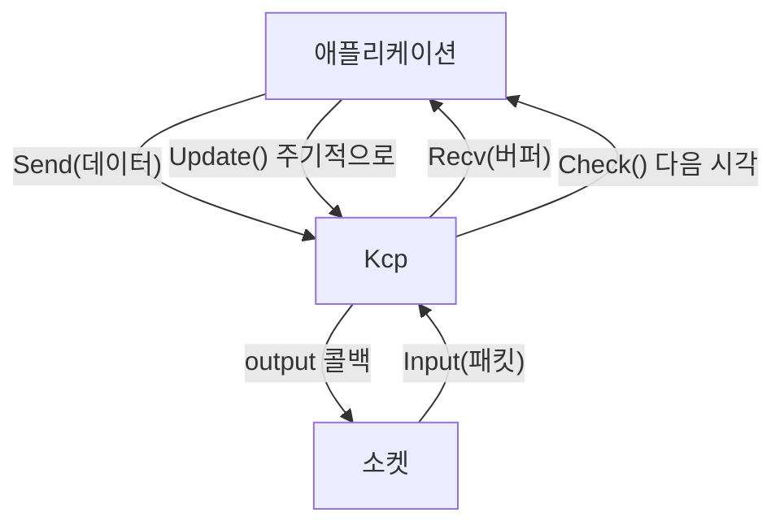

# 5장. 코어 API 정복

> **학습 목표**
> 1. `Kcp` 클래스의 모든 공개 API와 반환 코드를 표로 설명할 수 있습니다.
> 2. 메시지 모드와 스트림 모드의 차이를 알고 각각의 수신 코드를 쓸 수 있습니다.
> 3. `Check()` 로 절전 스케줄링을 구현하고, 통계로 회선 품질을 진단할 수 있습니다.

4장에서 쓴 `KcpClient`/`KcpServer` 는 소켓과 세션을 얹은 **전송 계층**입니다.
이 장에서는 그 아래에 있는 **코어 `Kcp` 클래스**를 직접 다룹니다.
소켓 없이 프로토콜만 떼어 놓고 보면 KCP가 무엇을 하는 물건인지 훨씬 선명해집니다.

## 코어는 아무것도 모른다

```csharp
// src/KcpCSharpR1/Kcp.cs
/// <para>
/// 이 클래스는 <b>순수한 프로토콜 상태 머신</b>이다. 소켓·스레드·실시간 시계·로깅 구현을 알지 못하며
/// 전부 주입받는다. 실제 패킷 송신은 생성자에 넘긴 output 콜백이 담당한다.
/// </para>
public class Kcp
```

생성자는 세 가지를 받습니다.

```csharp
// src/KcpCSharpR1/Kcp.cs
public Kcp(uint conv_, Action<byte[], int> output_, Func<uint>? currentTimeMs = null)
```

| 인자 | 뜻 |
|---|---|
| `conv` | 이 연결의 번호. **양 끝이 같아야** 합니다 |
| `output` | 패킷을 내보낼 콜백. UDP 소켓이든, 파일이든, 테스트용 가짜든 상관없습니다 |
| `currentTimeMs` | 밀리초 시계. 생략하면 단조 시계를 씁니다 |

세 번째 인자가 이 라이브러리의 테스트 전략 전부입니다.
**가상 시계를 주입하면 "2분짜리 시나리오"를 수십 밀리초 만에 돌릴 수 있습니다.**

```csharp
// tests/KcpCSharpR1.SimTests/KcpPair.cs
pair.A = new Kcp(conv, (buf, len) => pair.AtoB.Send(buf, len), () => pair.Now);
pair.B = new Kcp(conv, (buf, len) => pair.BtoA.Send(buf, len), () => pair.Now);
```

## 다섯 개의 동사

KCP를 쓰는 것은 결국 다섯 개의 메서드입니다.



| 메서드 | 방향 | 하는 일 |
|---|---|---|
| `Send(data)` | 앱 → KCP | 보낼 데이터를 **큐에 넣기만** 합니다 |
| `Input(packet, …)` | 소켓 → KCP | 받은 UDP 페이로드를 해석합니다 |
| `Recv(buffer)` | KCP → 앱 | 완성된 메시지 하나를 꺼냅니다 |
| `Update()` | — | 재전송·ACK·플러시를 실제로 수행합니다 |
| `Check()` | — | 다음에 `Update()` 를 부를 시각을 알려 줍니다 |

`Flush(ackOnly)` 도 있지만 보통은 `Update()` 가 알아서 부릅니다.

## 반환 코드 표

### `Send`

```csharp
// src/KcpCSharpR1/Kcp.cs
public int Send(ReadOnlySpan<byte> data)
```

| 값 | 뜻 | 대응 |
|---|---|---|
| `0` | 송신 큐에 적재 성공 | — |
| `-1` | 길이가 0 | 빈 메시지를 보내려 했습니다 |
| `-2` | 조각 수가 수신 윈도 이상 | 메시지를 쪼개 보내거나 `WndSize` 를 키웁니다 |

`-2` 는 **원본 ikcp.c 와 같은 검사**입니다. 조각 수가 수신 윈도 이상이면
받는 쪽이 절대 재조립할 수 없어 **영구 교착**이 됩니다. 그래서 보내기 전에 막습니다.

> 이 검사는 원래 이 저장소에 없었습니다(`count > 255` 만 검사). 진단 과정에서
> 발견해 고친 버그(B-04)이며, 지금은 시나리오 테스트가 지키고 있습니다.

### `Input`

```csharp
// src/KcpCSharpR1/Kcp.cs
public int Input(ReadOnlySpan<byte> data, bool regular, bool ackNoDelay)
```

| 값 | 뜻 |
|---|---|
| `0` | 정상 처리 |
| `-1` | 패킷이 헤더(24B)보다 짧거나 `conv` 가 다름 |
| `-2` | 헤더의 length 필드가 실제 남은 바이트보다 큼(잘린 패킷) |
| `-3` | 알 수 없는 cmd 값 |

**중요**: 오류를 반환해도 **그 앞까지 해석한 세그먼트의 상태 변경은 이미 적용된 상태**입니다.
원본 ikcp.c 와 같은 동작이며, 상호운용 검증을 위해 일부러 유지했습니다.
즉 `Input` 이 음수를 돌려줘도 "아무 일도 없었다"가 아닙니다.

`regular` 는 "FEC로 복원한 패킷이 아니라 실제로 받은 패킷"이라는 뜻입니다.
윈도·RTT 갱신에 쓰이며, 보통 `true` 입니다.

### `Recv`

```csharp
// src/KcpCSharpR1/Kcp.cs
public int Recv(Span<byte> buffer)
```

| 값 | 뜻 |
|---|---|
| `> 0` | 읽은 바이트 수 |
| `-1` | 완성된 메시지가 없음 |
| `-2` | 버퍼가 `PeekSize()` 보다 작음 |

## 메시지 모드 vs 스트림 모드

이 구분이 KCP 사용의 첫 갈림길입니다.

| | 메시지 모드(기본) | 스트림 모드 |
|---|---|---|
| 설정 | `SetStreamMode(false)` | `SetStreamMode(true)` |
| 경계 | **보존됩니다** | 사라집니다 |
| `Send` 3번 + `Recv` | 3번에 나눠 받습니다 | 한 번에 이어져 올 수 있습니다 |
| 어울리는 곳 | 게임 패킷(대부분) | 파일 전송, TCP 대체 |

### 메시지 모드 수신 패턴

```csharp
while (true)
{
    var size = kcp.PeekSize();
    if (size < 0) break;            // 완성된 메시지가 없다

    if (size > buffer.Length)
        buffer = new byte[size];    // 필요하면 키운다

    var n = kcp.Recv(buffer);
    if (n < 0) break;

    처리(buffer.AsSpan(0, n));
}
```

`PeekSize()` 로 **먼저 크기를 물어보고** 버퍼를 준비하는 것이 정석입니다.

### 스트림 모드 확인

```csharp
// samples 예시가 아니라 설명용 코드입니다
kcp.SetStreamMode(true);
kcp.Send(new byte[] { 1, 2, 3 });
kcp.Send(new byte[] { 4, 5 });
// → 상대는 { 1, 2, 3, 4, 5 } 를 한 번에 받을 수 있습니다
```

스트림 모드에서는 **직접 프레이밍을 해야** 합니다(10장의 길이 접두사가 그것입니다).

## 최대 메시지 크기

```
최대 메시지 = (RcvWnd − 1) × Mss
```

기본값(`RcvWnd = 32`, `Mss = 1376`)이면 **약 42KB** 입니다.

```csharp
// tests/KcpCSharpR1.SimTests/ScenarioTests.cs
var mss = (int)pair.A.Mss;
var rcvWnd = (int)pair.A.RcvWnd;

// (rcv_wnd - 1) × mss 는 보낼 수 있어야 한다.
var maxMessage = TestData.DeterministicBytes((rcvWnd - 1) * mss, seed: 23);
Assert.Equal(0, pair.A.Send(maxMessage));

// 조각 수가 수신 윈도 이상이면 영구 교착 대신 -2 를 반환해야 한다.
var tooBig = new byte[rcvWnd * mss];
Assert.Equal(-2, pair.A.Send(tooBig));
```

더 큰 것을 보내려면 `WndSize(sndwnd, rcvwnd)` 로 윈도를 키우거나,
애플리케이션에서 쪼개 보냅니다. **대부분의 게임 패킷은 1KB 이하**라 마주칠 일이 드뭅니다.

## `Check()` 로 절전하기

`Update()` 를 10ms마다 무조건 부르면 세션 1만 개에서 초당 100만 번입니다.
대부분은 할 일이 없습니다.

```csharp
// src/KcpCSharpR1/Kcp.cs
/// <remarks>
/// 반환값과 현재 시각의 비교는 반드시 <c>(int)(now - check) &gt;= 0</c> 처럼 부호 있는 차이로 해야 한다.
/// 단순 크기 비교는 약 49.7일 후 랩어라운드에서 영원히 갱신되지 않는 정지를 만든다(진단 B-02).
/// </remarks>
public uint Check()
```

```csharp
var next = kcp.Check();

if (Kcp.Itimediff(now, next) >= 0)   // ← 반드시 이렇게 비교합니다
{
    kcp.Update();
    next = kcp.Check();
}
```

### 49.7일 문제

`uint` 밀리초는 약 **49.7일**마다 0으로 돌아갑니다(랩어라운드).
`now >= next` 로 비교하면 그 순간 영원히 거짓이 되어 **서버가 조용히 멈춥니다.**

```csharp
// tests/KcpCSharpR1.Tests/CodecTests.cs
// 0x10 은 0xFFFF_FFF0 보다 32ms '뒤'다.
Assert.Equal(32, Kcp._itimediff(0x10, 0xFFFFFFF0));

// 단순 부호 없는 비교였다면 여기서 잘못된 결론이 난다.
Assert.True(0xFFFFFFF0u > 0x10u);
Assert.True(Kcp._itimediff(0x10, 0xFFFFFFF0) > 0);
```

**49일간 무중단 운영은 게임 서버에서 흔한 일입니다.** 이 라이브러리도 원래 이 버그가 있었고
(진단 B-02), 지금은 `Kcp.Itimediff` 를 공개해 사용자도 같은 실수를 하지 않게 했습니다.

`KcpServer` 를 쓰면 이 스케줄링을 최소 힙으로 알아서 해 줍니다(6장).

## 통계로 회선 진단하기

```csharp
// src/KcpCSharpR1/KcpStats.cs
public struct KcpStats
{
    public ulong BytesSent, BytesReceived;
    public ulong SegmentsSent, SegmentsReceived;
    public ulong RetransmitSegments;         // RTO 만료
    public ulong FastRetransmitSegments;     // 빠른 재전송
    public ulong EarlyRetransmitSegments;    // 조기 재전송
    public ulong RepeatSegments;             // 중복 수신
    public int CurrentRto, Srtt;
    public int SendWindowUsage, WaitSend;
}
```

가장 쓸모 있는 지표는 **재전송률**입니다.

```csharp
var s = kcp.GetStats();
var retransmit = s.RetransmitSegments + s.FastRetransmitSegments + s.EarlyRetransmitSegments;
var rate = s.SegmentsSent == 0 ? 0 : retransmit * 100.0 / s.SegmentsSent;
```

| 재전송률 | 해석 |
|---|---|
| 0% | 손실 없음. 유선 랜이거나 로컬 |
| 1~3% | 정상적인 무선/모바일 |
| **5% 초과** | 회선 문제 또는 서버 과부하. 경보 대상 |
| 20%+ | 사실상 못 쓰는 상태. FEC를 고려(16장) |

`Srtt` 는 게임의 핑 표시에 그대로 쓸 수 있습니다.
`WaitSnd` 가 계속 늘면 **보내는 속도가 회선보다 빠른 것**입니다 — 백프레셔를 넣어야 합니다.

## 스레딩 규약

```csharp
// src/KcpCSharpR1/Kcp.cs
/// <para>
/// <b>스레딩 규약</b>: 인스턴스 1개는 소유 스레드 1개에서만 사용한다. 내부에 lock 이 없으므로
/// 여러 스레드에서 동시에 호출하면 상태가 깨진다.
/// </para>
```

**락이 없는 것은 실수가 아니라 설계입니다.** 세션마다 락을 걸면 1만 세션에서 락 경합이
성능을 갉아먹습니다. 대신 "한 인스턴스 = 한 스레드" 규약을 두고, 상위 계층이 그것을 지킵니다.

위반하면 어떻게 되나요? 조용히 잘못됩니다 — 큐가 깨지고, 세그먼트가 사라지고,
운이 나쁘면 예외가 납니다. **재현이 어려운 종류의 버그**이므로 규약을 지키세요.

여러 스레드에서 보내야 한다면 **큐를 두고 소유 스레드가 꺼내 보내게** 합니다.

## 자원 해제

```csharp
// src/KcpCSharpR1/Kcp.cs
/// <summary>
/// 이 인스턴스가 들고 있는 모든 버퍼를 <see cref="System.Buffers.ArrayPool{T}"/> 에 돌려준다.
/// 세션 종료 시 호출한다. 호출 이후에도 다시 <see cref="Send(byte[])"/> 등을 쓸 수 있다.
/// </summary>
public void Release()
```

세그먼트 페이로드는 `ArrayPool` 에서 빌린 배열입니다.
세션이 끝나면 `Release()` 로 돌려주세요. 안 돌려줘도 GC가 회수하지만, 풀의 이점이 사라집니다.

## 요약

- 코어 `Kcp` 는 소켓·스레드·시계를 모릅니다. **전부 주입**받으므로 가상 시계로 테스트할 수 있습니다.
- 다섯 동사: `Send`(큐에 넣기) / `Input`(패킷 해석) / `Recv`(메시지 꺼내기) / `Update`(실행) / `Check`(다음 시각).
- 메시지 모드는 경계를 보존합니다. 스트림 모드를 쓰면 **직접 프레이밍**해야 합니다.
- 시각 비교는 **반드시 `Kcp.Itimediff`** 로. 49.7일마다 랩어라운드합니다.
- 재전송률 5% 초과는 경보 신호입니다. `WaitSnd` 증가는 백프레셔 신호입니다.

## 연습문제

1. **소켓 없이 왕복** — `Kcp` 두 개를 만들고 서로의 `output` 을 상대의 `Input` 에 직접 연결해
   보세요. 소켓 없이 KCP가 도는 것을 확인하면 이 클래스의 성격이 분명해집니다.
   (`tests/KcpCSharpR1.SimTests/KcpPair.cs` 가 정확히 그것을 합니다.)
2. **-2 재현하기** — `(RcvWnd) × Mss` 크기 메시지를 보내 `-2` 를 받아 보세요.
   그다음 `WndSize(256, 256)` 으로 키우면 얼마까지 보낼 수 있나요?
3. **랩어라운드 버그 만들기** — 가상 시계를 `0xFFFF_FF00` 에서 시작시키고,
   `Check()` 비교를 `now >= next` 로 바꿔 보세요. 몇 초 뒤 무슨 일이 일어나나요?

---

다음 장에서는 코어 위에 얹힌 **세션 계층** — 핸드셰이크, keepalive, 종료를 다룹니다.
"UDP에는 연결이 없다"는 말의 진짜 의미를 보게 됩니다.
