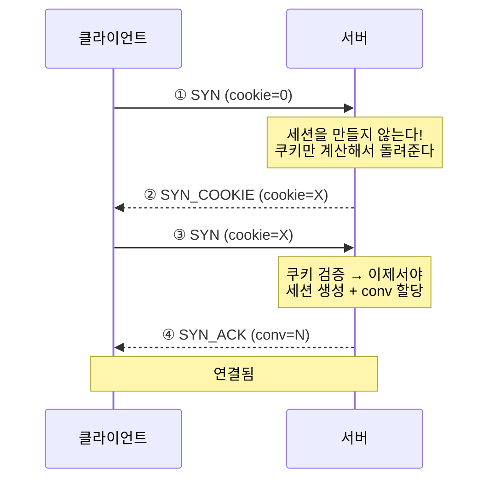
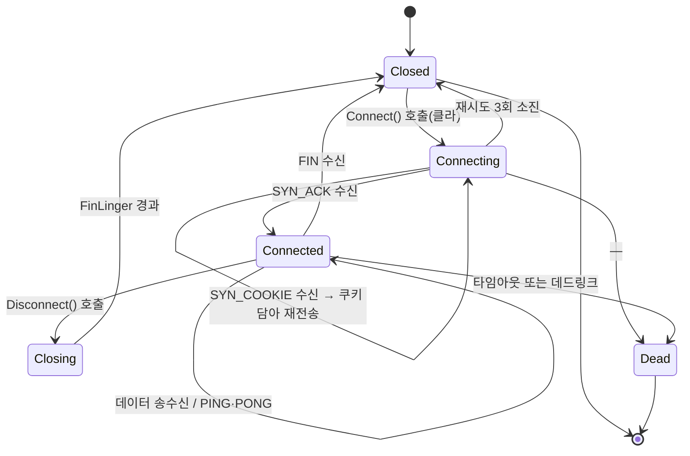

# 6장. 세션과 연결 수명

> **학습 목표**
> 1. 쿠키 핸드셰이크가 어떤 공격을 막는지 시퀀스 다이어그램으로 설명할 수 있습니다.
> 2. 세션 상태 전이표를 보고 각 상태에서 무엇을 할 수 있는지 판단할 수 있습니다.
> 3. 수신 이벤트 스레드와 게임 로직 스레드를 큐로 분리하는 패턴을 쓸 수 있습니다.

## "UDP에는 연결이 없다"

TCP에는 연결이 있습니다. `connect()` 가 성공하면 상대가 살아 있다는 뜻이고,
상대가 죽으면 `recv()` 가 0을 돌려줍니다. 운영체제가 관리해 줍니다.

UDP에는 그런 것이 없습니다. `SendTo` 는 상대가 존재하든 말든 성공합니다.
**"연결됐다"와 "끊겼다"는 우리가 정의해야 합니다.**

이 라이브러리는 이렇게 정의합니다.

| 개념 | 정의 |
|---|---|
| 연결됨 | 핸드셰이크 4단계를 마치고 `conv` 를 합의했다 |
| 살아 있음 | 마지막 수신 후 `SessionTimeout`(기본 10초)이 지나지 않았다 |
| 정상 종료 | FIN 프레임을 받았다(또는 보냈다) |
| 비정상 종료 | 타임아웃 또는 데드링크(같은 세그먼트를 20회 재전송) |

## 핸드셰이크 — 왜 4단계인가



한 번 왕복이 더 있는 이유는 **상태 고갈 공격**을 막기 위해서입니다.

### 막으려는 공격

공격자가 소스 IP를 위조해 SYN을 초당 수십만 개 보낸다고 합시다.
서버가 SYN을 받자마자 세션을 만들면

- 세션 객체 하나가 수 KB(KCP 버퍼 포함),
- 초당 10만 개면 **초당 수백 MB**,
- 몇 초 만에 메모리가 바닥납니다.

TCP의 SYN 플러드와 같은 공격이며, TCP는 SYN 쿠키로 막습니다. 우리도 같은 수법을 씁니다.

### 쿠키는 상태를 저장하지 않는다

```csharp
// src/KcpCSharpR1.Transport/HandshakeCookie.cs
/// <para>
/// 서버는 SYN 을 받아도 <b>세션을 만들지 않는다</b>. 대신
/// <c>cookie = HMAC-SHA256(serverSecret, 클라IP‖포트‖타임버킷)</c> 의 앞 4바이트를 돌려주고 잊는다.
/// 클라이언트가 그 쿠키를 담아 SYN 을 다시 보내야 비로소 세션을 만든다.
/// </para>
```

핵심은 **서버가 아무것도 기억하지 않는다**는 점입니다.
쿠키는 클라이언트 주소와 시각으로부터 계산되므로, 다시 받았을 때 같은 식으로 계산해 비교하면 됩니다.

```csharp
// src/KcpCSharpR1.Transport/HandshakeCookie.cs
private uint ComputeForBucket(AddressKey remote, long bucket)
{
    Span<byte> message = stackalloc byte[AddressKey.SerializedSize + sizeof(long)];
    remote.WriteTo(message);
    BinaryPrimitives.WriteInt64LittleEndian(message.Slice(AddressKey.SerializedSize), bucket);

    Span<byte> hash = stackalloc byte[32];
    HMACSHA256.HashData(secret, message, hash);

    var cookie = BinaryPrimitives.ReadUInt32LittleEndian(hash);
    return cookie == 0 ? 1u : cookie;   // 0 은 "쿠키 없음"이라 예약
}
```

위조된 IP로는 **쿠키를 받아 볼 수 없습니다**(응답이 위조된 주소로 가니까요).
따라서 3단계로 넘어가지 못하고, 서버는 메모리를 쓰지 않습니다.

### 타임버킷과 경계 문제

쿠키에 시각을 섞지 않으면 영원히 유효해 재사용 공격이 가능합니다.
그래서 30초 단위 버킷을 씁니다.

```csharp
// src/KcpCSharpR1.Transport/HandshakeCookie.cs
public bool Validate(AddressKey remote, uint cookie, long unixSeconds)
{
    if (cookie == 0) return false;

    var bucket = unixSeconds / BucketSeconds;

    var current = ComputeForBucket(remote, bucket) == cookie;
    var previous = ComputeForBucket(remote, bucket - 1) == cookie;
    return current || previous;
}
```

**직전 버킷도 허용**하는 것이 중요합니다. 버킷 경계 직전에 발급된 쿠키가
경계를 넘어 돌아오면 거부되어 연결이 실패합니다. 유효 기간은 30~60초가 됩니다.

### conv 는 서버가 정한다

이 라이브러리의 이전 버전에는 심각한 구조적 문제가 있었습니다(진단 B-11):
**클라이언트가 conv 를 난수로 정했습니다.** 그러면 두 클라이언트가 같은 conv 를 고를 수 있고,
서버는 누가 누구인지 구분할 방법이 없습니다. 서버를 만들 수 없는 구조였습니다.

지금은 서버가 단조 증가 카운터로 할당합니다(0은 예약).

```csharp
// src/KcpCSharpR1.Transport/KcpServer.cs
var conv = nextConv++;
if (nextConv == 0) nextConv = 1;   // 0 은 예약
```

## 상태 전이표



| 현재 | 이벤트 | 다음 | 액션 |
|---|---|---|---|
| Closed | Connect 요청(클라) | Connecting | SYN(cookie=0) 송신, 재시도 타이머 |
| Connecting | SYN_COOKIE 수신 | Connecting | cookie 포함 SYN 재송신 |
| Connecting | SYN_ACK 수신 | Connected | conv로 Kcp 생성, Connected 통지 |
| Connecting | 재시도 3회 소진 | Closed | 실패 통지 |
| Connected | KCP/RAW 수신 | Connected | Input / 수신 큐 적재, LastReceive 갱신 |
| Connected | PING 수신 | Connected | PONG 응답 |
| Connected | FIN 수신 | Closed | Disconnected 통지, 자원 해제 |
| Connected | Disconnect() 호출 | Closing | FIN 송신 |
| Closing | FinLinger 경과 | Closed | Kcp.Release |
| Connected | 타임아웃 / 데드링크 | Dead | Disconnected 통지 |

### 만들면서 잡은 버그 하나

처음 구현에서는 `Closed` 상태의 세션이 PING을 받으면 **PONG을 돌려줬습니다.**
그러면 상대는 "아직 살아 있네"라고 판단해 **영원히 타임아웃되지 않았습니다.**

```csharp
// src/KcpCSharpR1.Transport/KcpSession.cs
public void OnFrame(ReadOnlySpan<byte> frame, uint now)
{
    // 이미 끝난 세션은 어떤 프레임에도 반응하지 않는다.
    // (특히 PONG 을 돌려주면 상대가 "아직 살아 있다"고 오해해 영원히 타임아웃되지 않는다.)
    if (state == KcpSessionState.Dead || state == KcpSessionState.Closed)
        return;
    ...
}
```

**"FIN이 유실되면 상대는 타임아웃으로 정리한다"** 는 시나리오 테스트가 이것을 잡았습니다.
상태 머신은 각 상태에서 **무엇을 하지 않는지**도 정의해야 합니다.

## 수명 파라미터

```csharp
// src/KcpCSharpR1.Transport/KcpSessionOptions.cs
public int HandshakeTimeoutMs { get; set; } = 5_000;
public int HandshakeRetryIntervalMs { get; set; } = 1_000;
public int HandshakeMaxRetries { get; set; } = 3;
public int PingIntervalMs { get; set; } = 2_000;
public int SessionTimeoutMs { get; set; } = 10_000;
public int FinLingerMs { get; set; } = 2_000;
public int MaxSendBacklog { get; set; } = 1024;
```

| 항목 | 기본값 | 고려사항 |
|---|---|---|
| `PingInterval` | 2초 | **NAT 타임아웃보다 짧아야** 합니다(아래) |
| `SessionTimeout` | 10초 | 짧으면 잠깐의 끊김에도 튕기고, 길면 좀비 세션이 오래 남습니다 |
| `FinLinger` | 2초 | FIN 이후 잔여 재전송을 처리할 시간 |
| `MaxSendBacklog` | 1024 | 초과 시 `Send` 가 `Backpressure` 반환 |

### NAT 타임아웃과 PING

가정용 공유기와 모바일 통신망은 UDP 매핑을 **일정 시간 트래픽이 없으면 지웁니다.**
지워지면 서버가 보낸 패킷이 클라이언트에 도달하지 못합니다.

| 환경 | 흔한 UDP 매핑 유지 시간 |
|---|---|
| 가정용 공유기 | 30초 ~ 5분 |
| 모바일(LTE/5G) | **30초 안팎**, 짧으면 15초 |
| 기업 방화벽 | 정책에 따라 매우 짧을 수 있음 |

기본 2초는 넉넉히 안전한 값입니다. 배터리가 걱정된다면 늘릴 수 있지만
**15초를 넘기지 않는 것**을 권합니다.

## 백프레셔

```csharp
// src/KcpCSharpR1.Transport/KcpSession.cs
public KcpSendResult Send(ReadOnlySpan<byte> data)
{
    if (state != KcpSessionState.Connected || kcp == null)
        return KcpSendResult.NotConnected;
    if (data.Length == 0)
        return KcpSendResult.Error;

    // 백프레셔: 큐가 이미 상한이면 받아 주지 않는다(P4-4c).
    if (kcp.WaitSnd >= options.MaxSendBacklog)
        return KcpSendResult.Backpressure;
    ...
}
```

회선보다 빠르게 보내면 큐가 무한정 자랍니다. 그러면

- 메모리가 늘고,
- **지연이 폭증합니다**(큐에서 대기하는 시간).

상한을 두고 거절하는 편이 낫습니다. 부르는 쪽이 "지금은 못 보낸다"를 알고 대응할 수 있으니까요.

> 이 반환값을 무시하면 나중에 **"재전송은 0인데 데이터가 안 온다"** 는 이해 못 할 상황을 만납니다.
> 이 저장소의 부하 도구가 실제로 그 실수를 했고, 17장에 사례로 남겼습니다.

## 이벤트는 어느 스레드에서 발화하나

**이것을 모르면 반드시 사고가 납니다.**

| | 이벤트 발화 스레드 |
|---|---|
| `KcpServer` | 전용 수신 루프 스레드 |
| `KcpClient` (폴링형) | `Update()` 를 부른 스레드(= 게임 스레드) |
| `KcpClient` (`RunAsync`) | 라이브러리 루프 스레드 |

서버 쪽이 특히 중요합니다.

```csharp
// src/KcpCSharpR1.Transport/KcpServer.cs
/// <para>
/// <b>이벤트는 수신 루프 스레드에서 발화한다.</b> 게임 로직은 별도 스레드에서 돌리고,
/// 이벤트 핸들러에서는 큐에 넣기만 하는 것이 정석이다.
/// </para>
```

### 큐로 넘기는 패턴

```csharp
// 설명용 코드입니다(샘플에서는 게임 로직이 단순해 콜백에서 바로 처리합니다)
private readonly ConcurrentQueue<(KcpSession Session, byte[] Data)> _inbox = new();

server.ReliableReceived += (session, data) =>
{
    // 수신 스레드에서는 복사해서 넣기만 한다.
    _inbox.Enqueue((session, data.ToArray()));
};

// 게임 로직 스레드(고정 틱 루프 안)
void GameTick()
{
    while (_inbox.TryDequeue(out var item))
        HandleMessage(item.Session, item.Data);

    UpdateWorld();
    BroadcastSnapshot();
}
```

**`data.ToArray()` 를 잊지 마세요.** 콜백이 끝나면 원본 메모리는 무효입니다.

복사가 아깝다면 풀에서 빌린 버퍼로 복사하고 처리 후 반납하면 됩니다.
다만 **먼저 재 보고** 최적화하세요 — 대부분의 게임에서 이 복사는 문제가 되지 않습니다.

### 이 저장소의 샘플들은 왜 콜백에서 바로 처리하나

오목·이동 동기화 샘플은 게임 로직이 가볍고, 서버가 단일 스레드 모델이라
콜백에서 바로 처리해도 됩니다. `lock (players)` 를 쓴 곳은 **틱 루프 스레드와
수신 루프 스레드가 함께 만지는 자료구조**를 지키기 위해서입니다.

```csharp
// samples/04-MoveSync/Server/WorldServer.cs
lock (players)
{
    if (!players.TryGetValue(session, out var player) || !player.Joined) return;
    ...
}
```

로직이 무거워지면 큐 패턴으로 옮기세요.

## RawMode — kcp-go 서버에 붙기

이 라이브러리의 핸드셰이크·PING·FIN은 **자체 프레이밍**입니다.
원본 kcp나 kcp-go 서버에는 그런 것이 없습니다.

```csharp
// src/KcpCSharpR1.Transport/KcpSessionOptions.cs
/// <summary>
/// true 면 프레이밍 없이 순수 KCP 패킷만 주고받는다(kcp-go 등과 상호운용).
/// 이 경우 핸드셰이크·PING·FIN 이 없으므로 conv 를 직접 지정해야 한다.
/// </summary>
public bool RawMode { get; set; }

/// <summary>RawMode 에서 사용할 conv. RawMode 가 아니면 무시된다.</summary>
public uint RawModeConv { get; set; }
```

RawMode를 켜면 `conv` 합의도, keepalive도, 종료 통지도 **직접 만들어야** 합니다.
자세한 내용은 [부록 C](appendix-c-interop.md)에 있습니다.

## 요약

- UDP에는 연결이 없습니다. **연결·생존·종료를 우리가 정의**합니다.
- 쿠키 핸드셰이크는 SYN만으로 서버 메모리를 쓰지 않게 해 **상태 고갈 공격**을 막습니다.
- 상태 머신은 각 상태에서 **하지 않을 일**도 정의해야 합니다(끝난 세션은 PONG을 보내지 않습니다).
- `PingInterval` 은 **NAT 타임아웃보다 짧아야** 합니다(모바일은 15초 안팎도 있습니다).
- **이벤트가 어느 스레드에서 발화하는지 반드시 확인**하고, 필요하면 큐로 넘기세요.

## 연습문제

1. **쿠키 없이 만들어 보기** — `KcpServer.HandleSyn` 에서 쿠키 검증을 건너뛰고 바로 세션을
   만들도록 고친 뒤, 위조된 주소로 SYN을 대량 보내는 스크립트를 짜 보세요.
   세션 수와 메모리가 어떻게 되나요? (**로컬에서만** 실험하세요.)
2. **타임아웃 조정** — `SessionTimeoutMs` 를 2초로 줄이고 모바일 테더링으로 접속해 보세요.
   지하철이나 엘리베이터에서 어떤 일이 생기나요?
3. **큐 패턴 적용** — MoveSync 서버를 고쳐, 수신 콜백에서는 큐에만 넣고
   틱 루프에서 꺼내 처리하도록 바꿔 보세요. `lock` 이 몇 개나 없어지나요?

---

다음 장은 이 라이브러리를 쓰는 데 가장 실용적인 장입니다.
**무엇을 신뢰 채널로, 무엇을 비신뢰 채널로** 보낼지 판단하는 기준을 세웁니다.
