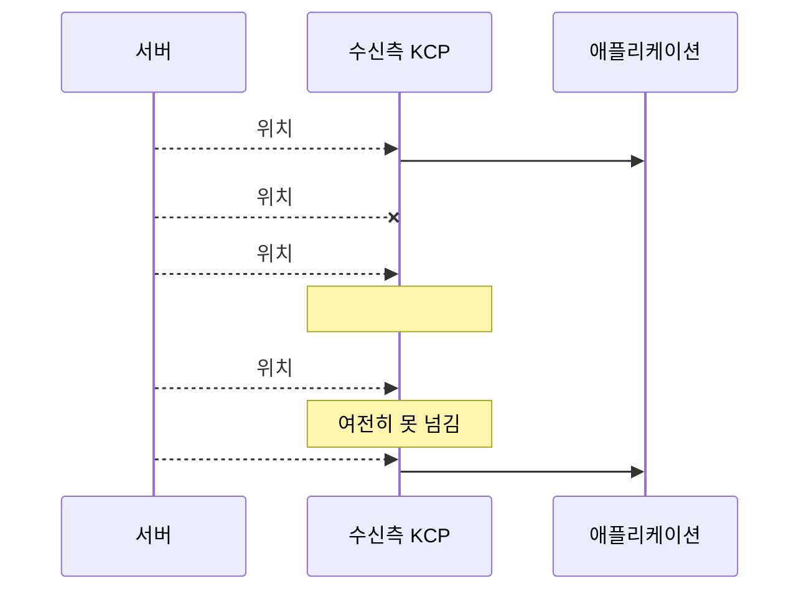

# 7장. 신뢰 채널과 비신뢰 채널

> **학습 목표**
> 1. 이동 스냅숏을 신뢰 채널로 보내면 왜 오히려 끊겨 보이는지 설명할 수 있습니다.
> 2. 데이터 종류별로 채널을 고르는 판단 기준표를 자기 게임에 적용할 수 있습니다.
> 3. 비신뢰 채널에서 "최신 것만 취하기"와 "중복 전송" 패턴을 구현할 수 있습니다.

이 장은 짧지만 **이 라이브러리를 쓰는 이유 그 자체**입니다.
KCP를 쓰면서 모든 것을 신뢰 채널로 보낸다면, TCP를 쓰는 것과 크게 다르지 않습니다.

## 신뢰성은 공짜가 아니다

신뢰·순서 보장은 이렇게 만들어집니다.

1. 각 세그먼트에 순서 번호(sn)를 붙인다
2. 받은 쪽이 ACK로 확인해 준다
3. 확인이 안 오면 **다시 보낸다**
4. 받는 쪽은 **빠진 번호가 채워질 때까지 뒤엣것을 넘겨주지 않는다**

4번이 문제입니다. 이것이 **head-of-line(HOL) 블로킹**입니다.



애플리케이션 입장에서 보면 **t=0 부터 t=250ms 까지 캐릭터가 멈춰 있다가 순간이동**합니다.
#102와 #103은 t=100, 150에 이미 도착해 있었는데 말입니다.

### 손해를 계산해 봅시다

20Hz 스냅숏, RTT 100ms, 손실 5% 환경에서

- 스냅숏 하나가 유실될 확률: 5%
- 재전송으로 복구되기까지: 최소 1 RTT = 100ms (실제로는 RTO 만큼 더)
- 그동안 **뒤에 도착한 2~3개의 최신 위치가 막혀 있음**

즉 **20번에 한 번꼴로 0.1~0.2초씩 캐릭터가 얼어붙습니다.** 게임으로서는 못 씁니다.

비신뢰 채널로 보내면 #101은 그냥 사라지고 #102가 오면 바로 씁니다.
**50ms 늦은 위치 하나를 잃는 대신 지연이 늘지 않습니다.**

## 판단 기준

이 질문 하나로 대부분 결정됩니다.

> **이 데이터를 놓쳤을 때, 다음 것이 곧 와서 덮어쓰는가?**

- **예** → 비신뢰 채널. 재전송은 낭비이자 지연입니다.
- **아니오** → 신뢰 채널. 놓치면 복구할 방법이 없습니다.

### 데이터 종류별 표

| 데이터 | 채널 | 근거 |
|---|---|---|
| 캐릭터 위치·회전 스냅숏 | **비신뢰** | 50ms 뒤 새 것이 온다 |
| 이동 입력(WASD) | **비신뢰** | 100ms 뒤 새 입력이 온다. 중요하면 중복 전송(아래) |
| 조준 방향 | **비신뢰** | 매 틱 갱신된다 |
| 발사 이벤트 | **신뢰** | 한 번뿐이다. 놓치면 총알이 사라진다 |
| 피격·사망·점수 | **신뢰** | 결과가 뒤집히면 안 된다 |
| 채팅 | **신뢰** | 놓치면 대화가 끊긴다 |
| 입장·퇴장 | **신뢰** | 놓치면 유령이 남는다 |
| 아이템 획득·상점 거래 | **신뢰** | 돈이 걸린 일이다 |
| 애니메이션 트리거(점프) | **경우에 따라** | 아래 참조 |
| 파티클·사운드 효과 | **비신뢰** | 놓쳐도 게임에 지장이 없다 |

### 애매한 것들

**애니메이션 트리거**가 대표적입니다. "점프했다"는 이벤트는 한 번뿐이라 신뢰 채널처럼 보입니다.
그런데 스냅숏에 "지금 점프 중"이라는 상태 비트를 넣으면 비신뢰로도 됩니다.

일반화하면 이렇습니다.

> **이벤트(한 번 일어남)는 신뢰, 상태(계속 유지됨)는 비신뢰.**
> 이벤트를 상태로 바꿀 수 있다면 비신뢰로 옮길 수 있습니다.

MoveSync 샘플은 방향(`dir`)을 스냅숏에 넣어 비신뢰로 보냅니다.
"방향키를 눌렀다"(이벤트)가 아니라 "지금 이 방향으로 가고 있다"(상태)이기 때문입니다.

## 코드에서는 메서드 하나 차이

```csharp
// 신뢰 — 재전송·순서 보장
session.Send(data);

// 비신뢰 — 한 번 보내고 잊는다
session.SendUnreliable(data);
```

내부적으로는 프레임 타입이 다릅니다.

```
0x04 KCP   [0x04][KCP 원본 패킷 ...]     ← 신뢰. KCP의 ARQ를 거친다
0x05 RAW   [0x05][conv u32][페이로드 ...] ← 비신뢰. 그냥 보낸다
```

RAW 프레임에 `conv` 가 들어가는 이유는 **세션 확인**입니다.
누군가 우연히(또는 일부러) 같은 주소·포트로 패킷을 보내도 conv가 다르면 버립니다.

### 비신뢰 채널의 크기 제한

```csharp
// src/KcpCSharpR1.Transport/KcpSession.cs
var overhead = Framing.RawHeaderSize + (cipher?.Overhead ?? 0);
if (data.Length + overhead > options.Mtu)
    return KcpSendResult.TooLarge;
```

비신뢰 채널은 **조각화하지 않습니다.** MTU(기본 1400)를 넘으면 `TooLarge` 입니다.
조각화하면 조각 하나만 잃어도 전체를 못 쓰는데, 그걸 복구하려면 결국 재전송이 필요하니까요.

스냅숏이 MTU를 넘으면 **나눠서 여러 패킷으로** 보내야 합니다(각각 독립적으로 쓸 수 있게).
16인 213바이트라면 걱정할 일이 없습니다(12장 계산 참조).

## 패턴 ① 최신 것만 취하기

비신뢰 채널은 순서를 보장하지 않습니다. 그래서 거의 항상 **순서 번호**가 필요합니다.

```csharp
// samples/04-MoveSync/Client/SnapshotBuffer.cs
public void Add(WorldSnapshot snapshot)
{
    ReceivedCount++;

    // 늦게 도착한 낡은 스냅숏은 버린다(비신뢰 채널의 정상 동작).
    if (snapshot.Tick <= LatestTick)
    {
        DiscardedCount++;
        return;
    }

    LatestTick = snapshot.Tick;
    snapshots.Add(snapshot);
}
```

서버 쪽도 마찬가지입니다.

```csharp
// samples/04-MoveSync/Server/WorldServer.cs
// 비신뢰 채널이라 순서가 뒤바뀔 수 있다. 낡은 입력은 버린다.
if (seq <= player.LastInputSeq) return;

player.LastInputSeq = seq;
player.Direction = (MoveDirection)(dir & 0x0F);
```

**"버린다"가 올바른 동작**이라는 점이 중요합니다. 낡은 위치를 적용하면 캐릭터가 뒤로 튑니다.

## 패턴 ② 중복 전송

입력은 스냅숏과 성격이 다릅니다. **놓치면 그 순간의 조작이 사라집니다** —
다음 입력이 덮어쓰는 것이 아니라, 그 틱에 아무 조작도 없었던 것이 됩니다.

재전송을 쓰면 지연이 늘어납니다. 대신 **같은 것을 미리 여러 번** 보냅니다.

```csharp
// samples/05-TankBattle/Client/TankBattleGame.cs
// ★ 최근 입력 3개를 한 패킷에 실어 보낸다.
// 비신뢰 채널이라 하나쯤 유실돼도 다음 패킷에 다시 들어 있어 서버가 놓치지 않는다.
recentInputs.Add(input);
while (recentInputs.Count > GameLimits.InputRedundancy) recentInputs.RemoveAt(0);

var writer = new MessageWriter(sendBuffer, MessageType.InputBatch);
writer.WriteByte((byte)recentInputs.Count);
foreach (var item in recentInputs)
{
    writer.WriteUInt32(item.Sequence);
    ...
}
```

| 방식 | 손실 복구 시간 | 대역폭 |
|---|---|---|
| 재전송(신뢰 채널) | **1 RTT 이상** | 낮음(잃은 것만) |
| 중복 전송 | **0** (이미 와 있음) | 높음(3배) |

입력 하나가 11바이트라 3개를 실어도 33바이트입니다. 30Hz면 초당 1kB — 싼 보험입니다.

**연속 2패킷이 유실돼도 서버는 입력을 놓치지 않습니다.** 3개를 싣기 때문입니다.

## 실험: 직접 비교해 보기

부하 도구로 두 채널을 같은 조건에서 비교할 수 있습니다.

```bash
# 신뢰 채널
dotnet run -c Release --project samples/tools/LoadTest -- \
  client --sessions 200 --duration 30 --csv channel.csv

# 비신뢰 채널
dotnet run -c Release --project samples/tools/LoadTest -- \
  client --sessions 200 --duration 30 --unreliable --csv channel.csv
```

손실을 걸고 비교하면 차이가 분명해집니다.

```bash
sudo tc qdisc add dev lo root netem loss 10% delay 50ms
```

- **신뢰 채널**: 에코 손실 0%, 하지만 RTT p99가 크게 튄다(재전송 대기)
- **비신뢰 채널**: 에코 손실이 손실률만큼 나타나지만, RTT p99가 안정적이다

**"손실 0%"와 "지연 안정" 중 무엇이 게임에 중요한가**가 채널 선택의 본질입니다.

## MoveSync 로 눈으로 보기

12장의 샘플에서 스냅숏 전송을 신뢰 채널로 바꿔 보세요.

```csharp
// samples/04-MoveSync/Server/WorldServer.cs 의 한 줄만 바꿉니다
foreach (var player in joined)
    player.Session.Send(packet);          // SendUnreliable → Send
```

손실 10%를 걸고 실행하면 다른 플레이어의 캐릭터가 **주기적으로 멈췄다가 순간이동**합니다.
비신뢰로 되돌리면 부드럽게 움직입니다. 코드 한 줄 차이입니다.

## 요약

- 신뢰·순서 보장의 대가는 **HOL 블로킹**입니다. 최신 데이터가 도착해도 못 씁니다.
- 판단 기준: **"놓쳐도 다음 것이 곧 덮어쓰는가?"** — 예면 비신뢰, 아니오면 신뢰.
- **이벤트는 신뢰, 상태는 비신뢰.** 이벤트를 상태로 바꾸면 비신뢰로 옮길 수 있습니다.
- 비신뢰 채널에는 **순서 번호**를 붙이고 낡은 것은 버립니다.
- 중요한 비신뢰 데이터(입력)는 **중복 전송**으로 손실을 이깁니다 — 지연이 늘지 않습니다.

## 연습문제

1. **채널 바꿔 보기** — MoveSync의 스냅숏을 신뢰 채널로 바꾸고 손실 10%를 걸어 보세요.
   `SendUnreliable` 로 되돌렸을 때와 화면을 비교해 영상이나 메모로 남겨 보세요.
2. **내 게임 분류하기** — 만들고 있는(또는 만들고 싶은) 게임의 데이터를 10가지 적고,
   위 기준표에 따라 채널을 배정해 보세요. 애매한 것은 왜 애매한가요?
3. **중복 개수 정하기** — 손실률 p, 중복 개수 n일 때 입력을 놓칠 확률은 대략 pⁿ 입니다.
   손실 10%에서 "1시간에 한 번 이하로 놓치기"를 목표로 하면 n은 얼마여야 하나요?
   (30Hz 기준, 1시간 = 108,000개 입력)

---

다음 장에서는 지금까지 기본값으로 써 온 KCP 파라미터를 **직접 고르는 법**을 배웁니다.
