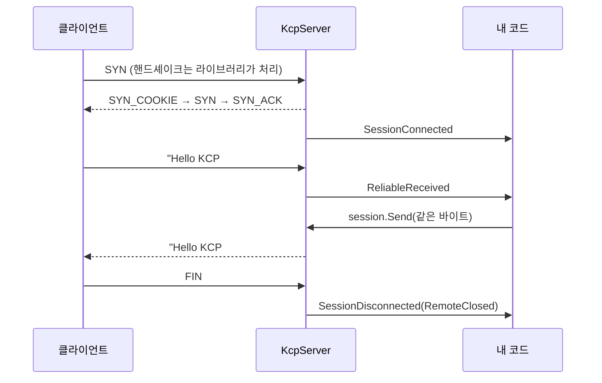

# 9장. 프로젝트 ① 에코 — 첫 왕복

> **학습 목표**
> 1. 60줄짜리 에코 서버와 클라이언트를 처음부터 끝까지 읽고 설명할 수 있습니다.
> 2. "보낸 것이 그대로 돌아온다"를 검증하는 습관이 왜 중요한지 이해합니다.
> 3. 정상 종료(FIN)와 비정상 종료(타임아웃)의 차이를 직접 관찰할 수 있습니다.

**대응 샘플**: `samples/01-Echo` (★1, UDP 27001)

## 이 프로젝트가 하는 일

- 서버: 받은 바이트를 그대로 돌려주고, 접속·종료를 로그로 남깁니다.
- 클라이언트: 1초마다 카운터 메시지를 보내고, 돌아온 값이 보낸 값과 같은지 **검증**합니다.

작아 보이지만 연결·송신·수신·종료를 전부 지나갑니다. 무언가 안 될 때 돌아올 기준점이 됩니다.

## 서버 워크스루



### 전체 코드

```csharp
// samples/01-Echo/Server/Program.cs
internal static class Program
{
    /// <summary>로드맵 12.4절 포트 배정표: 샘플 ① Echo = 27001.</summary>
    private const int Port = 27001;

    private static void Main()
    {
        using var server = new KcpServer(Port);

        // ① 누가 들어왔는지
        server.SessionConnected += session =>
            Log($"접속 {session.RemoteEndPoint} (conv={session.Conv}, 현재 {server.SessionCount}명)");

        // ② 받은 것을 그대로 돌려준다
        server.ReliableReceived += (session, data) =>
        {
            var text = Encoding.UTF8.GetString(data.Span);
            Log($"수신 [{session.Conv}] {text}");

            var result = session.Send(data.Span);
            if (result != KcpSendResult.Ok)
                Log($"에코 실패 [{session.Conv}] {result}");
        };

        // ③ 왜 나갔는지 (정상 종료 / 타임아웃 / 데드링크)
        server.SessionDisconnected += (session, reason) =>
            Log($"종료 {session.RemoteEndPoint} ({reason})");

        server.Error += ex => Log($"오류 {ex.Message}");

        server.Start();
        Log($"UDP {Port} 에서 대기 중입니다. Ctrl+C 로 종료합니다.");

        // Ctrl+C 를 눌러도 서버를 깔끔히 닫는다.
        using var quit = new ManualResetEventSlim(false);
        Console.CancelKeyPress += (_, e) =>
        {
            e.Cancel = true;
            quit.Set();
        };

        quit.Wait();
        Log("종료합니다.");
        server.Stop();
    }
}
```

### 눈여겨볼 점

**`data` 의 수명.** `ReliableReceived` 로 넘어오는 `ReadOnlyMemory<byte>` 는
**콜백이 끝나면 무효**입니다. 라이브러리가 풀에서 빌려 온 버퍼를 되돌려 주기 때문입니다.
에코는 콜백 안에서 바로 `Send` 하므로 안전하지만, 나중에 쓰려면 반드시 복사해야 합니다.

```csharp
// 위험 — 콜백이 끝나면 내용이 바뀔 수 있습니다
_pending.Add(data);

// 안전
_pending.Add(data.ToArray());
```

**`Send` 의 반환값.** 무시하지 마세요. 송신 큐가 상한(`MaxSendBacklog`, 기본 1024)을 넘으면
`Backpressure` 가 돌아오고 **그 메시지는 버려집니다**. 이 저장소의 부하 측정 도구가 초기에
이 값을 무시해서 "재전송은 0인데 데이터가 안 온다"는 결과를 만들었습니다(17장에서 다시 다룹니다).

**`Ctrl+C` 처리.** `e.Cancel = true` 로 기본 종료를 막고 `server.Stop()` 을 부릅니다.
그래야 세션들이 정리되고, 상대는 FIN 대신 타임아웃으로 알게 됩니다.

## 클라이언트 워크스루

핵심은 **검증 루프**입니다.

```csharp
// samples/01-Echo/Client/Program.cs
client.ReliableReceived += (session, data) =>
{
    var text = Encoding.UTF8.GetString(data.Span);
    if (text == expected)
    {
        echoed++;
        Log($"에코 확인 [{echoed}/{sent}] {text} (핑 {session.PingMs}ms, RTT {session.SrttMs}ms)");
    }
    else
    {
        mismatched++;
        LogError($"에코 불일치! 보낸 것: {expected} / 받은 것: {text}");
    }
};
```

그리고 게임 루프를 흉내 낸 폴링:

```csharp
// samples/01-Echo/Client/Program.cs
while (!quit.IsCancellationRequested && session.State == KcpSessionState.Connected)
{
    if (DateTime.UtcNow >= nextSendAt)
    {
        nextSendAt = DateTime.UtcNow.AddSeconds(1);

        expected = $"Hello KCP #{++sent}";
        var result = session.Send(Encoding.UTF8.GetBytes(expected));
        if (result != KcpSendResult.Ok)
            LogError($"송신 실패: {result}");
    }

    // 게임 루프의 한 프레임에 해당한다.
    client.Update();
    await Task.Delay(10, CancellationToken.None);
}
```

### 왜 "그대로 돌아왔는지" 확인하나

에코는 값을 비교하기가 쉽습니다. 그리고 **비교하는 습관**이 중요합니다.
네트워크 코드의 버그는 대개 "안 온다"가 아니라 **"조금 다르게 온다"** 로 나타납니다.

- 조각화(fragmentation) 경계에서 1바이트가 밀린다
- 버퍼를 재사용하다 이전 내용이 섞인다
- 순서가 바뀐 것을 눈치채지 못한다

이런 것들은 "동작은 하는 것처럼" 보이기 때문에 **검증하지 않으면 몇 주 뒤에 발견**됩니다.
그래서 이 저장소의 부하 도구도, 시뮬레이션 테스트도 전부 바이트 비교를 합니다.

## 종료를 관찰하기

UDP에는 "연결이 끊겼다"는 개념이 없습니다. 상대가 사라졌는지 아는 방법은
**우리가 정한 규칙**뿐입니다. 이 라이브러리는 두 가지를 씁니다.

| 방법 | 로그 | 걸리는 시간 |
|---|---|---|
| **FIN** — 정상 종료를 알림 | `종료 ... (RemoteClosed)` | 즉시 |
| **타임아웃** — 일정 시간 아무것도 못 받음 | `종료 ... (Timeout)` | 기본 10초 |

직접 확인해 보세요.

1. 클라이언트에서 **Ctrl+C** → 서버에 즉시 `(RemoteClosed)`.
2. 클라이언트 **창을 그냥 닫기**(크래시 흉내) → 서버에 10초 뒤 `(Timeout)`.

2번이 바로 "전원이 나간 사용자"입니다. 게임 서버라면 그동안 그 플레이어의 캐릭터를
어떻게 할지 정해야 합니다 — 오목 샘플(11장)에서는 30초 동안 자리를 지켜 줍니다.

## 요약

- `KcpServer` 는 이벤트 세 개면 완성됩니다. 나머지는 라이브러리가 합니다.
- 수신 콜백의 메모리는 **콜백이 끝나면 무효**입니다. 보관하려면 복사하세요.
- `Send` 의 반환값을 확인하세요. 백프레셔는 조용히 버립니다.
- 네트워크 버그는 "안 온다"보다 "조금 다르게 온다"가 많습니다. **항상 비교하세요.**
- 정상 종료(FIN, 즉시)와 비정상 종료(타임아웃, 10초)는 다른 사건입니다.

## 연습문제

1. **나만의 ping 도구** — 메시지에 송신 시각(8바이트)을 넣고, 돌아왔을 때 왕복 시간을 계산해
   최소/평균/최대를 출력하세요. `session.SrttMs` 와 비교하면 왜 값이 다를까요?
2. **의도적으로 깨뜨리기** — 서버에서 `session.Send(data.Span)` 대신
   `session.Send(data.Span[..^1])`(마지막 1바이트를 뺌)로 바꿔 보세요.
   클라이언트가 몇 번째 메시지에서 불일치를 잡아내나요?
3. **동시 접속** — 클라이언트를 5개 띄우고 서버의 `SessionCount` 로그를 확인하세요.
   한 클라이언트만 Ctrl+C 로 끄면 다른 세션에는 영향이 없는지 보세요.

---

다음 장에서는 "바이트를 그대로 되돌려주는" 수준을 넘어, **의미 있는 메시지**를 주고받기 위한
애플리케이션 프로토콜을 직접 설계합니다.
