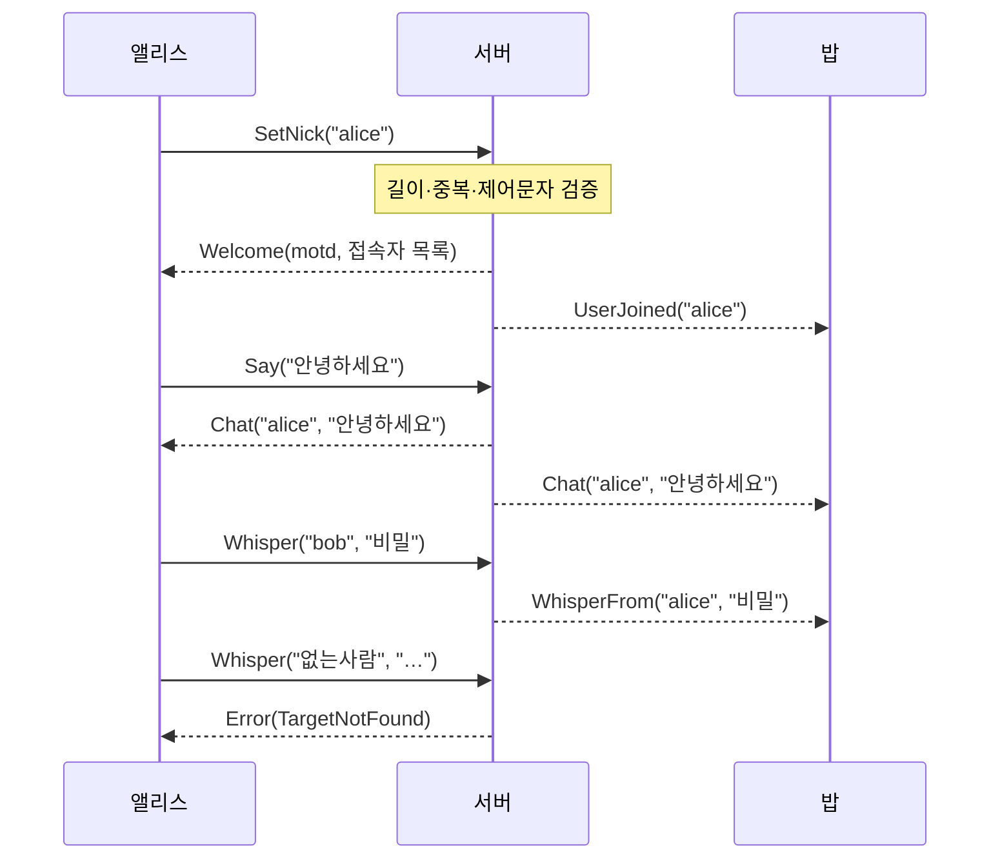

# 10장. 프로젝트 ② 채팅 — 애플리케이션 프로토콜 설계

> **학습 목표**
> 1. 길이 접두사 + 타입 프레이밍을 직렬화 라이브러리 없이 직접 만들 수 있습니다.
> 2. 네트워크에서 온 바이트를 "거짓말일 수 있다"는 전제로 읽는 코드를 쓸 수 있습니다.
> 3. 서버 측 입력 검증이 왜 클라이언트 검증과 별개로 필요한지 설명할 수 있습니다.

**대응 샘플**: `samples/02-Chat` (★2, UDP 27002)

## 왜 직렬화 라이브러리를 쓰지 않나

MessagePack이나 Protobuf를 쓰면 5분이면 끝날 일입니다. 그런데도 손으로 만드는 이유는

- **바이트가 어떻게 놓이는지 한 번은 봐야** 패킷 덤프를 읽을 수 있고,
- 대역폭을 계산할 수 있고(12장에서 실제로 합니다),
- 라이브러리가 숨기는 비용(리플렉션, 스키마 헤더)을 알게 되기 때문입니다.

실무에서는 물론 검증된 라이브러리를 쓰세요. 다만 **무엇을 대신해 주는지 알고** 쓰는 편이 낫습니다.

## 한눈에 보는 흐름



## 프레임 설계

```
[u16 length][u8 type][payload...]
```

- `length` 는 **자기 자신을 뺀** 뒤쪽 전체 길이(타입 1바이트 + 페이로드)입니다.
- 문자열은 `[u16 바이트수][UTF-8]` 입니다.
- 모든 정수는 리틀엔디언입니다.

### 길이 접두사가 정말 필요한가?

솔직히 말하면 **여기서는 없어도 됩니다.** KCP를 메시지 모드로 쓰면 보낸 단위 그대로 도착하므로
경계가 이미 보존됩니다. 그래도 넣은 이유는 두 가지입니다.

1. **스트림 모드로 바꾸거나 TCP로 옮겨도 코드가 그대로 삽니다.**
2. 나중에 한 패킷에 여러 메시지를 묶는 최적화를 넣을 수 있습니다.

실무 프로토콜은 대부분 이 형태라 습관을 들여 두는 편이 낫습니다.
"필요 없는데 왜 넣었지?"라고 스스로 물어보고 답할 수 있으면 충분합니다.

### 타입 번호로 방향을 나눈다

```csharp
// samples/02-Chat/Shared/Protocol.cs
public enum MessageType : byte
{
    SetNick = 0x01,      // C→S
    Say = 0x02,          // C→S
    Whisper = 0x03,      // C→S

    Welcome = 0x81,      // S→C
    UserJoined = 0x82,   // S→C
    UserLeft = 0x83,     // S→C
    Chat = 0x84,         // S→C
    WhisperFrom = 0x85,  // S→C
    Error = 0x8F,        // S→C
}
```

최상위 비트로 방향을 구분했습니다(`0x00~0x7F` 클라→서버, `0x80~0xFF` 서버→클라).
**패킷 덤프의 세 번째 바이트만 봐도 방향을 알 수 있습니다.** 사소하지만 디버깅이 훨씬 편해집니다.

## 쓰는 쪽

```csharp
// samples/02-Chat/Shared/MessageCodec.cs
public ref struct MessageWriter
{
    private readonly Span<byte> buffer;
    private int position;

    public MessageWriter(Span<byte> destination, MessageType type)
    {
        buffer = destination;
        position = sizeof(ushort);       // 길이 자리를 비워 두고 시작한다.
        buffer[position++] = (byte)type;
    }

    public void WriteString(string? value)
    {
        value ??= string.Empty;

        var byteCount = Encoding.UTF8.GetByteCount(value);
        if (byteCount > ushort.MaxValue)
            throw new ArgumentException("문자열이 너무 깁니다.", nameof(value));

        WriteUInt16((ushort)byteCount);
        Encoding.UTF8.GetBytes(value, buffer.Slice(position));
        position += byteCount;
    }

    public ReadOnlySpan<byte> Finish()
    {
        BinaryPrimitives.WriteUInt16LittleEndian(buffer, (ushort)(position - sizeof(ushort)));
        return buffer.Slice(0, position);
    }
}
```

**길이를 나중에 채우는 것**이 요령입니다. 앞의 2바이트를 비워 두고 쓴 다음,
`Finish()` 에서 실제 길이를 되돌아가 적습니다. 미리 크기를 계산하지 않아도 됩니다.

`ref struct` 로 만든 이유는 `Span<byte>` 를 필드로 갖기 위해서입니다.
덕분에 **힙 할당 없이** 스택 버퍼나 재사용 버퍼 위에서 직접 씁니다.

## 읽는 쪽 — 여기가 진짜 중요합니다

```csharp
// samples/02-Chat/Shared/MessageCodec.cs
public static bool TryParse(ReadOnlySpan<byte> packet, out MessageReader reader)
{
    reader = default;

    if (packet.Length < sizeof(ushort) + 1) return false;

    var length = BinaryPrimitives.ReadUInt16LittleEndian(packet);
    if (length < 1 || sizeof(ushort) + length > packet.Length) return false;

    var type = (MessageType)packet[sizeof(ushort)];
    var payload = packet.Slice(sizeof(ushort) + 1, length - 1);

    reader = new MessageReader(payload, type);
    return true;
}

public bool TryReadString(out string value, int maxBytes = ChatLimits.MaxMessageBytes)
{
    value = string.Empty;
    if (!TryReadUInt16(out var byteCount)) return false;

    if (byteCount > maxBytes || Remaining < byteCount)
    {
        IsValid = false;
        return false;
    }

    value = Encoding.UTF8.GetString(buffer.Slice(position, byteCount));
    position += byteCount;
    return true;
}
```

### 세 가지 원칙

**① 모든 읽기는 `Try` 형태입니다.**
네트워크에서 온 바이트에 예외를 던지면, 공격자가 예외 비용으로 서버를 괴롭힐 수 있습니다.
false 를 돌려주고 호출자가 판단하게 합니다.

**② 한 번 깨지면 계속 실패합니다.**
`IsValid` 플래그를 둬서, 중간에 실패한 뒤의 읽기는 전부 false 입니다.
그래야 호출부가 매번 검사하지 않고 마지막에 한 번만 확인해도 됩니다.

```csharp
if (!reader.TryReadString(out var target) || !reader.TryReadString(out var text))
{
    SendError(session, ChatError.MalformedPacket, "귓속말을 읽을 수 없습니다.");
    return;
}
```

**③ 길이에 상한을 둡니다.**
`[u16 길이]` 는 최대 65,535를 담을 수 있습니다. 그 값을 그대로 믿고 배열을 잡으면
작은 패킷 하나로 큰 메모리를 잡게 만들 수 있습니다. `maxBytes` 로 잘라 냅니다.

### 무작위 바이트를 흘려 보내기

이 규칙들이 지켜지는지는 테스트로 못 박습니다.

```csharp
// samples/02-Chat/Tests/MessageCodecTests.cs
[Fact]
public void 무작위_쓰레기에_예외가_나지_않는다()
{
    var rng = new Random(20260825);
    var junk = new byte[64];

    for (var i = 0; i < 1000; i++)
    {
        rng.NextBytes(junk);
        var length = rng.Next(0, junk.Length);

        if (MessageReader.TryParse(junk.AsSpan(0, length), out var reader))
        {
            // 해석에 성공했더라도 뒤의 읽기는 실패할 수 있을 뿐, 예외는 없어야 한다.
            reader.TryReadByte(out _);
            reader.TryReadUInt16(out _);
            reader.TryReadString(out _);
        }
    }
}
```

퍼징(fuzzing)의 아주 단순한 형태입니다. 시드를 고정했으니 실패하면 재현도 됩니다.

## 서버는 클라이언트를 믿지 않는다

이 책에서 처음으로 **보안 관점**이 등장하는 곳입니다.

```csharp
// samples/02-Chat/Server/ChatServer.cs
private void HandleSetNick(KcpSession session, ref MessageReader reader)
{
    if (!reader.TryReadString(out var nick))
    {
        SendError(session, ChatError.MalformedPacket, "닉네임을 읽을 수 없습니다.");
        return;
    }

    nick = nick.Trim();

    // 서버 측 검증 — 클라이언트가 이미 검사했더라도 다시 한다.
    if (nick.Length == 0 || nick.Length > ChatLimits.MaxNickLength || nick.Any(char.IsControl))
    {
        SendError(session, ChatError.NickInvalid,
            $"닉네임은 1~{ChatLimits.MaxNickLength}자여야 하고 제어문자를 넣을 수 없습니다.");
        return;
    }

    if (byNickname.ContainsKey(nick))
    {
        SendError(session, ChatError.NickTaken, $"'{nick}' 은(는) 이미 사용 중입니다.");
        return;
    }
    ...
}
```

**클라이언트의 검증은 사용자 경험을 위한 것이고, 서버의 검증은 시스템을 위한 것입니다.**
클라이언트는 언제든 조작될 수 있습니다 — 우리가 만든 클라이언트를 쓴다는 보장이 없습니다.

무엇을 검사했나 봅시다.

| 검사 | 막는 것 |
|---|---|
| 빈 문자열 | 화면이 깨지는 유령 사용자 |
| 길이 상한(16자) | UI를 밀어내는 긴 닉네임 |
| 제어문자(`\n`, `\r`, ANSI 이스케이프) | 로그·콘솔 위조 |
| 중복 | 다른 사람인 척하기 |
| **순서**(닉 없이 발언) | 상태 머신 우회 |

마지막 항목이 특히 중요합니다. 프로토콜은 "어떤 메시지가 오는가"만이 아니라
**"어떤 순서로 와야 하는가"** 도 규정합니다. 서버는 그 순서를 강제해야 합니다.

## 콘솔 입력과 폴링 루프를 잇기

`Console.ReadLine()` 은 블로킹이라 폴링 루프를 멈춰 버립니다.
입력 전용 스레드를 두고 큐로 넘깁니다.

```csharp
// samples/02-Chat/Client/Program.cs
private static void StartInputThread(CancellationToken token)
{
    var thread = new Thread(() =>
    {
        while (!token.IsCancellationRequested)
        {
            var line = Console.ReadLine();
            if (line == null) break;
            InputQueue.Enqueue(line.Trim());
        }
    })
    {
        IsBackground = true,
        Name = "console-input",
    };
    thread.Start();
}
```

```csharp
while (!quit.IsCancellationRequested && session.State == KcpSessionState.Connected)
{
    while (InputQueue.TryDequeue(out var line))
    {
        if (!HandleCommand(session, line)) { quit.Cancel(); break; }
    }

    client.Update();
    await Task.Delay(10, CancellationToken.None);
}
```

**게임에서 UI 스레드와 네트워크 스레드를 잇는 방식과 같습니다.**
느린 쪽(사용자 입력)이 빠른 쪽(네트워크 폴링)을 막지 않게 큐로 분리합니다.

## 실행해 보기

```bash
dotnet run --project samples/02-Chat/Server
dotnet run --project samples/02-Chat/Client -- 127.0.0.1 헝배
dotnet run --project samples/02-Chat/Client -- 127.0.0.1 철수
```

```
* KcpCSharpR1 채팅 샘플에 오신 것을 환영합니다. /help 로 명령을 볼 수 있습니다.
* 접속자 1명: alice
alice: 안녕하세요
* 오류[TargetNotFound] 'bob' 은(는) 접속해 있지 않습니다.
```

## 요약

- 프레이밍은 `[길이][타입][페이로드]` 가 기본형입니다. 길이는 나중에 채우면 편합니다.
- 타입 번호의 최상위 비트로 방향을 나누면 덤프 읽기가 쉬워집니다.
- 읽기는 전부 `Try` 형태로, 한 번 깨지면 계속 실패하게, 길이에는 상한을 둡니다.
- **클라이언트 검증은 UX, 서버 검증은 보안**입니다. 둘 다 해야 합니다.
- 순서(상태 머신)도 프로토콜의 일부입니다. 서버가 강제해야 합니다.

## 연습문제

1. **방(room) 추가** — `JoinRoom(roomName)` 메시지를 만들고, 발언이 같은 방 사람에게만
   가도록 고쳐 보세요. 방 목록을 요청하는 메시지도 추가해 보세요.
2. **재접속 시 닉 유지** — 지금은 끊기면 닉이 사라집니다. 서버가 토큰을 발급해
   30초 안에 돌아오면 같은 닉을 되찾게 해 보세요(11장의 재접속과 같은 구조입니다).
3. **한 패킷에 여러 메시지** — 프레이밍에 길이가 있으니 가능합니다.
   `while (남은 바이트 >= 3) { 한 메시지 파싱 }` 로 바꾸고, 서버가 브로드캐스트를
   묶어 보내도록 고쳐 보세요. 패킷 수가 얼마나 줄어드나요?

---

다음 장부터는 **게임**입니다. 서버가 상태를 소유하고 클라이언트는 요청만 하는
권위 서버 구조를 오목으로 배웁니다.
