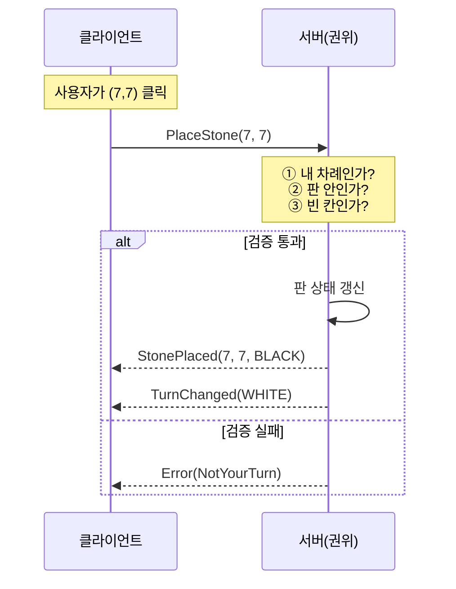
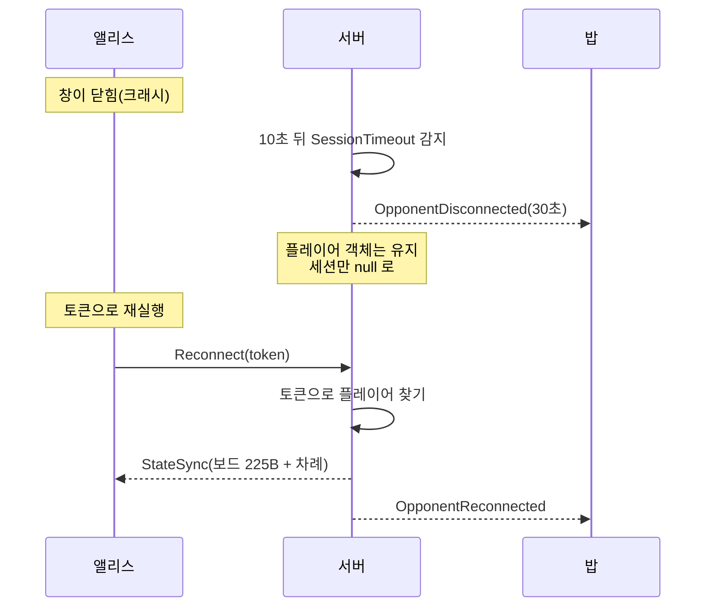

# 11장. 프로젝트 ③ 오목 — 권위 서버와 턴제 게임

> **학습 목표**
> 1. 권위 서버(authoritative server) 구조를 설명하고 직접 구현할 수 있습니다.
> 2. 끊긴 플레이어를 30초간 기다렸다가 상태를 통째로 재동기화하는 재접속을 만들 수 있습니다.
> 3. MonoGame의 `Game.Update()` 에 네트워크 폴링을 붙여 게임 클라이언트를 만들 수 있습니다.

**대응 샘플**: `samples/03-Gomoku` (★3, UDP 27003, MonoGame 클라이언트)

## 권위 서버란

한 문장으로: **게임 상태는 서버만 소유하고, 클라이언트는 요청과 렌더링만 합니다.**



클라이언트가 "돌을 놓았다"고 말하는 것이 아니라 **"놓고 싶다"고 요청**합니다.
화면에 돌이 나타나는 것은 서버가 `StonePlaced` 를 보낸 뒤입니다.

### 왜 이렇게 하나

클라이언트를 조작하는 것은 어렵지 않습니다. 메모리를 고치거나, 프로토콜을 분석해
직접 패킷을 만들면 됩니다. **클라이언트가 계산한 결과를 서버가 그대로 믿으면 게임이 무너집니다.**

턴제 게임에서는 이 구조의 비용이 거의 없습니다. 클릭 한 번에 왕복 한 번이면 충분하고,
사람의 반응 시간(200ms+)에 비하면 RTT 30~100ms는 눈에 띄지 않습니다.

> 실시간 액션은 이야기가 다릅니다. 왕복을 기다리면 조작이 둔해집니다.
> 그 문제를 푸는 것이 13장의 **클라이언트 예측**입니다.

## 규칙을 공유한다

```csharp
// samples/03-Gomoku/Shared/GomokuBoard.cs
public PlaceResult Place(int x, int y, StoneColor color)
{
    if (IsFinished) return PlaceResult.GameOver;
    if (!InBounds(x, y)) return PlaceResult.OutOfBounds;
    if (color != Turn) return PlaceResult.NotYourTurn;
    if (cells[y * Size + x] != StoneColor.None) return PlaceResult.Occupied;

    cells[y * Size + x] = color;
    StoneCount++;

    if (IsWinningMove(x, y, color))
    {
        Winner = color;
        IsFinished = true;
    }
    ...
}
```

이 클래스는 `Shared` 에 있고 **서버와 클라이언트가 함께 씁니다.**
같은 코드로 판정하니 "내 화면에서는 이겼는데 서버는 아니라더라" 같은 어긋남이 생기지 않습니다.

다만 **권위는 서버에 있습니다.** 클라이언트의 판정은 화면을 미리 갱신하기 위한 것일 뿐,
최종 결과는 언제나 서버가 보낸 것을 따릅니다. 클라이언트에서도 한 번 걸러 주면
명백히 잘못된 클릭(상대 차례, 이미 놓인 자리)으로 서버를 괴롭히지 않아도 됩니다.

### 승리 판정 — 육목은 무효

```csharp
// samples/03-Gomoku/Shared/GomokuBoard.cs
public bool IsWinningMove(int x, int y, StoneColor color)
{
    // 가로, 세로, ↘, ↗ 네 방향
    return CountLine(x, y, 1, 0, color) == 5
        || CountLine(x, y, 0, 1, color) == 5
        || CountLine(x, y, 1, 1, color) == 5
        || CountLine(x, y, 1, -1, color) == 5;
}
```

`== 5` 이지 `>= 5` 가 아닌 점에 주의하세요. 6개 이상 이어지면 승리가 아닙니다(육목 무효).
이런 규칙은 **테스트로 못 박아 두어야** 나중에 누가 `>=` 로 "고치는" 일을 막을 수 있습니다.

```csharp
// samples/03-Gomoku/Tests/GomokuBoardTests.cs
[Fact]
public void 육목은_승리가_아니다()
{
    // 흑이 3,5,6,7,8 을 먼저 채우고(4목), 마지막에 4를 메워 6목을 만든다.
    ...
    Assert.Equal(PlaceResult.Ok, board.Place(4, 5, StoneColor.Black));
    Assert.False(board.IsFinished);
    Assert.Equal(StoneColor.None, board.Winner);
}
```

> **테스트를 쓰다 겪은 함정**: 처음에는 상대 차례를 흘려보내려고 더미 수를
> (14,14), (13,13), (12,12)… 대각선으로 뒀습니다. 그랬더니 **더미가 5목을 완성해서**
> 백이 이겨 버렸습니다. 판정 테스트에서 더미 수는 절대 승부에 관여하면 안 됩니다.
> 지금은 두 칸씩 떨어뜨린 자리를 씁니다.

## 재접속 — "UDP에는 끊김이 없다"

게임 중에 클라이언트가 죽으면 어떻게 될까요? 오목이라면 30초쯤 기다려 주는 것이 인간적입니다.



### 토큰은 매칭 때 발급합니다

```csharp
// samples/03-Gomoku/Server/GameRoom.cs
private void SendMatchFound(Player player, string opponentNick)
{
    var writer = new MessageWriter(sendBuffer, MessageType.MatchFound);
    writer.WriteUInt32(Id);
    writer.WriteByte((byte)player.Color);
    writer.WriteString(opponentNick);
    writer.WriteString(player.Token);      // ← 재접속 토큰
    player.Session.Send(writer.Finish());
}
```

토큰은 서버가 만든 난수 12바이트의 16진 문자열입니다.
**추측할 수 없어야** 남의 자리에 끼어들 수 없습니다.

```csharp
// samples/03-Gomoku/Server/GameServer.cs
private static string NewToken()
{
    Span<byte> bytes = stackalloc byte[12];
    RandomNumberGenerator.Fill(bytes);
    return Convert.ToHexString(bytes);
}
```

`Random` 이 아니라 `RandomNumberGenerator` 입니다. 예측 가능한 난수는 토큰이 아닙니다.

### 세션이 끊겨도 플레이어는 남습니다

```csharp
// samples/03-Gomoku/Server/GameRoom.cs
public void OnPlayerDisconnected(Player player, long nowSeconds)
{
    player.Session = null;                      // 연결만 끊는다
    player.DisconnectedAtSeconds = nowSeconds;  // 플레이어 객체는 유지

    var opponent = Opponent(player);
    if (opponent.Session == null) return;

    var writer = new MessageWriter(sendBuffer, MessageType.OpponentDisconnected);
    writer.WriteByte(ProtocolLimits.ReconnectGraceSeconds);
    opponent.Session.Send(writer.Finish());
}
```

**연결(session)과 플레이어(player)를 분리한 것**이 핵심입니다.
연결은 사라졌지만 플레이어는 방에 남아 있습니다.

30초가 지나면 정리합니다.

```csharp
// samples/03-Gomoku/Server/GameServer.cs
private static void CheckGrace(GameRoom room, Player player, long nowSeconds)
{
    if (player.IsOnline || player.DisconnectedAtSeconds == 0) return;
    if (nowSeconds - player.DisconnectedAtSeconds < ProtocolLimits.ReconnectGraceSeconds) return;

    player.DisconnectedAtSeconds = 0;
    room.OpponentGaveUp(player);
}
```

### 돌아오면 상태를 통째로 보냅니다

```csharp
// samples/03-Gomoku/Server/GameRoom.cs
private void WriteBoardState(ref MessageWriter writer, StoneColor myColor)
{
    board.WriteTo(boardScratch);

    writer.WriteBytes(boardScratch);          // 15×15 = 225바이트
    writer.WriteByte((byte)board.Turn);
    writer.WriteByte((byte)myColor);
    writer.WriteByte(board.IsFinished ? (byte)1 : (byte)0);
    writer.WriteByte((byte)board.Winner);
}
```

증분(diff)이 아니라 **전체 스냅숏**입니다. 225바이트면 작으니까요.
재접속·관전처럼 "처음부터 다시 맞춰야 하는" 순간에는 전체 스냅숏이 훨씬 단순하고 안전합니다.
증분을 쓰면 "어디서부터 보내야 하지?"를 관리해야 하고, 그 경계에서 버그가 납니다.

> 상태가 커서 통째로 못 보내는 게임(MMO의 월드)이라면 관심 영역(AOI)으로 잘라 보냅니다.
> 그래도 "그 영역 안에서는 전체 스냅숏"인 경우가 많습니다.

## MonoGame 클라이언트

### 네트워크를 게임 루프에 붙이기

```csharp
// samples/03-Gomoku/Client/GomokuGame.cs
protected override void Update(GameTime gameTime)
{
    // ★ 이 한 줄이 MonoGame 과 KCP 를 잇는 전부다.
    network.Poll();

    var keyboard = Keyboard.GetState();
    ...
    var mouse = Mouse.GetState();
    hover = ToBoardCoordinate(mouse.X, mouse.Y);

    if (mouse.LeftButton == ButtonState.Pressed && previousMouse.LeftButton == ButtonState.Released)
    {
        if (hover.X >= 0) network.RequestPlace(hover.X, hover.Y);
    }
    previousMouse = mouse;

    base.Update(gameTime);
}
```

`network.Poll()` 안에서 `KcpClient.Update()` 를 부릅니다.
**수신 콜백이 게임 스레드에서 발화**하므로 렌더링 상태를 lock 없이 직접 고쳐도 안전합니다.

서버는 반대로 전용 수신 스레드를 씁니다. 같은 라이브러리인데 모델이 다른 이유는
클라이언트는 이미 게임 루프가 있고, 서버는 없기 때문입니다(6장에서 자세히).

### 마우스 좌표 → 보드 칸

```csharp
// samples/03-Gomoku/Client/GomokuGame.cs
private static (int X, int Y) ToBoardCoordinate(int screenX, int screenY)
{
    var x = (int)MathF.Round((screenX - Margin) / (float)CellSize);
    var y = (int)MathF.Round((screenY - Margin) / (float)CellSize);

    if (!GomokuBoard.InBounds(x, y)) return (-1, -1);

    // 교점에서 너무 멀면 무시한다.
    var dx = MathF.Abs(screenX - (Margin + x * CellSize));
    var dy = MathF.Abs(screenY - (Margin + y * CellSize));
    return dx > CellSize * 0.45f || dy > CellSize * 0.45f ? (-1, -1) : (x, y);
}
```

`Round` 로 가장 가까운 교점을 고르되, 너무 멀면 무시합니다.
이런 "관대하지만 무한정은 아닌" 판정이 조작감을 만듭니다.

### 콘텐츠 파이프라인 없이 그리기

이 샘플은 `.mgcb`(MonoGame Content Builder)를 쓰지 않습니다.
보드와 돌은 도형으로, 글자는 코드에 넣은 5×7 비트맵 폰트로 그립니다.
덕분에 에셋 없이 `dotnet run` 만으로 돌아갑니다. 자세한 이유와 방법은 [부록 D](appendix-d-monogame.md)에 있습니다.

## 실행해 보기

```bash
dotnet run --project samples/03-Gomoku/Server
dotnet run --project samples/03-Gomoku/Client -- 127.0.0.1 alice
dotnet run --project samples/03-Gomoku/Client -- 127.0.0.1 bob
```

```
[12:11:57] 오목 서버가 UDP 27003 에서 대기 중입니다. Ctrl+C 로 종료합니다.
[12:12:01] 대기열 alice (대기 1명)
[12:12:04] 대기열 bob (대기 2명)
[12:12:04] [방 1] 시작 — 흑 alice vs 백 bob
```

**재접속을 확인하려면**: 대국 중 한쪽 창을 닫고, 화면 우하단에 있던 토큰을 인자로 넘겨 다시 실행합니다.

```bash
dotnet run --project samples/03-Gomoku/Client -- 127.0.0.1 alice A1B2C3D4E5F6...
```

## 요약

- 권위 서버 = 상태는 서버만 소유, 클라이언트는 **요청**만 합니다.
- 규칙 코드는 `Shared` 에 두고 양쪽이 함께 쓰되, **최종 판단은 서버**가 합니다.
- 재접속은 **연결과 플레이어를 분리**하는 데서 출발합니다. 토큰은 추측 불가능해야 합니다.
- 재동기화는 증분보다 **전체 스냅숏**이 단순하고 안전합니다(225바이트면 충분히 작습니다).
- MonoGame 연동은 `Game.Update()` 에서 폴링 한 줄이면 끝입니다.

## 연습문제

1. **무르기** — `RequestUndo` / `UndoAccepted` 메시지를 추가해, 상대가 동의하면
   마지막 수를 되돌리게 해 보세요. 서버의 판 상태를 어떻게 되돌릴지가 관건입니다.
   (힌트: 수순을 기록해 두었다가 다시 두는 편이 쉽습니다.)
2. **제한 시간** — 각자 5분의 지속 시간을 주고, 다 쓰면 지게 해 보세요.
   시간은 **서버가** 재야 합니다. 왜일까요?
3. **관전자에게 채팅 금지** — 지금은 관전자도 채팅할 수 있습니다.
   서버에서 관전자의 `Chat` 을 막고 `Error` 를 돌려주도록 고쳐 보세요.

---

지금까지는 "누가 클릭하면 왕복 한 번"이면 충분했습니다.
다음 장부터는 **1초에 20번 상태가 바뀌는** 실시간 세계로 들어갑니다.
