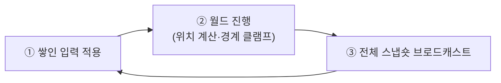
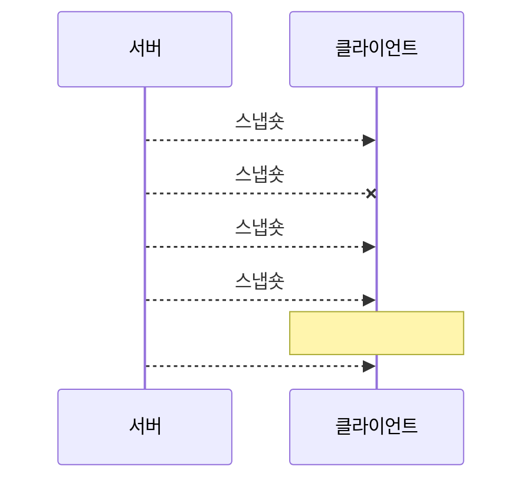
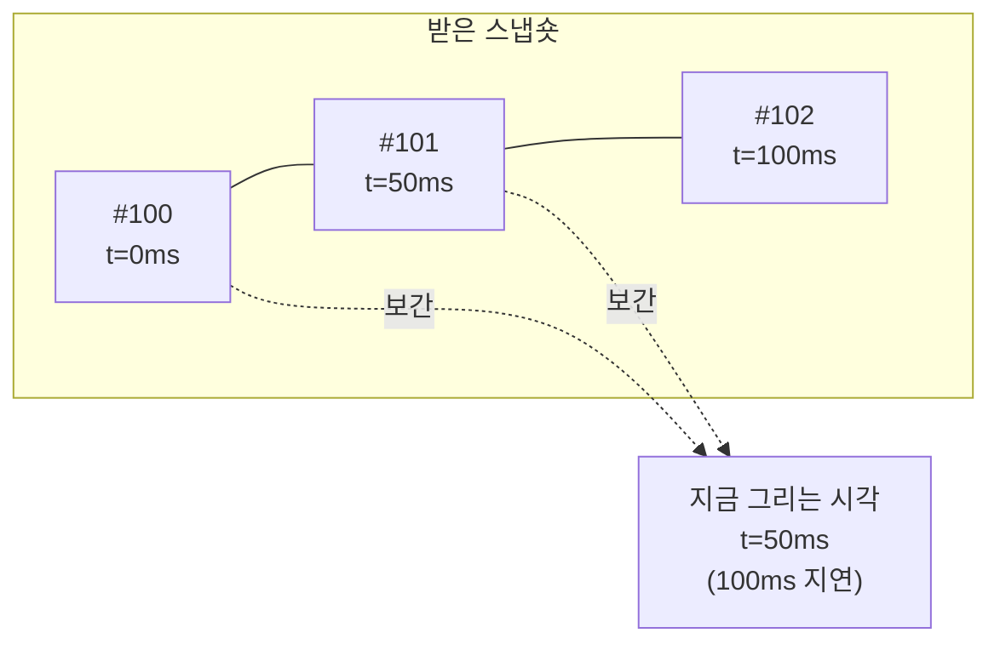

# 12장. 프로젝트 ④ 이동 동기화 — 실시간의 시작

> **학습 목표**
> 1. 고정 틱(fixed tick) 서버 루프를 드리프트 없이 작성할 수 있습니다.
> 2. 어떤 데이터를 신뢰 채널로, 어떤 데이터를 비신뢰 채널로 보낼지 근거를 들어 판단할 수 있습니다.
> 3. 스냅숏 보간을 구현하고, 그 대가로 무엇을 내주는지 설명할 수 있습니다.

**대응 샘플**: `samples/04-MoveSync` (★4, UDP 27004, MonoGame 클라이언트)

## 실시간의 뼈대: 고정 틱

턴제에서는 "사용자가 행동할 때"가 곧 시간이었습니다. 실시간에서는 **시간이 스스로 흐릅니다.**

서버는 초당 20번(50ms마다) 깨어나 세 가지를 합니다.



```csharp
// samples/04-MoveSync/Server/WorldServer.cs
public void Step()
{
    tick++;
    const float dt = 1f / ProtocolLimits.TickRate;

    lock (players)
    {
        // ① 입력 적용 + ② 월드 진행
        foreach (var player in players.Values)
        {
            if (!player.Joined) continue;
            Move(player, dt);
        }

        // ③ 스냅숏 브로드캐스트(비신뢰)
        BroadcastSnapshot();
    }
}
```

### 드리프트 없는 루프

`Thread.Sleep(50)` 을 반복하면 안 됩니다. 매번 조금씩 늦어져 시간이 밀립니다(드리프트).
**목표 시각을 누적**해야 합니다.

```csharp
// samples/04-MoveSync/Server/Program.cs
var watch = Stopwatch.StartNew();
var tickInterval = 1000.0 / ProtocolLimits.TickRate;
var nextTickMs = tickInterval;

while (running)
{
    var now = watch.Elapsed.TotalMilliseconds;

    if (now < nextTickMs)
    {
        var sleep = (int)(nextTickMs - now);
        if (sleep > 1) Thread.Sleep(sleep - 1);
        continue;
    }

    server.Step();

    nextTickMs += tickInterval;      // ← 누적. Sleep 오차가 쌓이지 않는다

    // 밀렸으면 따라잡기를 포기하고 기준을 다시 잡는다(스파이럴 방지).
    if (nextTickMs < now) nextTickMs = now + tickInterval;
}
```

마지막 두 줄이 중요합니다. 서버가 잠시 멈췄다가(GC, 디스크 I/O) 깨어나면
밀린 틱을 전부 따라잡으려다 더 밀리는 **죽음의 나선(death spiral)** 에 빠질 수 있습니다.
따라잡기를 포기하고 현재 시각을 기준으로 다시 시작하는 편이 낫습니다.

### 클라이언트는 60Hz, 서버는 20Hz

서로 다른 속도로 도는 것이 정상입니다.
클라이언트는 프레임마다 그리고, 서버는 50ms마다 진실을 갱신합니다.
그 사이를 메우는 것이 **보간**입니다(아래에서).

## 채널을 나누는 기준

이 장의 핵심입니다. KCP를 쓴다고 **모든 것을 신뢰 채널로 보내면 안 됩니다.**

| 데이터 | 채널 | 근거 |
|---|---|---|
| 입장/퇴장, 내 ID 배정, 채팅 | **신뢰(KCP)** | 놓치면 게임이 망가진다. 한 번만 도착하면 되고 순서가 중요하다 |
| 입력(10Hz), 스냅숏(20Hz) | **비신뢰(RAW)** | 50~100ms 뒤면 새 것이 온다. 낡은 것을 기다릴 이유가 없다 |

### 스냅숏을 신뢰 채널로 보내면 생기는 일



이것이 **head-of-line 블로킹**입니다(1장). 신뢰·순서 보장의 대가입니다.

문제는 이미 지나간 위치를 기다린다는 점입니다. #103이 도착해 있는데
#101 때문에 못 쓰는 것은 손해일 뿐입니다. **최신 것만 알면 되는 데이터**에는 최악의 성질입니다.

비신뢰 채널로 보내면 #101은 그냥 사라지고, #102가 오면 바로 씁니다.
50ms 늦은 위치 하나를 잃는 대신 **지연이 늘지 않습니다.**

### 코드에서는 메서드 하나 차이입니다

```csharp
// samples/04-MoveSync/Server/WorldServer.cs
var packet = writer.Finish();
foreach (var player in joined)
    player.Session.SendUnreliable(packet);   // ← Send 가 아니라 SendUnreliable
```

## 스냅숏 설계와 대역폭

```
[u16 len][u8 0x84][u32 tick][u8 count]{ [u32 id][f32 x][f32 y][u8 dir] } × count
```

| 항목 | 크기 |
|---|---|
| 엔티티 1개 | id 4 + x 4 + y 4 + dir 1 = **13 B** |
| 헤더 | tick 4 + count 1 = 5 B |
| 16인 페이로드 | 5 + 13 × 16 = **213 B** |

**클라이언트 1명이 받는 양**:

```
213 B × 20회/초 = 4,260 B/s ≈ 34 kbps   (페이로드)
(213 + 5 + 28) B × 20 = 4,920 B/s ≈ 39 kbps   (RAW 헤더 5B + UDP/IP 28B 포함)
```

**서버의 업로드**는 이것의 16배 ≈ **630 kbps**.
인원이 늘면 **N²** 로 증가합니다 — 100명이면 24 Mbps, 1000명이면 2.4 Gbps입니다.

그래서 실제 게임은 관심 영역(AOI)으로 자릅니다. "내 화면 근처의 엔티티만" 보내면
N²이 N×k가 됩니다. 이 샘플은 16인 제한이라 전체를 보냅니다.

### 대역폭을 줄이는 흔한 수법

| 수법 | 절감 | 대가 |
|---|---|---|
| 좌표를 `float`(4B) → `short`(2B) 고정소수 | 엔티티당 4B | 정밀도(월드 크기에 따라 cm 단위) |
| 변한 엔티티만 보내기(델타) | 상황에 따라 | 기준 스냅숏 관리 복잡도 |
| 관심 영역(AOI) | N² → N×k | 시야 경계 처리 |

먼저 **재 보고** 나서 고치세요. 16인 34kbps는 아무 문제가 없습니다.

## 클라이언트 보간

### 문제

서버는 50ms마다 위치를 보냅니다. 받은 즉시 그리면

- 초당 20번만 위치가 바뀌어 **뚝뚝 끊겨** 보이고,
- 스냅숏 하나만 유실돼도 **100ms 동안 멈춥니다.**

### 해법: 일부러 과거를 재생한다



현재 시각에서 **100ms를 뺀 시점**을 렌더 시각으로 삼습니다.
그러면 항상 "이미 지나간 두 스냅숏" 사이에 있게 되므로, 그 사이를 선형 보간해
매 프레임 부드럽게 그릴 수 있습니다.

```csharp
// samples/04-MoveSync/Client/SnapshotBuffer.cs
var renderTime = nowMs - ProtocolLimits.InterpolationDelayMs;

// renderTime 을 사이에 두는 두 스냅숏을 찾는다.
...
var span = newer.ReceivedAtMs - older.ReceivedAtMs;
var t = span <= 0.0001 ? 1f : (float)Math.Clamp((renderTime - older.ReceivedAtMs) / span, 0, 1);

// 두 스냅숏 사이를 선형 보간한다.
foreach (var from in older.Entities)
{
    var target = from;
    foreach (var to in newer.Entities)
    {
        if (to.Id != from.Id) continue;
        target.X = from.X + (to.X - from.X) * t;
        target.Y = from.Y + (to.Y - from.Y) * t;
        break;
    }
    output[from.Id] = target;
}
```

**100ms의 지연을 내주고 부드러움을 사는 거래**입니다.
지연 폭은 틱 간격의 2배로 잡았습니다 — 스냅숏 하나가 유실돼도 버틸 수 있는 크기입니다.

### 다음 스냅숏이 안 왔다면

두 가지 선택지가 있습니다.

| 선택 | 결과 |
|---|---|
| **마지막 위치 유지**(이 샘플) | 잠깐 멈춘 것처럼 보인다. 틀리지는 않는다 |
| **외삽(extrapolation)** | 계속 움직인다. 예측이 틀리면 튄다 |

이 샘플은 외삽하지 않습니다.

```csharp
// samples/04-MoveSync/Client/SnapshotBuffer.cs
if (newer == null)
{
    // 다음 스냅숏이 아직 안 왔다 — 마지막 위치를 유지한다(외삽하지 않는다).
    foreach (var entity in older.Entities)
        output[entity.Id] = entity;
    return true;
}
```

외삽은 손실이 잦은 환경에서 도움이 되지만, 방향이 바뀌는 순간 크게 틀려서
**되돌아가는 것처럼 보이는** 부작용이 있습니다. 연습문제로 남겨 둡니다.

### 늦게 온 스냅숏은 버린다

비신뢰 채널이라 순서가 뒤바뀔 수 있습니다.

```csharp
// samples/04-MoveSync/Client/SnapshotBuffer.cs
public void Add(WorldSnapshot snapshot)
{
    ReceivedCount++;

    // 늦게 도착한 낡은 스냅숏은 버린다(비신뢰 채널의 정상 동작).
    if (snapshot.Tick <= LatestTick)
    {
        DiscardedCount++;
        return;
    }

    LatestTick = snapshot.Tick;
    snapshots.Add(snapshot);
    ...
}
```

틱 번호가 있으니 판단이 간단합니다. **비신뢰 채널을 쓸 때는 거의 항상 순서 번호가 필요합니다.**

## 직접 껐다 켜 보기

클라이언트에서 `F1` 을 누르면 보간이 꺼집니다.

- **OFF** — 최신 스냅숏을 그대로 그립니다. 20Hz로 뚝뚝 끊깁니다.
- **ON** — 100ms 과거를 보간해 그립니다. 60Hz로 부드럽습니다.

이 차이를 눈으로 보는 것이 이 장의 핵심 실습입니다.

```bash
dotnet run --project samples/04-MoveSync/Server
dotnet run --project samples/04-MoveSync/Client -- 127.0.0.1 alice
dotnet run --project samples/04-MoveSync/Client -- 127.0.0.1 bob
```

```
[12:17:29] MoveSync 서버가 UDP 27004 에서 대기 중입니다 (20Hz). Ctrl+C 로 종료합니다.
[12:17:34] 입장 a (id=1, 총 1명)
[12:17:39] 틱 200, 인원 4, 틱 처리 최대 1.14ms
```

## 서버는 여전히 믿지 않습니다

입력은 "어디로 가고 싶다"는 **의도**이고, 위치는 **서버가 계산**합니다.

```csharp
// samples/04-MoveSync/Server/WorldServer.cs
player.X += dx * ProtocolLimits.MoveSpeed * dt;
player.Y += dy * ProtocolLimits.MoveSpeed * dt;

// 서버가 경계를 강제한다 — 클라이언트가 무엇을 보내든 월드 밖으로 못 나간다.
player.X = Math.Clamp(player.X, ProtocolLimits.PlayerRadius, ProtocolLimits.WorldWidth - ProtocolLimits.PlayerRadius);
player.Y = Math.Clamp(player.Y, ProtocolLimits.PlayerRadius, ProtocolLimits.WorldHeight - ProtocolLimits.PlayerRadius);
```

그리고 대각선 이동이 빨라지지 않도록 정규화합니다. 이것도 서버에서 합니다.

```csharp
if (dx != 0f && dy != 0f)
{
    // 대각선이 빨라지지 않도록 정규화한다.
    var inv = 1f / MathF.Sqrt(2f);
    dx *= inv;
    dy *= inv;
}
```

## 이 샘플이 아직 하지 않는 것

**내 캐릭터도 서버 스냅숏을 기다렸다가 움직입니다.** 즉 내 입력이 RTT만큼 늦게 반영됩니다.
로컬(RTT 1ms)에서는 티가 안 나지만 RTT 100ms 환경에서는 확실히 둔합니다.

이것을 없애는 것이 다음 장의 **클라이언트 예측**입니다.

## 요약

- 고정 틱 루프는 **목표 시각을 누적**해야 드리프트가 없고, 밀렸을 때는 따라잡기를 포기해야 합니다.
- **"곧 다음 것이 오는" 데이터는 비신뢰 채널**입니다. 신뢰 채널로 보내면 HOL 블로킹으로 오히려 끊깁니다.
- 스냅숏 대역폭은 `엔티티 크기 × 인원 × 틱레이트` 이며 서버 업로드는 **N²** 로 늘어납니다.
- 보간은 **100ms 지연을 내주고 부드러움을 사는 거래**입니다.
- 비신뢰 채널에는 순서 번호가 거의 항상 필요합니다.

## 연습문제

1. **틱레이트 비교** — 서버의 `TickRate` 를 10 / 20 / 30 으로 바꿔 가며 체감을 비교하세요.
   대역폭은 어떻게 변하나요? 보간 지연(`InterpolationDelayMs`)도 함께 조정해야 할까요?
2. **외삽 실험** — 다음 스냅숏이 없을 때 마지막 속도로 계속 움직이게 해 보세요.
   손실 10%를 걸었을 때 좋아지나요, 나빠지나요? 방향을 급히 바꾸면 어떻게 보이나요?
3. **대역폭 절감** — 좌표를 `float`(4B) 대신 `ushort`(2B) 고정소수로 보내 보세요.
   월드가 800×600이면 어떤 정밀도가 나오나요? 눈에 띄나요?

---

다음 장은 이 책의 마지막 프로젝트입니다. 예측·보정·지연 보상을 전부 넣어
**RTT 100ms에서도 로컬처럼 느껴지는** 조작을 만듭니다.
