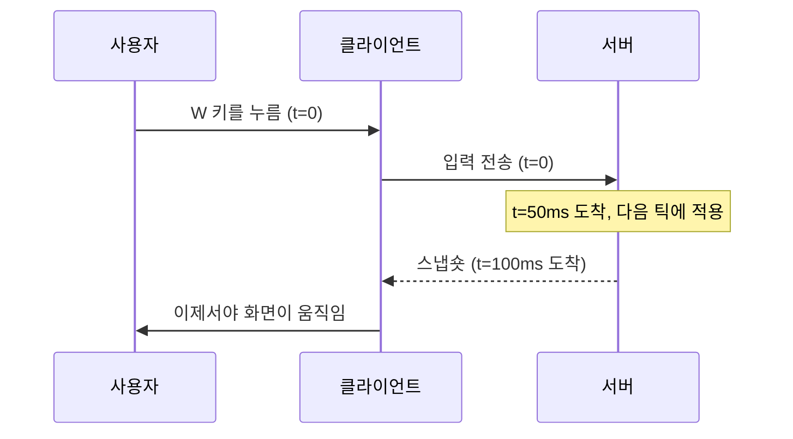
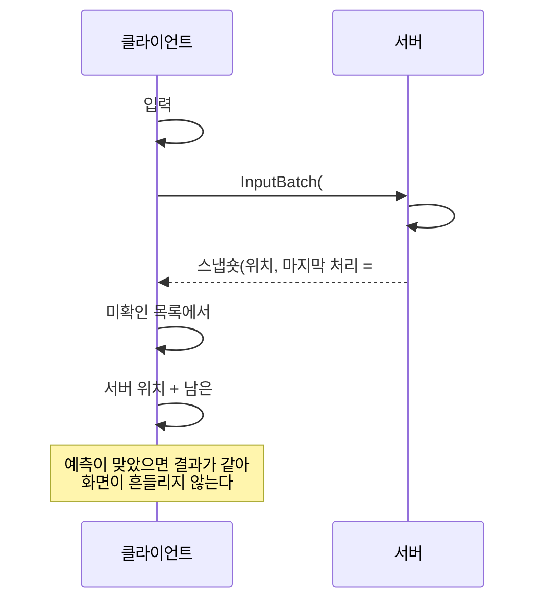

# 13장. 프로젝트 ⑤ 탱크 배틀 — 예측과 보정

> **학습 목표**
> 1. 클라이언트 예측과 서버 보정(reconciliation)을 구현하고, 왜 물리가 순수 함수여야 하는지 설명할 수 있습니다.
> 2. 입력 중복 전송으로 손실을 이기는 방법을 이해합니다.
> 3. 지연 보상(lag compensation)의 원리와 그 대가를 설명할 수 있습니다.

**대응 샘플**: `samples/05-TankBattle` (★5, UDP 27005, MonoGame 클라이언트)

## 남은 문제: 입력 지연

12장까지의 구조에서는 내 입력이 이렇게 반영됩니다.



RTT 100ms면 **키를 누르고 0.1초 뒤에 움직입니다.** 사람은 이 정도를 확실히 느낍니다.
액션 게임에서는 치명적입니다.

## 해법 ① 클라이언트 예측

**입력을 보내는 동시에 내 화면에서는 즉시 적용합니다.**

```csharp
// samples/05-TankBattle/Client/Prediction.cs
public TankInput CreateInput(sbyte throttle, sbyte steer, float turretAngle, bool fire, uint tick)
{
    var input = new TankInput
    {
        Sequence = NextSequence++,
        Throttle = throttle,
        Steer = steer,
        TurretAngle = turretAngle,
        Fire = fire,
    };

    unacknowledged.Add(input);
    ...
    if (Enabled)
    {
        // ★ 예측: 서버 응답을 기다리지 않고 지금 바로 적용한다.
        Predicted = TankPhysics.Step(Predicted, input, tick);
    }

    return input;
}
```

서버와 **같은 물리 코드**를 쓰므로 대개 같은 결과가 나옵니다. 그러면 화면은 즉시 반응하고,
나중에 서버 결과가 와도 이미 같은 자리라 아무 일도 일어나지 않습니다.

## 해법 ② 서버 보정(reconciliation)

문제는 "대개"입니다. 서버가 다르게 판단하는 경우가 있습니다 — 벽에 막혔거나, 쿨다운을 거부했거나.
그때는 서버 쪽이 진실이므로 맞춰야 합니다.

**서버는 스냅숏에 "너의 몇 번 입력까지 반영했다"를 실어 보냅니다.**

```csharp
// samples/05-TankBattle/Server/BattleServer.cs
var writer = new MessageWriter(snapshotBuffer, MessageType.Snapshot);
writer.WriteUInt32(tick);

// ★ 이 값이 클라이언트 보정의 열쇠다: "너의 몇 번 입력까지 반영했다"
writer.WriteUInt32(receiver.LastProcessedInputSeq);
writer.WriteByte((byte)players.Count);
```

클라이언트는 그 시점의 서버 위치를 진실로 받아들이고, **아직 서버가 모르는 입력들을 다시 적용**합니다.

```csharp
// samples/05-TankBattle/Client/Prediction.cs
public void Reconcile(TankState serverState, uint lastProcessedSeq, uint serverTick)
{
    Authoritative = serverState;
    ...
    // 서버가 이미 처리한 입력은 버린다.
    unacknowledged.RemoveAll(input => input.Sequence <= lastProcessedSeq);

    // 서버 상태에서 출발해 미확인 입력을 다시 적용한다(되감기 → 재적용).
    var replayed = serverState;
    for (var i = 0; i < unacknowledged.Count; i++)
        replayed = TankPhysics.Step(replayed, unacknowledged[i], serverTick + (uint)i);

    // 예측과 얼마나 어긋났는지 재 본다.
    var dx = replayed.X - Predicted.X;
    var dy = replayed.Y - Predicted.Y;
    var distance = MathF.Sqrt(dx * dx + dy * dy);

    if (distance > 0.5f)
    {
        CorrectionCount++;
        LastCorrectionDistance = distance;
    }

    Predicted = replayed;
}
```

전체 흐름을 그림으로:



### 물리는 반드시 순수 함수여야 합니다

되감기-재적용이 성립하려면 **같은 입력에 항상 같은 결과**가 나와야 합니다.

```csharp
// samples/05-TankBattle/Shared/TankPhysics.cs
/// <para>
/// 규칙: <b>순수 함수만</b>. 전역 상태 금지, <c>DateTime.Now</c> 금지, <c>Random</c> 금지.
/// 같은 입력이면 언제 어디서 돌려도 같은 결과가 나와야 한다.
/// </para>
public static TankState Step(TankState state, TankInput input, uint tick)
```

여기에 난수나 시간 의존이 들어가는 순간 예측이 무너지고 화면이 튑니다(rubber-banding).
그래서 테스트로 못 박습니다.

```csharp
// samples/05-TankBattle/Tests/TankPhysicsTests.cs
[Fact]
public void 되감아_재적용해도_같은_결과가_나온다()
{
    // ① 한 번에 쭉 적용
    var direct = NewTank();
    for (var i = 0; i < inputs.Length; i++)
        direct = TankPhysics.Step(direct, inputs[i], (uint)i);

    // ② 중간 상태를 저장했다가 거기서부터 재적용(보정과 같은 절차)
    var checkpoint = ...;
    var replayed = checkpoint;
    replayed = TankPhysics.Step(replayed, inputs[2], 2);
    replayed = TankPhysics.Step(replayed, inputs[3], 3);

    Assert.Equal(direct.X, replayed.X, 6);
    Assert.Equal(direct.Y, replayed.Y, 6);
}
```

> **주의**: 부동소수점은 플랫폼·컴파일러에 따라 미세하게 다를 수 있습니다.
> 같은 .NET 런타임끼리는 문제없지만, 서버가 Linux·클라가 Windows이거나
> 다른 언어로 서버를 만들면 **결정성(determinism)** 을 따로 검증해야 합니다.
> 완전한 결정성이 필요하면 고정소수점(fixed point) 연산을 씁니다.

## 해법 ③ 입력 중복 전송

입력은 비신뢰 채널로 보냅니다. 그런데 입력을 놓치면 어떻게 될까요?
스냅숏과 달리 **입력은 "다음 것이 덮어쓰면 그만"이 아닙니다** — 그 순간의 조작이 사라집니다.

재전송을 쓰면 지연이 늘어납니다. 대신 **같은 것을 여러 번 보냅니다.**

```csharp
// samples/05-TankBattle/Client/TankBattleGame.cs
// ★ 최근 입력 3개를 한 패킷에 실어 보낸다.
// 비신뢰 채널이라 하나쯤 유실돼도 다음 패킷에 다시 들어 있어 서버가 놓치지 않는다.
recentInputs.Add(input);
while (recentInputs.Count > GameLimits.InputRedundancy) recentInputs.RemoveAt(0);

var writer = new MessageWriter(sendBuffer, MessageType.InputBatch);
writer.WriteByte((byte)recentInputs.Count);
foreach (var item in recentInputs)
{
    writer.WriteUInt32(item.Sequence);
    writer.WriteByte((byte)item.Throttle);
    ...
}
```

입력 하나는 11바이트입니다. 3개를 실어도 33바이트 — 30Hz면 초당 1kB 남짓입니다.
**연속 2패킷이 유실돼도 서버는 입력을 놓치지 않습니다.**

서버는 중복을 걸러 냅니다.

```csharp
// samples/05-TankBattle/Server/BattleServer.cs
// 이미 처리한 입력은 버린다(중복 탑재로 같은 입력이 여러 번 온다).
if (seq <= player.LastProcessedInputSeq) continue;

player.PendingInputs[seq] = new TankInput { ... };
```

`SortedDictionary` 로 받아 두었다가 **시퀀스 순서대로** 적용합니다.
순서가 뒤바뀌어 도착해도 물리는 올바른 순서로 돕니다.

## 해법 ④ 지연 보상

이제 마지막 문제입니다. **사수가 화면에서 보고 있는 표적은 이미 과거입니다.**

```
사수가 보는 시점 = 지금 − (RTT/2 + 보간 지연 100ms)
```

RTT 60ms면 130ms 전의 세계를 보고 있습니다. 그 사이에 표적은 움직였습니다.
서버가 "지금" 위치로 판정하면 **잘 조준해도 빗나갑니다.**

### 되감아서 판정한다

서버가 과거 1초의 모든 위치를 들고 있다가, 사수의 지연만큼 되감아 그 시점으로 판정합니다.

```csharp
// samples/05-TankBattle/Server/BattleServer.cs
// 지연 보상: 사수가 화면에서 보고 있던 시점의 표적 위치로 되감는다.
var rewindTicks = lagCompensation ? EstimateRewindTicks(shooter) : 0;
var judgeTick = rewindTicks >= tick ? 0 : tick - rewindTicks;

foreach (var target in players)
{
    if (ReferenceEquals(target, shooter)) continue;

    var targetState = lagCompensation
        ? history.StateAt(judgeTick, target.Id, target.State)
        : target.State;

    if (!TankPhysics.RayHitsTank(shooter.State.X, shooter.State.Y, input.TurretAngle,
            GameLimits.FireRange, targetState, out var distance))
    {
        continue;
    }
    ...
}
```

```csharp
// samples/05-TankBattle/Server/BattleServer.cs
private static uint EstimateRewindTicks(BattlePlayer shooter)
{
    var halfRtt = (shooter.Session?.SrttMs ?? 0) / 2.0;
    var latencyMs = halfRtt + GameLimits.InterpolationDelayMs;
    var ticks = (uint)Math.Round(latencyMs / (1000.0 / GameLimits.TickRate));
    return Math.Min(ticks, GameLimits.HistoryTicks - 1);
}
```

과거는 링버퍼에 담아 둡니다.

```csharp
// samples/05-TankBattle/Server/LagCompensator.cs
public void Record(uint tick, IReadOnlyList<BattlePlayer> players)
{
    var slot = (int)(tick % (uint)frames.Length);

    var frame = frames[slot];
    frame.Clear();
    frameTicks[slot] = tick;

    for (var i = 0; i < players.Count; i++)
        frame[players[i].Id] = players[i].State;
}

public TankState StateAt(uint tick, uint playerId, TankState fallback)
{
    var slot = (int)(tick % (uint)frames.Length);

    // 링버퍼가 이미 덮어써졌으면(1초보다 오래된 요청) 되감지 않는다.
    if (frameTicks[slot] != tick) return fallback;

    return frames[slot].TryGetValue(playerId, out var state) ? state : fallback;
}
```

`frameTicks[slot] != tick` 검사가 중요합니다. 링버퍼는 20칸뿐이라 1초가 지나면 덮어써집니다.
그 이상 되감으라는 요청은 거부합니다 — **되감기 상한이 곧 악용 방지선**입니다.

### 대가

지연 보상에는 분명한 대가가 있습니다.

> **맞은 쪽에서는 "엄폐물 뒤로 숨었는데 맞았다"가 생깁니다.**

사수 화면에서는 맞았고, 표적 화면에서는 피했습니다. 둘 다 맞습니다 — 서로 다른 시점을 보고 있었으니까요.
서버는 둘 중 하나를 골라야 하고, 대부분의 대전 액션 게임은 **사수 쪽을 고릅니다.**
"조준했는데 안 맞는" 좌절이 "숨었는데 맞는" 좌절보다 크기 때문입니다.

되감기 상한(1초)이 이 불공평의 한계를 정합니다.

## 서버 검증 — 치트 방지의 기초

예측 구조에서는 클라이언트가 자기 위치를 먼저 정합니다. 그렇다고 믿는 것은 아닙니다.

| 검증 | 코드 |
|---|---|
| 이동 속도 | 서버가 같은 물리로 다시 계산 — 클라가 보낸 위치는 아예 받지 않음 |
| 월드 경계 | `Math.Clamp` (`TankPhysics.Step` 안) |
| 발사 쿨다운 | `TankPhysics.CanFire(state, tick)` 를 **서버가** 확인 |

```csharp
// samples/05-TankBattle/Server/BattleServer.cs
private void TryFire(BattlePlayer shooter, in TankInput input)
{
    // 서버가 쿨다운을 검증한다 — 클라이언트가 연사 패킷을 보내도 통하지 않는다.
    if (!TankPhysics.CanFire(shooter.State, tick)) return;

    shooter.State = TankPhysics.ApplyFireCooldown(shooter.State, tick);
    ...
}
```

**클라이언트가 보내는 것은 "입력"뿐입니다.** 위치도, 명중 여부도, 점수도 보내지 않습니다.
입력만 받으면 클라이언트가 할 수 있는 최악은 "말도 안 되는 조작을 하는 것"이고,
그건 물리 규칙 안에서만 가능합니다.

> 물론 이것으로 모든 치트가 막히지는 않습니다. 에임봇(사람보다 정확한 조준)은
> 완벽하게 정당한 입력이라 전송 계층에서 막을 수 없습니다. 15장에서 다시 이야기합니다.

## 실행해 보기

```bash
dotnet run --project samples/05-TankBattle/Server -- --bots 7
dotnet run --project samples/05-TankBattle/Client -- 127.0.0.1 me
```

```
[12:25:18] TankBattle 서버가 UDP 27005 에서 대기 중입니다 (20Hz, 봇 7, 지연보상 ON).
[12:25:22] 입장 me (id=8, 총 8명)
[12:25:22] 킬 BOT2 -> BOT4 (되감기 2틱)
[12:25:28] 틱 200, 인원 8, 틱 처리 최대 0.40ms
```

### 꼭 해 볼 것

`F1` 로 예측을 껐다 켜 보세요. **로컬에서는 차이가 거의 없습니다** — RTT가 1ms니까요.
clumsy나 `tc netem` 으로 100ms 지연을 걸고 다시 해 보면 차이가 분명해집니다.

```bash
sudo tc qdisc add dev lo root netem delay 50ms   # 편도 50ms = RTT 100ms
```

HUD의 `CORRECTIONS` 는 예측이 틀려 보정된 횟수입니다. 벽으로 계속 밀고 들어가면 늘어납니다.

## 요약

- **예측**은 입력을 즉시 적용해 조작 지연을 없앱니다. **보정**은 서버 위치에서 미확인 입력을 재적용합니다.
- 이 구조는 물리가 **순수 함수**일 때만 성립합니다. 난수·시간 의존을 넣지 마세요.
- 입력은 재전송 대신 **중복 전송**으로 손실을 이깁니다(지연이 늘지 않습니다).
- **지연 보상**은 사수 화면 기준으로 판정하되, 되감기 상한으로 악용을 제한합니다.
- 클라이언트가 보내는 것은 **입력뿐**입니다. 위치·명중·점수는 전부 서버가 정합니다.

## 연습문제

1. **예측 오차 시각화** — 서버가 준 권위 위치(`Authoritative`)를 반투명하게 함께 그려 보세요.
   평소에는 겹쳐 있다가 언제 벌어지나요?
2. **중복 전송 개수 실험** — `InputRedundancy` 를 1로 낮추고 손실 20%를 걸어 보세요.
   조작이 어떻게 느껴지나요? 5로 올리면 대역폭이 얼마나 늘어나나요?
3. **지연 보상 상한 낮추기** — `HistoryTicks` 를 5(250ms)로 줄이고 RTT 300ms 환경에서
   쏴 보세요. 왜 잘 안 맞나요? 상한을 늘리면 어떤 부작용이 생길까요?

---

3부는 여기까지입니다. 4부에서는 지금까지 만든 것을 **빠르게, 안전하게, 운영 가능하게** 만드는
이야기를 합니다.
