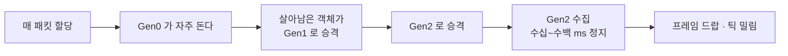

# 14장. 성능: 무할당 네트워킹

> **학습 목표**
> 1. 게임 서버에서 GC가 왜 문제인지, Gen0/1/2의 차이가 무엇인지 설명할 수 있습니다.
> 2. 이 라이브러리의 무할당 설계 네 가지를 코드와 벤치 수치로 짚을 수 있습니다.
> 3. BenchmarkDotNet 결과를 읽고, 자기 코드에서 재현할 수 있습니다.

## GC가 게임에서 문제가 되는 이유

.NET의 GC는 훌륭합니다. 대부분의 애플리케이션에서는 신경 쓸 필요가 없습니다.
**게임은 예외**입니다.

| 세대 | 수집 시간(대략) | 게임에서 보이는 모습 |
|---|---|---|
| Gen0 | 수십 µs ~ 1ms | 대개 안 보인다 |
| Gen1 | 1~5ms | 프레임 하나가 살짝 길어진다 |
| **Gen2** | **수십~수백 ms** | **명백한 끊김. 서버라면 틱 하나를 통째로 놓친다** |

60fps 게임의 한 프레임은 **16.6ms**입니다. Gen2가 50ms 걸리면 3프레임이 사라집니다.
20Hz 서버라면 틱 하나가 밀리고, 밀린 만큼 모든 클라이언트의 지연이 늘어납니다.

**"평균은 좋은데 가끔 튄다"** 의 흔한 범인이 GC입니다.



### 목표: 정상 상태에서 할당 0

접속·해제 때 할당하는 것은 괜찮습니다. 문제는 **매 패킷·매 틱 할당**입니다.
초당 20패킷 × 1000세션 = 2만 번의 할당이 매초 일어나면 Gen0가 쉴 새 없이 돌고,
살아남은 것들이 Gen1 → Gen2로 승격됩니다.

그래서 이 라이브러리의 목표는 **"정상 상태 송수신 경로에서 관리 힙 할당 0 B/op"** 입니다.

## 무할당 설계 네 가지

### ① ArrayPool 로 세그먼트 페이로드 빌리기

```csharp
// src/KcpCSharpR1/KcpSegment.cs
/// <para>
/// 페이로드는 <see cref="ArrayPool{T}.Shared"/> 에서 빌린 배열이다. 대여 배열은 요청보다 클 수 있으므로
/// <b>유효 길이는 반드시 <see cref="Len"/> 으로 관리</b>하며 <c>Data.Length</c> 를 길이로 쓰지 않는다.
/// </para>
internal void Rent(int capacity)
{
    ReturnBuffer();
    if (capacity > 0)
    {
        // 민감 데이터가 없으므로 clearArray: false (기본값) 로 빌려 성능을 취한다.
        Data = ArrayPool<byte>.Shared.Rent(capacity);
    }
    Len = 0;
}
```

**함정 세 가지**를 지켜야 합니다.

| 함정 | 대응 |
|---|---|
| 이중 반환 | `Reset()` 을 멱등으로. 반환 후 `Array.Empty` 센티널 |
| 대여 배열이 요청보다 큼 | `Data.Length` 를 **절대** 유효 길이로 쓰지 않음 |
| 반환 전 초기화 비용 | 민감 데이터가 없으므로 `clearArray: false` |

이중 반환은 특히 위험합니다. 같은 배열이 풀에 두 번 들어가면
**서로 다른 두 곳이 같은 메모리를 쓰게 됩니다.** 재현이 거의 불가능한 버그가 됩니다.

```csharp
// src/KcpCSharpR1/KcpSegment.cs
private void ReturnBuffer()
{
    if (Data.Length > 0)
    {
        ArrayPool<byte>.Shared.Return(Data);
        Data = Array.Empty<byte>();   // 이중 반환 방지 센티널
    }
    Len = 0;
}
```

테스트로 못 박습니다.

```csharp
// tests/KcpCSharpR1.Tests/CodecTests.cs
[Fact]
public void Segment_Reset은_여러번_불러도_안전하다()
{
    var seg = new KcpSegment();
    seg.Rent(128);
    seg.Append(new byte[] { 1, 2, 3 });

    seg.Reset();
    seg.Reset();
    seg.Reset();

    Assert.Equal(0, seg.Len);
    Assert.Empty(seg.Data);
}
```

### ② Span 기반 코덱

`BinaryPrimitives` 를 쓰면 임시 배열 없이 바이트를 읽고 씁니다.

```csharp
// src/KcpCSharpR1/KcpCodec.cs
public static int WriteHeader(Span<byte> p, uint conv, byte cmd, byte frg, ushort wnd, uint ts, uint sn, uint una, uint len)
{
    WriteU32(p, conv);
    WriteU8(p.Slice(4), cmd);
    WriteU8(p.Slice(5), frg);
    WriteU16(p.Slice(6), wnd);
    WriteU32(p.Slice(8), ts);
    WriteU32(p.Slice(12), sn);
    WriteU32(p.Slice(16), una);
    WriteU32(p.Slice(20), len);
    return Kcp.IKCP_OVERHEAD;
}
```

공개 API에도 Span 오버로드를 추가했습니다. 기존 `byte[]` 오버로드는 호환을 위해 남겼습니다.

```csharp
public int Send(ReadOnlySpan<byte> data);
public int Input(ReadOnlySpan<byte> data, bool regular, bool ackNoDelay);
public int Recv(Span<byte> buffer);
```

### ③ 원형 덱으로 큐 교체

KCP의 네 큐는 **"앞에서 n개 제거"** 가 잦습니다.
`List<T>.RemoveRange(0, n)` 은 매번 나머지를 앞으로 당깁니다 — O(n)입니다.

```csharp
// src/KcpCSharpR1/RingBuffer.cs
/// <remarks>
/// KCP 의 네 큐(snd_queue, rcv_queue, snd_buf, rcv_buf)는 "앞에서 n개 제거"가 잦다.
/// <see cref="System.Collections.Generic.List{T}"/> 의 <c>RemoveRange(0, n)</c> 는 매번 O(n) 이동이 발생하지만
/// 이 자료구조는 head 인덱스만 옮기므로 O(1) 이다(진단 PF-04).
/// </remarks>
public void RemoveFront(int n)
{
    if (n <= 0) return;
    if (n > count) n = count;

    var mask = items.Length - 1;
    // 참조 타입이면 남은 참조를 끊어 GC 를 방해하지 않게 한다.
    if (!typeof(T).IsValueType)
    {
        for (var i = 0; i < n; i++)
            items[(head + i) & mask] = default!;
    }

    head = (head + n) & mask;
    count -= n;
}
```

용량을 2의 거듭제곱으로 유지해 나눗셈 대신 **마스크 연산**을 씁니다.

### ④ 인스턴스별 풀 — lock 없애기

세그먼트 풀이 전역 static이면 세션이 늘수록 **모든 세션이 같은 락을 두드립니다.**

```csharp
// src/KcpCSharpR1/Kcp.cs
// 인스턴스 전용 세그먼트 풀. 소유 스레드 규약(2.3절) 덕분에 lock 이 필요 없다(진단 PF-06).
private readonly Stack<KcpSegment> segmentPool = new Stack<KcpSegment>(32);
```

"인스턴스 1개 = 소유 스레드 1개" 규약(5장)이 있으니 락이 필요 없습니다.
**규약이 성능을 만드는** 좋은 예입니다.

## 측정 결과

전부 `docs/benchmarks.md` 에 재현 명령어와 함께 기록되어 있습니다.

| 벤치마크 | 개선 전 | 개선 후 | 변화 |
|---|---:|---:|---:|
| `SendRecvRoundtrip` (1000 × 1KB) | 441.3 µs | **321.3 µs** | **−27.2%** |
| `InputAckBatch` (64 ACK) | 1.428 µs | **1.318 µs** | −7.7% |
| `FlushLargeWindow` (윈도 1024) | 1.921 µs | **1.642 µs** | −14.5% |
| `FragmentationLarge` (32KB) | 8.252 µs | **6.882 µs** | −16.6% |
| 정상 상태 할당 | 0 B/op | **0 B/op** | 유지 |

### "할당이 원래 0이었다"는 사실

솔직하게 말하면, 개선 전에도 정상 상태 할당은 0이었습니다.
기존의 자체 버퍼 풀과 세그먼트 풀이 이미 재사용을 하고 있었기 때문입니다.

그래서 Phase 3의 성과는 **"할당을 0으로 만든 것"이 아니라 "0을 유지하면서 아래를 없앤 것"** 입니다.

- 전역 static 풀의 `lock`(세션이 늘수록 경합)
- 풀에서 임의 크기 버퍼가 나오던 문제
- `RemoveRange(0, n)` 의 O(n) 이동
- 호출당 임시 배열

**정확하게 말하는 것이 중요합니다.** "27% 빨라졌다"는 사실이고,
"할당을 없앴다"는 과장입니다.

## BenchmarkDotNet 읽는 법

```
| Method    | Messages | Mean     | Error    | StdDev  | Allocated |
|---------- |--------- |---------:|---------:|--------:|----------:|
| Roundtrip | 1000     | 321.3 us | 15.78 us | 4.10 us |         - |
```

| 열 | 뜻 |
|---|---|
| `Mean` | 평균 실행 시간 |
| `Error` | 99.9% 신뢰 구간의 절반 — **이보다 작은 차이는 노이즈** |
| `StdDev` | 표준편차 — 크면 측정이 불안정하다는 뜻 |
| `Allocated` | 호출당 관리 힙 할당. `-` 는 0 |

**`Error` 를 반드시 보세요.** 321.3 ± 15.78 과 330.0 ± 20.0 은 사실상 같은 값입니다.
"3% 빨라졌다"고 주장하려면 Error가 그보다 작아야 합니다.

### 재현하기

```bash
dotnet run -c Release --project benchmarks/KcpCSharpR1.Benchmarks -- --filter '*'
dotnet run -c Release --project benchmarks/KcpCSharpR1.Benchmarks -- --filter '*SendRecvRoundtrip*'
```

**반드시 `-c Release`** 입니다. Debug 빌드 수치는 의미가 없습니다.

## 측정하면서 배운 것 — 함정 세 가지

`docs/benchmarks.md` 에 그대로 남겨 둔 기록입니다.

### ① 벤치마크가 의도한 것을 재지 않았다

`FlushLargeWindow` 는 "송신 버퍼 1024개일 때의 순회 비용"을 재려 했습니다.
그런데 상대 윈도(`rmt_wnd`)의 기본값이 32라 **실제로는 32개만 차 있었습니다.**

WINS 패킷을 하나 넣어 윈도를 열어 준 뒤에야 제대로 잴 수 있었습니다.

```csharp
// benchmarks/KcpCSharpR1.Benchmarks/KcpBenchmarks.cs
// 상대가 큰 윈도를 통지해야 snd_buf 가 실제로 WindowSize 만큼 찬다(rmt_wnd 기본값은 32).
var wins = new byte[Kcp.IKCP_OVERHEAD];
...
kcp.Input(wins, 0, wins.Length, true, false);
```

### ② 시계를 진행시켰더니 측정이 흔들렸다

벤치마크 안에서 가상 시각을 1ms씩 올렸더니, 200회쯤부터 RTO가 만료되어
**1024개 전량 재전송**이 섞였습니다. BenchmarkDotNet의 호출 횟수에 따라 평균이 달라졌습니다.

지금은 시각을 고정해 **순수 순회 비용**만 잽니다.

### ③ 자료구조를 바꿨더니 오히려 느려졌다

`List` → `RingBuffer` 로 바꾼 직후 `FlushLargeWindow` 가 **15% 느려졌습니다.**
원소 접근마다 `items`/`head`/`Length` 를 다시 읽는 비용 때문이었습니다.

순회 구간에서 배열·head·mask를 지역에 붙잡는 **스냅숏 뷰**를 도입해 기준선보다 빠르게 되돌렸습니다.

```csharp
// src/KcpCSharpR1/Kcp.cs
// 이 루프는 snd_buf 를 수정하지 않으므로 스냅숏 뷰로 순회한다(원소당 필드 재로드 제거).
var sndBufView = snd_buf.CreateView();
var sndBufCount = snd_buf.Count;
for (var k = 0; k < sndBufCount; k++)
{
    var segment = sndBufView[k];
    ...
}
```

**이 과정이 없었다면 "자료구조를 바꿨으니 빨라졌겠지"라고 넘어갔을 것입니다.**
측정이 먼저인 이유가 여기 있습니다.

## 세션당 메모리 예산

"몇 명까지 받을 수 있나"를 물으면 보통 CPU를 먼저 떠올리는데, 실제로는 **메모리가 먼저 걸립니다.**
세션 수를 정하기 전에 이 표를 한 번 계산해 보세요.

| 항목 | 크기 | 비고 |
|---|---:|---|
| `KcpSession.frameBuffer` | `MTU + 암호화 오버헤드 + 5` ≈ **1.4KB** | 항상 |
| `Kcp.buffer`(플러시 스테이징) | `MTU` ≈ **1.4KB** | 항상 |
| 큐·풀 오버헤드 | 수백 B | 항상 |
| **유휴 세션 합계** | **약 3~4KB** | |
| 상주 복호화 버퍼 | +1.4KB | 암호화를 켠 세션만 |
| FEC 디코더 그룹 슬랩 | **+283KB** | FEC 를 켠 세션만(16그룹 × 13샤드 × 1,393B) |
| 미확인·대기 세그먼트 | `개수 × 2,048B` | 아래 참고 |

**세그먼트 하나가 2,048바이트인 이유**가 중요합니다. 페이로드는 `ArrayPool<byte>.Shared.Rent(mss)` 로
빌리는데 `mss` 는 1,376바이트지만, **풀의 버킷이 2의 거듭제곱**이라 실제로 돌아오는 배열은 2,048바이트입니다.
1,376으로 계산하면 33% 과소평가하게 됩니다.

세그먼트 개수의 상한은 이렇습니다.

| 큐 | 상한 |
|---|---|
| `snd_queue` | `MaxSendBacklog` (기본 **1024**) |
| `snd_buf` | `SendWindow` (기본 128) |
| `rcv_buf` + `rcv_queue` | `ReceiveWindow` (기본 128) |

최악의 경우 `(1024 + 128 + 128) × 2,048` ≈ **2.6MB / 세션** 입니다.
1,000세션이면 2.6GB죠. 부하 도구에서 백로그를 4096으로 잡았다가
**관리 힙이 1GB까지 부풀어 오르는 것**을 본 것이 이 계산 때문입니다.

```csharp
// samples/tools/LoadTest/Program.cs
// 부하 도구는 밀리면 흘려보내는 편이 낫다. 상한을 크게 잡으면 세션 하나가
// 수 MB 의 대여 버퍼를 물고 있어 메모리가 폭증한다(1,000세션에서 관리 힙 1GB 를 봤다).
MaxSendBacklog = 256,
```

다만 **평시에는 이 최악치가 나오지 않습니다.** 백로그가 차는 것은 상대가 응답하지 않는 비정상 상황이고,
그 전에 `Send` 가 `Backpressure` 를 돌려주며 막습니다. 정상 상태의 세션당 메모리는 수십 KB 수준입니다.
그래도 **용량 산정은 최악치로** 하세요. 1,000세션 서버가 한꺼번에 밀리는 순간이 곧 장애입니다.

**소켓 버퍼**는 성격이 다릅니다. 기본 1MB × 2인데, 서버는 소켓 하나로 모든 세션을 받으므로
세션 수와 무관하게 2MB입니다. 문제는 **클라이언트를 1,000개 띄우는 부하 도구** 쪽으로,
그대로 두면 2GB를 요청하게 됩니다. 그래서 도구에 `--sockbuf` 옵션이 있습니다.

> 몇 명까지 받을 수 있는지에 대한 종합 판단은 [17장](ch17-operations.md)의
> "몇 명까지 받을 수 있나 — 구조가 정하는 상한" 절에 있습니다.

## 한 걸음 더 — 무복사 수신 이벤트 (G-2)

여기까지가 "라이브러리 안쪽"의 할당 0입니다. 그런데 **애플리케이션에 메시지를 넘기는 마지막 한 걸음**에는
오랫동안 복사가 남아 있었습니다.

```csharp
// 예전 경로: 이벤트 하나를 쏘기 위해 대여 + 복사 + 반환
var buffer = ArrayPool<byte>.Shared.Rent(size);
var n = kcp.Recv(buffer);                 // 세그먼트 → 대여 버퍼 복사
handler(this, new ReadOnlyMemory<byte>(buffer, 0, n));
ArrayPool<byte>.Shared.Return(buffer);
```

이 복사는 `Action<KcpSession, ReadOnlyMemory<byte>>` 라는 **이벤트 타입 때문에** 생깁니다.
`ReadOnlySpan<byte>` 는 ref struct 라 제네릭 `Action<>` 의 타입 인자가 될 수 없거든요.
하지만 **전용 델리게이트로는 쓸 수 있습니다.**

```csharp
public delegate void KcpMessageHandler(KcpSession session, ReadOnlySpan<byte> data);
```

그래서 Span 이벤트를 하나 더 뒀습니다. 기존 이벤트는 그대로 두었으니 골라 쓰면 됩니다.

```csharp
// 무복사 경로 — data 는 KCP 세그먼트를 그대로 가리킨다.
server.ReliableReceivedSpan += (session, data) =>
{
    var opcode = data[0];
    // ...파싱은 여기서 끝내고, 남길 것만 복사한다.
};
```

구독자가 Span 쪽만 있으면 코어의 `Kcp.RecvInPlace` 가 **큐에서 세그먼트를 꺼내 페이로드를 바로 넘깁니다.**
대여도, 복사도, 할당도 없습니다.

```csharp
// src/KcpCSharpR1/Kcp.cs
public int RecvInPlace(InPlaceMessageHandler handler)
{
    var seg = rcv_queue.PeekFront();
    if (seg.frg != 0) return -3;   // 다조각이면 기존 조립 경로로 폴백
    rcv_queue.RemoveFront(1);
    try { handler(seg.Payload); }  // ← 복사 없음
    finally { ReturnSegment(seg); }
    ...
}
```

게임 메시지는 대부분 MTU 한 장에 들어가므로 이 경로가 거의 항상 탑니다.
MTU 를 넘는 메시지(`frg != 0`)만 조립이 필요하고, 그 조립 버퍼도 **세션 상주 버퍼 하나**를 재사용합니다.

**지켜야 할 규약은 하나뿐입니다.**

> `data` 는 콜백이 반환하면 무효입니다. 보관하려면 콜백 안에서 복사하세요.

기존 `ReadOnlyMemory` 이벤트도 이미 같은 규약이었으니 새로운 부담은 아닙니다.
다만 Span 은 컴파일러가 **필드에 저장하는 것 자체를 막아 주기 때문에**, 실수하기가 더 어렵습니다.

## 스레드 경계를 건너는 법 (M-1 / M-2)

이 라이브러리의 규약은 "세션 1개 = 소유 스레드 1개"입니다. 서버에서는 수신 루프 스레드가 소유자죠.
그런데 게임 로직은 보통 다른 스레드에서 돕니다. 이 경계를 건너는 정석은 **큐**입니다.

예전에는 그 큐를 사용자가 직접 짜야 했습니다. 이제 두 방향 모두 라이브러리가 제공합니다.

**받는 쪽 — 이벤트 큐**

```csharp
var events = server.EnableEventQueue(capacity: 4096);   // Start() 전에
server.Start();

// 게임 루프(다른 스레드)에서
while (events.TryRead(out var ev))
{
    switch (ev.Type)
    {
        case KcpEventType.Connected:    OnJoin(ev.Session); break;
        case KcpEventType.Reliable:     Handle(ev.Session, ev.Data); break;
        case KcpEventType.Disconnected: OnLeave(ev.Session, ev.Reason); break;
    }
    ev.ReturnPayload();   // ★ 반드시. 대여 버퍼를 풀에 돌려준다.
}
```

큐가 가득 차면 이벤트를 **버리고** `events.Dropped` 를 올립니다. 신뢰 채널 메시지도 예외가 아닙니다.
게임 루프가 밀리면 조용히 데이터가 사라진다는 뜻이므로, `Dropped` 는 반드시 지표로 내보내세요.

**보내는 쪽 — 아웃박스**

```csharp
options.SendOutboxCapacity = 256;   // 0 이면 아웃박스를 만들지 않는다(기본값)

// 게임 스레드 어디서든
if (!session.TrySendFromAnyThread(payload))
{
    // 큐가 찼다. 이번 틱은 건너뛰거나 우선순위가 낮은 메시지를 버린다.
}
```

여기서는 복사 1회가 **필수 비용**입니다. 호출자 버퍼의 수명과 라이브러리의 수명을 떼어 놓아야 하니까요.
반대로 이벤트 콜백 안(= 소유 스레드)에서는 `session.Send()` 를 그대로 쓰면 이 복사가 없습니다.

> 정리하면, **소유 스레드 안에서는 `Send`/Span 이벤트로 무복사, 스레드를 건널 때만 큐로 1회 복사**입니다.

## 요약

- 게임에서 문제가 되는 것은 **Gen2**입니다. 정상 상태 할당을 0으로 만드는 것이 목표입니다.
- 무할당 설계 네 가지: **ArrayPool 대여 / Span 코덱 / 원형 덱 / 인스턴스별 풀**.
- ArrayPool은 **이중 반환**과 **대여 배열이 요청보다 큼**을 반드시 지켜야 합니다.
- BenchmarkDotNet의 **`Error` 보다 작은 차이는 노이즈**입니다.
- 측정은 **의도한 것을 재고 있는지부터** 확인하세요. 세 번 중 세 번 다 함정이 있었습니다.
- 세션당 메모리는 **세그먼트 2,048B 기준**으로 계산하세요(`mss` 1,376이 아닙니다 — ArrayPool 버킷).
- 용량은 **최악치로 산정**하세요. 평시 수십 KB, 백로그 포화 시 2.6MB로 100배 차이가 납니다.

## 연습문제

1. **할당 찾기** — 여러분의 게임 서버 코드에서 매 패킷 할당이 일어나는 곳을 찾아보세요.
   `data.ToArray()`, `string` 연결, LINQ, 람다 캡처가 흔한 범인입니다.
2. **벤치마크 작성** — 자기 프로토콜의 인코딩/디코딩 벤치마크를 `[MemoryDiagnoser]` 와 함께
   작성하고, 할당이 0인지 확인해 보세요.
3. **백로그 실험** — `MaxSendBacklog` 를 32 / 256 / 4096 으로 바꿔 가며 부하 도구를 돌리고,
   관리 힙과 RTT p99가 어떻게 변하는지 재 보세요.
4. **메모리 예산 계산** — 목표 세션 수 × 최악치로 필요한 힙을 계산해 보세요.
   FEC를 켜면 세션당 283KB가 더 붙는다는 점을 잊지 마세요.

---

다음 장은 보안입니다. 지금까지 만든 것에 **누가 무엇을 할 수 있는지** 살펴봅니다.
