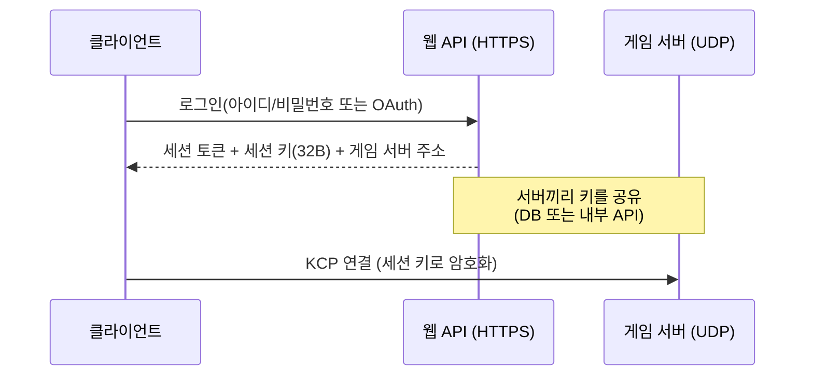

# 15장. 보안

> **학습 목표**
> 1. UDP 게임 서버의 위협 모델 다섯 가지를 나열하고 각각의 대응을 말할 수 있습니다.
> 2. AES-GCM의 nonce 설계와 리플레이 윈도가 왜 필요한지 설명할 수 있습니다.
> 3. 전송 보안이 막지 못하는 것(안티치트)을 구분할 수 있습니다.

## 위협 모델

"보안"을 뭉뚱그리면 아무것도 못 지킵니다. **누가, 무엇을, 어떻게** 할 수 있는지 나눠 봅시다.

| 위협 | 공격자가 하는 일 | 이 라이브러리의 대응 |
|---|---|---|
| **스푸핑** | 소스 IP를 위조해 패킷을 보냄 | 쿠키 핸드셰이크(6장) |
| **상태 고갈** | SYN을 대량으로 보내 서버 메모리를 소진 | 쿠키 핸드셰이크 |
| **증폭 공격** | 작은 요청으로 큰 응답을 유도해 제3자를 공격 | 핸드셰이크 응답이 요청보다 작음 |
| **패킷 위조·변조** | 남의 세션에 가짜 패킷을 끼워 넣음 | AES-GCM 인증 암호화 |
| **리플레이** | 정상 패킷을 녹음했다가 다시 보냄 | 64비트 슬라이딩 윈도 |

### 스푸핑과 상태 고갈

6장에서 다뤘습니다. 요점만 반복하면

> 서버는 SYN을 받아도 **아무것도 기억하지 않습니다.**
> 쿠키를 계산해 돌려주고 잊습니다. 그 쿠키를 담아 다시 와야 세션을 만듭니다.

위조된 IP로는 쿠키를 받아 볼 수 없으므로(응답이 위조된 주소로 가니까요) 3단계로 못 넘어갑니다.

### 증폭 공격

DNS나 NTP 증폭이 유명합니다. 60바이트 요청으로 4000바이트 응답을 유도해
피해자에게 쏟아붓는 수법입니다(증폭률 60배).

우리 프로토콜은 어떨까요?

| 요청 | 응답 | 증폭률 |
|---|---|---|
| SYN (10 B) | SYN_COOKIE (10 B) | **1.0배** |
| 미등록 주소의 다른 프레임 | **무응답** | 0배 |

**증폭이 없습니다.** 특히 두 번째가 중요합니다.

```csharp
// src/KcpCSharpR1.Transport/KcpServer.cs
if (Framing.PeekType(frame) == FrameType.Syn)
{
    HandleSyn(frame, remote, now);
}

// 미등록 주소의 그 밖의 프레임은 무응답으로 버린다(스캐닝 대응).
```

세션이 없는 주소에서 온 데이터 패킷에 "그런 세션 없다"고 답하면
그 자체가 증폭이자 스캐닝 도우미가 됩니다. **조용히 버리는 것이 맞습니다.**

## 쿠키가 막지 못하는 것

정직하게 말합시다. 쿠키 핸드셰이크는 **소스 주소 위조**를 막습니다. 그것뿐입니다.

| 막는다 | 못 막는다 |
|---|---|
| 위조 IP로 세션 테이블 채우기 | **진짜 IP로** 대량 접속하기(봇넷) |
| 무상태 SYN 홍수 | 회선 자체를 채우는 대역폭 공격 |
| — | 정상 세션에서 하는 어뷰징 |

봇넷은 실제로 응답을 받을 수 있으므로 쿠키를 통과합니다.
그래서 `MaxSessions` 상한과 IP당 세션 수 제한(직접 구현), 그리고
회선 앞단의 DDoS 방어 서비스가 함께 필요합니다.

```csharp
// src/KcpCSharpR1.Transport/KcpServer.cs
// 쿠키 검증 통과 → 이제서야 세션을 만든다.
if (sessions.Count >= options.MaxSessions)
    return;   // 상한 초과는 무응답 폐기
```

## 암호화 — AES-256-GCM

암호화를 켜면 KCP·RAW 프레임의 **페이로드**가 암호화됩니다.
프레임 타입 바이트는 평문으로 남습니다(수신측이 복호화 전에 종류를 알아야 하므로).

현재 전송 프로토콜 v1의 SYN·SYN_ACK·PING·PONG·FIN과 프레임 타입·외부 헤더는
이 인증 범위에 포함되지 않습니다. 따라서 이를 인증된 핸드셰이크나 전체 패킷 인증으로
해석하면 안 됩니다. 플레이어 인증·키 교부는 별도로 수행하고, 제어 프레임까지 보호해야
하는 서비스는 인증된 외부 전송 계층을 사용해야 합니다.

사용자 정의 암호화기는 `KcpSessionOptions.CipherFactory`로 연결마다 새 인스턴스를
생성할 수 있습니다. 팩터리는 대화 번호와 송신 방향을 받은 뒤 호출되며, 각 인스턴스의
nonce·리플레이 상태와 수명은 독립됩니다. `CipherFactoryOverhead`에는 실제 암호화기의
`Overhead`와 같은 값을 지정해야 합니다. 서버가 하나의 `Cipher` 인스턴스를 모든
세션에 공유하는 설정은 거부합니다. 자세한 설정은 [게임 연동 가이드](../game-integration_kr.md)를 참고하세요.

```csharp
// src/KcpCSharpR1.Transport/KcpSessionOptions.cs
/// <summary>
/// AES-256-GCM 세션 키(32바이트). 지정하면 KCP·RAW 프레임의 페이로드를 암호화한다(P5-1).
/// </summary>
public byte[]? EncryptionKey { get; set; }
```

쓰는 법은 키를 넣는 것뿐입니다.

```csharp
var options = new KcpSessionOptions { EncryptionKey = sessionKey };  // 32바이트
using var client = new KcpClient(options);
```

### GCM 을 고른 이유

**인증 암호화(AEAD)** 이기 때문입니다. 암호화와 무결성 검증을 한 번에 합니다.

```
평문 → [카운터 8B][암호문][인증 태그 16B]
```

태그가 맞지 않으면 **한 비트라도 바뀐 것**입니다. 복호화 결과를 아예 내주지 않습니다.

```csharp
// src/KcpCSharpR1.Transport/AesGcmPacketCipher.cs
try
{
    aes.Decrypt(nonce, body, tag, destination.Slice(0, payloadLength));
}
catch (CryptographicException)
{
    // 인증 실패(변조). 윈도는 갱신하지 않는다.
    return false;
}
```

암호화만 하고 인증을 안 하면(예: AES-CTR 단독) 공격자가 **암호문을 조작해
평문의 특정 비트를 뒤집을 수** 있습니다. 게임에서는 "체력 값의 최상위 비트"처럼
치명적인 곳을 노릴 수 있습니다. **AEAD 가 아닌 암호화는 쓰지 마세요.**

### nonce 설계 — 가장 중요한 부분

GCM에서 **같은 키로 같은 nonce를 두 번 쓰면 보안이 완전히 무너집니다.**
평문을 복원할 수 있고, 인증 키까지 노출됩니다. 이론적인 위험이 아니라 실제 사고 사례가 많습니다.

이 라이브러리의 설계:

```
nonce(12B) = conv(4B) ‖ counter(8B)
```

```csharp
// src/KcpCSharpR1.Transport/AesGcmPacketCipher.cs
private void BuildNonce(Span<byte> nonce, ulong counter)
{
    BinaryPrimitives.WriteUInt32LittleEndian(nonce, conv);
    BinaryPrimitives.WriteUInt64LittleEndian(nonce.Slice(4), counter);
}
```

**두 축으로 겹침을 막습니다.**

| 축 | 방법 |
|---|---|
| 세션 간 | `conv` 가 다름(서버가 단조 증가로 할당) |
| 같은 세션의 두 방향 | **카운터 공간을 나눔** |

두 번째가 미묘합니다. 클라이언트와 서버가 같은 키를 쓰는데 둘 다 0부터 세면
**같은 nonce가 생깁니다.** 그래서 방향마다 시작점을 다르게 합니다.

```csharp
// src/KcpCSharpR1.Transport/AesGcmPacketCipher.cs
// 방향마다 카운터 공간을 나눠 nonce 재사용을 원천 차단한다.
sendCounter = serverDirection ? 1UL << 63 : 0UL;
```

서버 방향은 최상위 비트가 1입니다. 2^63개를 보내야 겹치는데, 초당 100만 패킷을 보내도
**29만 년**이 걸립니다.

수신측은 방향까지 검사합니다.

```csharp
// src/KcpCSharpR1.Transport/AesGcmPacketCipher.cs
// 상대 방향의 카운터 공간이 아니면 거부한다.
var expectServerHighBit = !serverDirection;
var hasHighBit = (counter & (1UL << 63)) != 0;
if (hasHighBit != expectServerHighBit) return true;   // 리플레이로 취급
```

### 리플레이 방지 — 슬라이딩 윈도

공격자가 정상 패킷을 녹음했다가 다시 보내면? 암호는 유효하니 통과합니다.
"아이템 구매" 패킷을 100번 재생하면 곤란합니다.

카운터를 기억해 막습니다. 그런데 **비신뢰 채널은 순서가 뒤바뀌므로**
"마지막 것보다 작으면 거부"는 너무 엄격합니다.

그래서 **64비트 비트마스크**를 씁니다.

```csharp
// src/KcpCSharpR1.Transport/AesGcmPacketCipher.cs
private bool IsReplay(ulong counter)
{
    ...
    if (!anyReceived) return false;
    if (counter > highestSeen) return false;      // 새 것 — 통과

    var delta = highestSeen - counter;
    if (delta >= 64) return true;                 // 윈도 밖(너무 오래됨)
    return (window & (1UL << (int)delta)) != 0;   // 이미 본 것
}

private void MarkSeen(ulong counter)
{
    ...
    if (counter > highestSeen)
    {
        var shift = counter - highestSeen;
        window = shift >= 64 ? 1UL : (window << (int)shift) | 1UL;
        highestSeen = counter;
        return;
    }

    var delta = highestSeen - counter;
    if (delta < 64)
        window |= 1UL << (int)delta;
}
```

| 상황 | 판정 |
|---|---|
| 가장 큰 카운터보다 큼 | 통과, 윈도를 밀어냄 |
| 윈도(최근 64개) 안에 있고 처음 봄 | 통과, 비트 설정 |
| 윈도 안에 있고 이미 봄 | **거부** |
| 윈도보다 오래됨 | **거부** |

IPsec의 anti-replay 윈도와 같은 방식입니다. 테스트로 못 박습니다.

```csharp
// tests/KcpCSharpR1.Tests/CryptoTests.cs
[Fact]
public void 윈도_안에서_순서가_뒤바뀐_패킷은_받아준다()
{
    // 뒤에 것부터 넣어도(순서 뒤섞임) 전부 받아야 한다.
    for (var i = packets.Length - 1; i >= 0; i--)
    {
        Assert.True(receiver.TryDecrypt(packets[i], output, out _), $"패킷 {i} 를 거부했다.");
    }

    // 다시 넣으면 전부 리플레이로 거부.
    for (var i = 0; i < packets.Length; i++)
        Assert.False(receiver.TryDecrypt(packets[i], output, out _));
}
```

## 키는 어디서 오나

**이 라이브러리는 키 합의를 하지 않습니다.** 의도적인 선택입니다.

```csharp
// src/KcpCSharpR1.Transport/AesGcmPacketCipher.cs
/// <para>
/// <b>키 교부는 라이브러리의 일이 아니다.</b> 게임은 보통 TLS 웹 API 로그인에서 세션 키를 받아 오므로,
/// 그 32바이트를 <see cref="KcpSessionOptions.EncryptionKey"/> 에 넣어 주면 된다.
/// </para>
```

전형적인 게임의 흐름:



**HTTPS로 이미 안전한 채널이 있는데 UDP에서 다시 키 교환을 할 이유가 없습니다.**
TLS의 인증서 검증·PKI를 UDP 위에 다시 만드는 것은 큰일이고, 틀리기도 쉽습니다.

> 로그인 서버가 따로 없는 P2P 게임이라면 X25519 키 교환을 핸드셰이크에 넣어야 합니다.
> 이 라이브러리는 `IPacketCipher` 인터페이스를 열어 두어 직접 구현할 수 있게 했습니다.

## 비용

암호화는 공짜가 아닙니다. `docs/benchmarks.md` 의 실측:

| 항목 | 시간(1376바이트) | 기준선 대비 |
|---|---:|---:|
| 평문 복사 | 13.41 ns | 1.00배 |
| **암호화** | 357.7 ns | 26.7배 |
| **복호화**(인증 + 리플레이 검사) | 351.3 ns | 26.2배 |

절대값으로 보면 **패킷당 0.36µs** 입니다.

```
1,000 세션 × 초당 30패킷 × 0.36µs ≈ 11ms/초 = 코어 하나의 1.1%
```

**게임 서버에서 감당할 만한 비용**입니다. 대역폭 오버헤드는 패킷당 24바이트(카운터 8 + 태그 16)로,
256바이트 패킷 기준 9% 증가입니다.

> 참고: 이 측정에도 함정이 있었습니다. 처음에는 복호화가 3ns로 나왔는데,
> **리플레이 윈도에 걸려 조기 반환된 값**이었습니다. 같은 패킷을 반복 복호화할 수 없다는
> 사실을 잊은 것입니다. 카운터가 다른 패킷 256개를 미리 만들어 재는 방식으로 고쳤습니다.

## 전송 보안이 막지 못하는 것 — 안티치트

여기가 가장 중요한 절입니다. **암호화는 안티치트가 아닙니다.**

| 치트 | 전송 보안으로 막히나 |
|---|---|
| 패킷 위조·변조 | ✅ 막힌다 |
| 리플레이 | ✅ 막힌다 |
| 중간자 공격 | ✅ 막힌다 |
| **에임봇**(사람보다 정확한 조준) | ❌ 정당한 입력이다 |
| **월핵**(벽 너머 정보 활용) | ❌ 서버가 보낸 정보를 볼 뿐 |
| **매크로**(자동 반복 입력) | ❌ 정당한 입력이다 |
| **속도핵** | ⚠️ 서버 검증으로 막힌다(전송 보안이 아니라) |

**클라이언트가 가진 정보는 전부 볼 수 있다**고 가정해야 합니다.
암호화는 "회선에서 엿보는 제3자"를 막을 뿐, **클라이언트를 실행하는 사용자**를 막지 못합니다.

### 그래서 무엇을 하나

| 대책 | 어디서 |
|---|---|
| **서버가 계산한다** | 위치·명중·점수는 클라이언트가 보내지 않는다(13장) |
| **정보를 안 보낸다** | 벽 너머 적의 위치를 아예 안 보내면 월핵이 무의미(AOI) |
| **통계적 탐지** | 명중률·반응 시간이 사람의 범위를 벗어나는지 |
| **클라이언트 무결성 검사** | 별도 안티치트 솔루션의 영역 |

이 라이브러리가 도울 수 있는 것은 첫 두 가지입니다.

```csharp
// samples/05-TankBattle/Server/BattleServer.cs
// 서버가 쿨다운을 검증한다 — 클라이언트가 연사 패킷을 보내도 통하지 않는다.
if (!TankPhysics.CanFire(shooter.State, tick)) return;
```

## 체크리스트

배포 전에 확인할 것들입니다.

- [ ] 암호화를 켰다면 같은 키·conv 조합을 재사용하지 않는가(서버 재시작·다른 서버 인스턴스·conv 순환 포함)
- [ ] 사용자 정의 암호화기는 세션마다 별도 인스턴스를 생성하고 실제 오버헤드를 선언하는가
- [ ] 인증되지 않는 제어 프레임과 별도 플레이어 인증·키 교부의 범위를 이해하고 있는가
- [ ] 키를 HTTPS 등 **안전한 채널**로 받는가
- [ ] `MaxSessions` 상한이 서버 용량에 맞는가
- [ ] IP당 세션 수 제한이 있는가(직접 구현)
- [ ] **클라이언트가 보내는 것이 "입력"뿐**인가(위치·결과를 보내지 않는가)
- [ ] 서버가 이동 속도·쿨다운·범위를 검증하는가
- [ ] 로그에 **개인정보나 키가 찍히지 않는가**

## 요약

- 위협은 다섯 가지로 나눠 봅니다: 스푸핑 / 상태 고갈 / 증폭 / 위조 / 리플레이.
- 쿠키는 **위조 IP**를 막습니다. 진짜 IP의 봇넷은 못 막습니다 — 상한과 외부 방어가 필요합니다.
- **AEAD(인증 암호화)가 아니면 쓰지 마세요.** 암호화만으로는 변조를 막지 못합니다.
- **nonce 재사용은 치명적**입니다. `conv` + 방향별 카운터 공간으로 원천 차단합니다.
- **암호화는 안티치트가 아닙니다.** 에임봇·월핵은 정당한 입력이거나 정당한 정보입니다.

## 연습문제

1. **nonce 재사용 재현** — `AesGcmPacketCipher` 에서 방향 분리를 없애고
   양쪽이 0부터 세게 해 보세요. 같은 nonce가 언제 생기나요?
   (**로컬 실험만** 하고 되돌리세요.)
2. **리플레이 공격** — 정상 패킷을 캡처했다가 다시 보내는 스크립트를 만들어 보세요.
   윈도 안일 때와 밖일 때 어떻게 다른가요?
3. **정보 최소화** — MoveSync 서버를 고쳐 "내 화면 반경 300px 안의 플레이어만" 스냅숏에
   담아 보세요. 월핵이 얼마나 무력해지나요? 대역폭은 얼마나 줄었나요?

---

다음 장에서는 재전송이 아닌 방법으로 손실을 이기는 FEC를 다룹니다.
