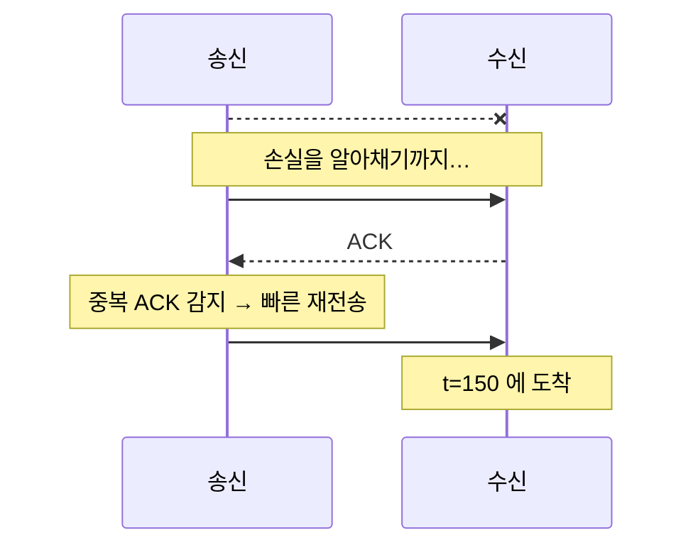
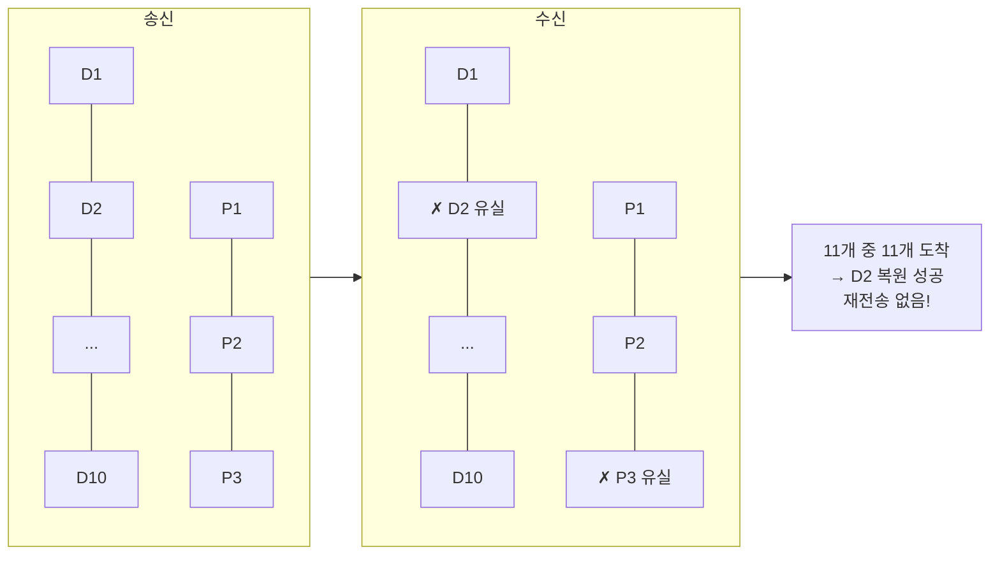
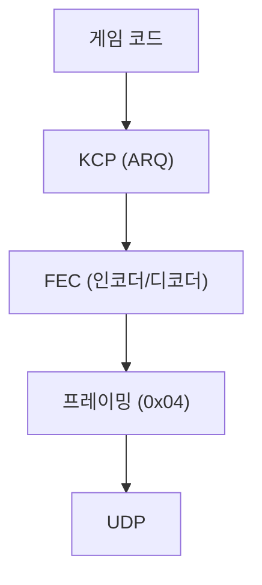

# 16장. 손실을 이기는 또 다른 방법 — FEC

> **학습 목표**
> 1. 재전송의 근본 한계(최소 1 RTT)를 설명하고 FEC가 그것을 어떻게 피하는지 이해합니다.
> 2. 리드-솔로몬 부호의 "데이터 10 + 패리티 3 → 아무 10개로 복원"을 그림으로 설명할 수 있습니다.
> 3. 대역폭 30% 추가와 재전송 지연 제거 사이에서 판단할 수 있습니다.

## 재전송의 근본 한계

2장에서 배운 ARQ는 "안 왔으면 다시 보내기"입니다. 여기에는 피할 수 없는 비용이 있습니다.



가장 빠른 경우(빠른 재전송)에도 **최소 1 RTT**가 듭니다.
RTO 만료를 기다리면 훨씬 깁니다(30ms ~ 수백 ms).

**"이미 지나간 시간은 되돌릴 수 없다"** 는 것이 핵심입니다.
재전송은 정보를 복구하지만, 그 정보가 **늦게** 도착합니다.

## FEC의 발상

> 잃어버릴 것을 대비해 **미리 여분을 보낸다.**

데이터 10개를 보낼 때 패리티 3개를 함께 보냅니다.
**13개 중 아무 10개만 도착하면** 원본 10개를 전부 복원할 수 있습니다.



**왕복이 없습니다.** 패리티가 이미 와 있으므로 도착하는 즉시 복원합니다.
지연 추가가 **0**입니다.

## 리드-솔로몬 부호

FEC의 대표적인 방식입니다. 원리를 한 문단으로 줄이면:

> 데이터 k개를 **k차원 벡터**로 보고, 잘 고른 행렬을 곱해 n개(n > k)의 값을 만든다.
> 그 행렬이 "어떤 k개 행을 뽑아도 역행렬이 존재"하도록 설계되어 있으면,
> **아무 k개만 있어도 원본을 풀 수 있다.**

이 라이브러리는 반데르몬드 행렬을 조직 부호(systematic code)로 만들어 씁니다.

```csharp
// src/KcpProject.Transport/Fec/ReedSolomon.cs
/// <para>
/// 부호화 행렬은 반데르몬드 행렬을 상단 정사각 부분의 역행렬로 곱해 조직 부호(systematic code)로 만든 것이다.
/// 즉 상단 k×k 가 단위행렬이라 데이터 샤드는 그대로 나가고 패리티만 계산된다.
/// </para>
```

**조직 부호**라는 점이 중요합니다. 상단이 단위행렬이므로 데이터 샤드는 **변형 없이 그대로** 나갑니다.
손실이 없으면 복원 계산조차 필요 없습니다.

### GF(2^8) — 바이트 단위 산술

행렬 연산을 하려면 덧셈·곱셈·나눗셈이 필요한데, 바이트(0~255)에서 그것을 정의해야 합니다.
**유한체 GF(2^8)** 를 씁니다.

```csharp
// src/KcpProject.Transport/Fec/GaloisField.cs
/// <remarks>
/// 기약 다항식은 <c>x^8 + x^4 + x^3 + x^2 + 1</c>(0x11D), 생성원은 2 다.
/// klauspost/reedsolomon 및 kcp-go 와 같은 설정이라 산출 바이트가 호환된다.
/// </remarks>
internal static class GaloisField
```

| 연산 | GF(2^8)에서 |
|---|---|
| 덧셈 | **XOR** (`a ^ b`) — 뺄셈도 같습니다 |
| 곱셈 | 로그 테이블로 `exp[log[a] + log[b]]` |
| 나눗셈 | `exp[log[a] - log[b] + 255]` |

덧셈이 XOR이라는 점이 재미있습니다. **더한 것을 다시 더하면 원래대로** 돌아옵니다.

```csharp
// src/KcpProject.Transport/Fec/GaloisField.cs
public static byte Multiply(byte a, byte b)
{
    if (a == 0 || b == 0) return 0;
    return ExpTable[LogTable[a] + LogTable[b]];
}
```

로그 테이블을 두 배로 펼쳐 두어 인덱스 나머지 연산을 생략합니다.

```csharp
// 로그 덧셈 결과가 255 를 넘어도 그대로 인덱싱할 수 있게 두 배로 펼쳐 둔다.
for (var i = 255; i < 512; i++)
    ExpTable[i] = ExpTable[i - 255];
```

### 복원 — 가우스 소거

살아남은 k개 샤드에 대응하는 행렬 부분을 뽑아 역행렬을 구하고, 곱합니다.

```csharp
// src/KcpProject.Transport/Fec/ReedSolomon.cs
// 살아 있는 샤드 k 개를 골라 부분 행렬을 만든다.
var subMatrix = new byte[DataShards][];
var subShards = new byte[DataShards][];
...
var inverted = Invert(subMatrix);
if (inverted == null) return false;

// 빠진 데이터 샤드 = 역행렬의 해당 행 × 살아 있는 샤드들
for (var i = 0; i < DataShards; i++)
{
    if (shards[i] != null) continue;

    var recovered = new byte[shardSize];
    var row = inverted[i];
    for (var c = 0; c < DataShards; c++)
        GaloisField.MultiplyAddInto(row[c], subShards[c].AsSpan(0, shardSize), recovered);

    shards[i] = recovered;
}
```

## 와이어 포맷 — kcp-go 호환

kcp-go 와 같은 헤더를 씁니다.

```
[seqid u32][flag u16]              ← FEC 헤더 6바이트
데이터 샤드는 뒤에 [size u16][페이로드...]
```

| flag | 뜻 |
|---:|---|
| `0xF1` | 데이터 샤드 |
| `0xF2` | 패리티 샤드 |

```csharp
// src/KcpProject.Transport/Fec/FecCodec.cs
/// <remarks>
/// 헤더: <c>[seqid u32][flag u16]</c> (6바이트). 데이터 샤드는 그 뒤에 <c>[size u16]</c> 를 더 붙이고
/// 실제 페이로드가 온다. <c>size</c> 는 <b>size 필드 자신을 포함한</b> 길이다(kcp-go 와 동일).
/// 패리티 샤드는 <c>[size][payload]</c> 구간을 0 으로 채워 길이를 맞춘 뒤 계산한다.
/// </remarks>
```

**패리티는 길이가 같아야** 계산할 수 있습니다. 그래서 그룹 안에서 가장 큰 샤드에 맞춰
나머지를 0으로 채웁니다. `size` 필드가 있으니 복원 후 실제 길이를 알 수 있습니다.

### 그룹 인덱스와 위치

`seqid` 하나로 그룹과 위치를 다 압니다.

```csharp
// src/KcpProject.Transport/Fec/FecCodec.cs
var groupIndex = seq / (uint)rs.TotalShards;
var position = (int)(seq % (uint)rs.TotalShards);

// 데이터 샤드 위치에 패리티가 오거나 그 반대면 규격 위반이다.
if (isData != position < rs.DataShards) return false;
```

10+3이면 seqid 0~9는 데이터, 10~12는 패리티, 13~22는 다음 그룹의 데이터… 식입니다.
**위치와 타입이 맞지 않으면 규격 위반**이므로 버립니다.

## 어디에 놓이나



**KCP 바깥, 프레이밍 안쪽**입니다. KCP가 만든 패킷을 FEC가 샤드로 다루고,
복원된 샤드는 `regular: false` 로 KCP에 넣습니다.

```csharp
// src/KcpProject.Transport/KcpSession.cs
if (fecDecoder != null)
{
    // 데이터 샤드면 payload 가 원본 KCP 패킷, 복원된 샤드는 콜백으로 온다.
    var isData = fecDecoder.Decode(payload, out var original,
        recovered => kcp.Input(recovered, false, options.AckNoDelay));

    if (isData)
        kcp.Input(original, true, options.AckNoDelay);

    DrainReliable();
    return;
}
```

`regular: false` 인 이유는 **복원된 패킷의 타임스탬프로 RTT를 재면 안 되기 때문**입니다.
실제로 그때 도착한 것이 아니니까요.

## 효과 — 실측

`Phase5IntegrationTests` 가 검증하는 수치입니다.
100KB를 보내면서 클라이언트가 내보내는 KCP 프레임 **5개마다 1개(20%)** 를 결정적으로 떨어뜨렸습니다.

| 설정 | KCP 재전송 | FEC 복원 |
|---|---:|---:|
| FEC 없음 | 23회 | — |
| **FEC 10+3** | **7회** | 16패킷 |

**재전송이 70% 줄었습니다.** 재전송 한 번은 최소 1 RTT를 더 기다린다는 뜻이므로,
손실이 잦은 회선에서 체감 지연이 크게 달라집니다.

### 비용

| 항목 | 값 |
|---|---|
| 대역폭 | **+30%** (10+3 기준) |
| CPU (부호화) | 그룹당 30µs = 패킷당 약 3µs |
| CPU (복원) | 그룹당 31.5µs |
| 지연 | 그룹이 찰 때까지 패리티가 안 나감 |

마지막 항목이 미묘합니다. **데이터 10개가 모여야 패리티가 나갑니다.**
초당 20패킷이면 그룹 하나에 0.5초가 걸립니다 — 그동안의 손실은 FEC로 복구되지 않습니다.

**트래픽이 꾸준한 경우에만 FEC가 제 값을 합니다.**

## 켤까 말까

| 상황 | 판단 |
|---|---|
| 유선 랜, 손실 0% | **끄세요.** 30% 낭비일 뿐입니다 |
| 손실 1~3% | 대개 끄는 편이 낫습니다. 빠른 재전송으로 충분합니다 |
| 손실 5~15%, 지연 민감 | **켜 볼 만합니다.** FPS·격투 게임 |
| 손실 20%+ | 켜세요. 다만 회선 자체를 의심해야 합니다 |
| 트래픽이 드문드문 | 끄세요. 그룹이 안 차서 효과가 없습니다 |

```csharp
var options = new KcpSessionOptions
{
    Fec = new FecOptions { DataShards = 10, ParityShards = 3 },
};
```

### 비율 고르기

| 설정 | 복구 가능 손실 | 대역폭 |
|---|---:|---:|
| 10 + 1 | ~9% | +10% |
| 10 + 2 | ~17% | +20% |
| **10 + 3** | **~23%** | **+30%** |
| 10 + 5 | ~33% | +50% |
| 20 + 4 | ~17% | +20% |

**그룹을 키우면(20+4)** 같은 비율로 더 넓은 손실 패턴을 견디지만,
그룹이 차는 데 시간이 더 걸립니다. 실시간 게임에서는 **작은 그룹이 유리**합니다.

## 현재 제약

이 버전에서는 **FEC와 암호화를 함께 켤 수 없습니다.**

```csharp
// src/KcpProject.Transport/KcpSessionOptions.cs
if (Fec != null && (EncryptionKey != null || Cipher != null))
    throw new ArgumentException("이 버전에서는 FEC 와 암호화를 함께 켤 수 없습니다(로드맵 P5-2 참조).", nameof(Fec));
```

두 계층을 어느 순서로 놓느냐가 와이어 포맷에 영향을 주는데(FEC 헤더를 암호화하면
수신측이 그룹을 못 찾습니다), 그 명세를 임의로 정하는 대신 **명시적으로 막았습니다.**

일반적인 해법은 "FEC 먼저, 그다음 각 샤드를 암호화하되 FEC 헤더는 평문"입니다.
kcp-go 가 그렇게 합니다.

## 요약

- 재전송은 최소 **1 RTT**가 듭니다. FEC는 **미리 보내** 왕복을 없앱니다.
- 리드-솔로몬은 "n개 중 아무 k개"로 복원합니다. GF(2^8)에서 덧셈은 XOR입니다.
- 헤더는 kcp-go 호환(`seqid u32 | flag u16 | size u16`)이라 상호운용됩니다.
- 실측: 손실 20%에서 **재전송 23회 → 7회(-70%)**, 대역폭 +30%.
- **트래픽이 꾸준할 때만** 효과가 있습니다. 그룹이 차야 패리티가 나가기 때문입니다.

## 연습문제

1. **비율 실험** — `DataShards`/`ParityShards` 를 10+1, 10+3, 10+5 로 바꿔 가며
   손실 10%·20%·30% 환경에서 재전송 횟수를 재 보세요. 손익분기점이 어디인가요?
2. **그룹 크기** — 10+3과 20+6은 같은 30% 오버헤드입니다. 손실이 **뭉쳐서**(burst) 날 때는
   어느 쪽이 유리한가요? `SimulatedLink` 로 연속 손실을 만들어 확인해 보세요.
3. **FEC + 암호화** — 두 계층을 어떤 순서로 놓아야 할지 설계해 보세요.
   FEC 헤더는 왜 평문이어야 하나요? 패리티 샤드는 암호화해야 하나요?

---

마지막 장에서는 만든 것을 **실제로 운영**하는 이야기를 합니다.
